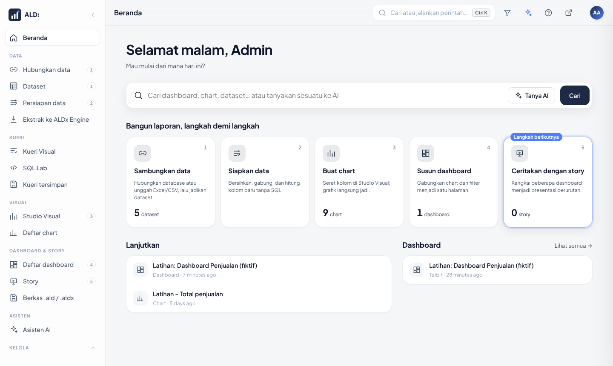
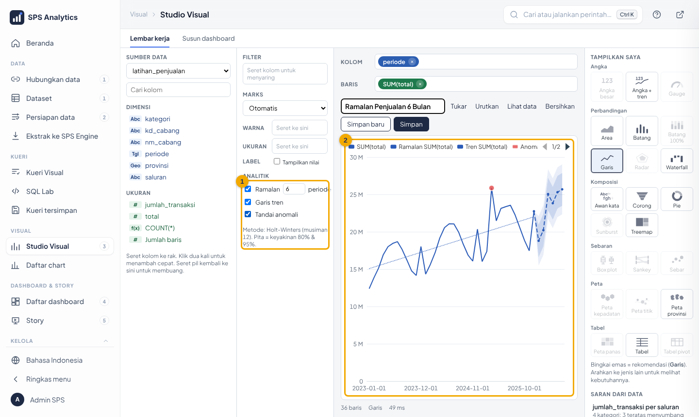
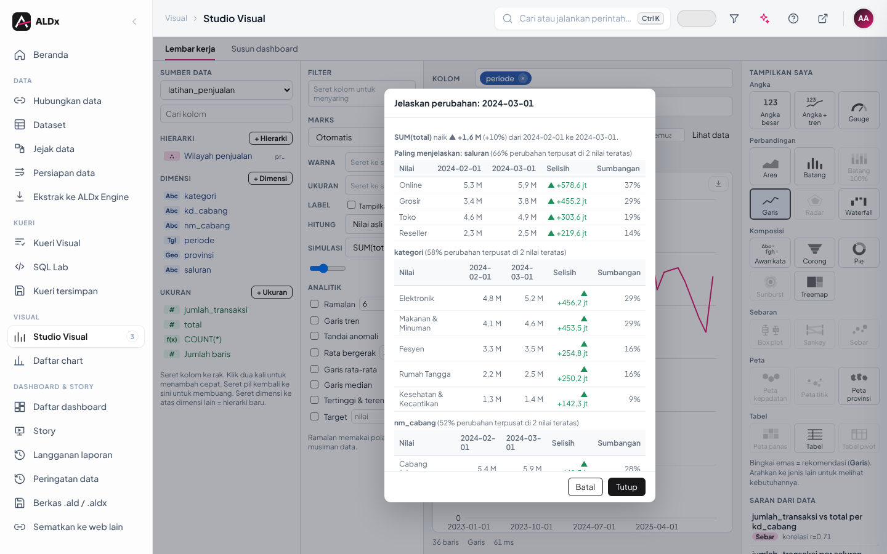
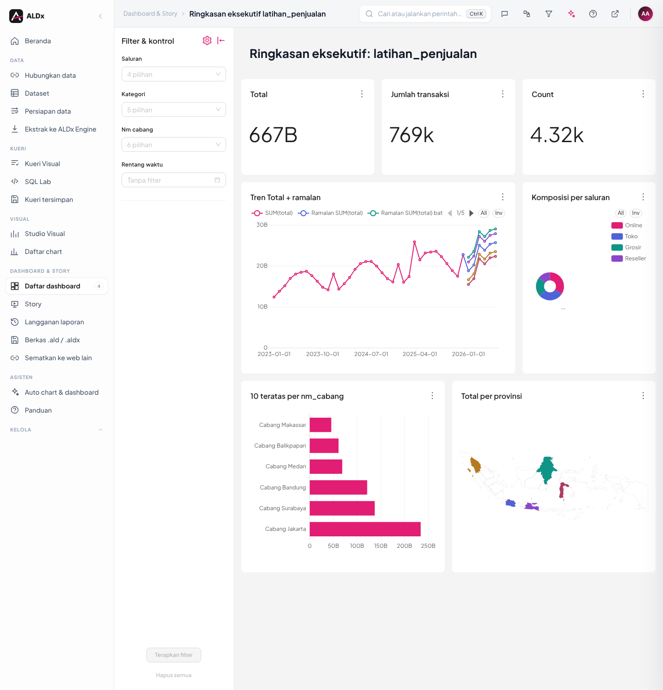
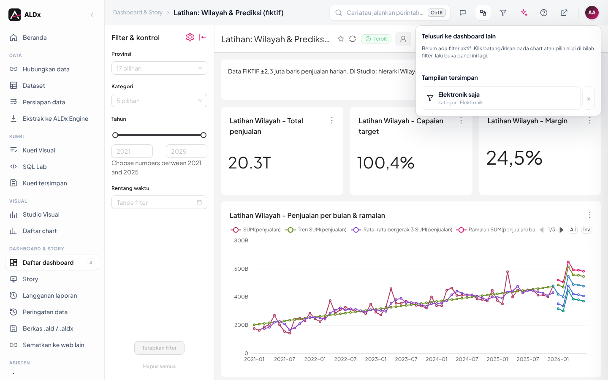
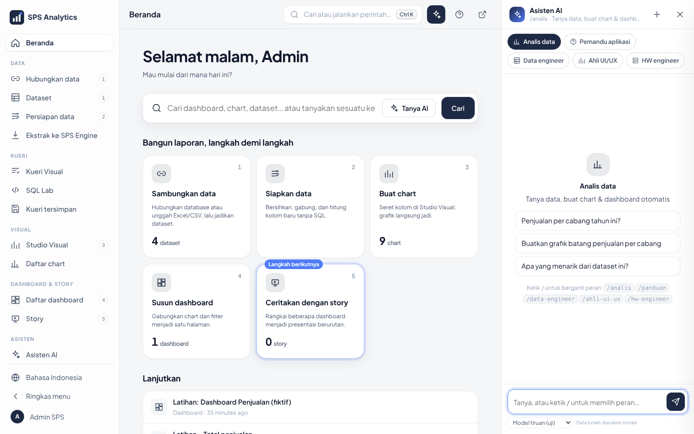

<div align="center" markdown="1">

# ALDx
### Advanced Learning & Data eXperience

**Dari data mentah ke dashboard, ramalan, dan jawaban AI, dalam satu aplikasi yang Anda miliki sendiri.**


[Pasang](#pasang-dalam-3-langkah) · [Git manual](#pasang--perbarui-dengan-git-tanpa-exe) · [Perjalanan](#dari-data-ke-keputusan-5-langkah) · [Fitur](#fitur-unggulan) · [Asisten AI](#asisten-ai-bintang-aplikasi) · [Belajar](#belajar-aldx-per-level) · [Dokumentasi](#dokumentasi)



</div>

ALDx adalah platform **BI (dashboard & analitik) siap pakai untuk perusahaan atau instansi mana pun**, dibangun di atas
Apache Superset. Semua berjalan di komputer/server **Anda sendiri** dengan Docker. Nama, logo, dan warna bisa diganti kapan saja.

## Kenapa ALDx

| | | |
|---|---|---|
| **🧩 Pasang tanpa ribet**<br>Installer Next-Next, versi online & offline, hapus bersih bila perlu | **🎨 Seret-lepas**<br>23 jenis chart, peta, ramalan, template dashboard, tanpa SQL | **🤖 Asisten AI di setiap halaman**<br>Model lokal, gratis, atau berbayar; menyesuaikan diri dengan modelnya |
| **⚡ Cepat**<br>ALDx Engine (ClickHouse) untuk jutaan baris; ekstrak terjadwal | **🔐 Aman**<br>Hak akses per baris (RLS), SSO, LDAP, jejak audit, berkas terenkripsi | **🏠 Milik Anda**<br>Data tetap di server Anda, white-label, lisensi Apache 2.0 |

## Pasang dalam 3 langkah

> Panduan satu halaman tanpa istilah teknis: **[CARA-PASANG.md](CARA-PASANG.md)** · PDF: [docs/pdf/cara-pasang.pdf](docs/pdf/cara-pasang.pdf)

| # | Langkah |
|---|---|
| 1 | **Tim TI, sekali:** pasang Docker Desktop dan masukkan akun pengguna ke grup `docker-users`. |
| 2 | **Unduh [`ALDx-Setup.exe`](../../releases/tag/terbaru)** (Releases › *ALDx terbaru*). |
| 3 | **Klik dua kali** › Lanjut › **Pasang** › isi **akun Superadmin** › **Buka aplikasi**. |

| Keadaan | Caranya |
|---|---|
| **Tanpa internet** | `ALDx-Setup-Offline.exe` + semua `.bin` di satu folder ([Releases › ALDx offline](../../releases/tag/offline)) |
| **Memperbarui** | jalankan installer baru **di atas** instalasi lama, Next-Next (data, dashboard, pengguna tetap) → [docs/29](docs/29-versi-pembaruan-hapus-total.md) |
| **Versi tertentu** | tiap versi punya rilis tetap `v<VERSI>` (mis. [`v2026.11.14`](../../releases/tag/v2026.11.14)) berisi installer + `ALDx-SHA256.txt` untuk memeriksa unduhan → [docs/29](docs/29-versi-pembaruan-hapus-total.md#versi-yang-bisa-dicocokkan-dengan-rilis-github) |
| **Menghapus** | Settings › Apps › ALDx › Uninstall; bersih tanpa sisa: `ALDx-HapusTotal.exe` |
| **Tanpa .exe** (mis. dihapus antivirus) | `git clone` lalu `PASANG.cmd` → [Pasang & perbarui dengan git](#pasang--perbarui-dengan-git-tanpa-exe), atau Download ZIP › Extract All › `PASANG.cmd` |

Versi terpasang tampil di kaki halaman login dan bawah Beranda (= nama tag rilis di GitHub); yang baru di setiap versi: [docs/31](docs/31-catatan-versi.md).

## Pasang & perbarui dengan git (tanpa .exe)

Cara ini memasang ALDx langsung dari kode di GitHub, **tanpa berkas .exe**. Hasilnya sama dengan `ALDx-Setup.exe`
(wizard yang sama), ditambah: pembaruan cukup satu perintah dan versi mana pun bisa dipilih.

| Pakai cara ini bila | Keterangan |
|---|---|
| Antivirus kantor (CrowdStrike, Windows Defender) menghapus `ALDx-Setup.exe` / `ALDx-HapusTotal.exe` | jalur ini tidak memakai .exe buatan ALDx. **Jangan mematikan antivirus**; bila skrip PowerShell juga diblokir, minta tim TI mengizinkan ([docs/18](docs/18-installer.md#peringatan-windows--antivirus)) |
| Ingin versi tertentu atau kembali ke versi sebelumnya | setiap versi punya tag `v<VERSI>`, mis. `v2026.11.14.2` |
| Mengelola beberapa komputer/server | satu perintah memperbarui, menerapkan, dan menguji |

<details markdown="1">
<summary><b>Langkah lengkap (klik untuk membuka)</b></summary>

### 0. Siapkan sekali

| Kebutuhan | Cara | Cek berhasil |
|---|---|---|
| Docker Desktop menyala | tim TI memasang + menambahkan akun Anda ke grup `docker-users` | ikon paus di pojok kanan bawah diam |
| Git for Windows | `winget install --id Git.Git -e` (atau unduh dari git-scm.com) | buka PowerShell **baru**: `git --version` |
| Disk kosong ≥ 40 GB | sebaiknya drive `D:` | File Explorer |

Semua perintah di bawah diketik di **PowerShell** (tombol Start › ketik *PowerShell* › Enter), **tanpa** *Run as administrator*.

### 1. Ambil kode

```powershell
git clone https://github.com/rntrn/aldx_superset.git D:\ALDx    # versi terbaru (cabang main)
cd D:\ALDx
git checkout v2026.11.14.2                                        # opsional: kunci ke satu versi rilis
```

Daftar versi: `git tag --list "v*"` atau halaman **Releases**. Tanpa git? **Code › Download ZIP** › klik kanan ›
*Extract All* ke `D:\ALDx` (pembaruan nanti dengan mengunduh ZIP baru).

### 2. Pasang

```powershell
.\PASANG.cmd                     # atau klik dua kali PASANG.cmd di File Explorer
```

Wizard sama dengan Setup.exe: Pemeriksaan › **akun Superadmin** › Pasang (± 10–30 menit pertama kali) › Selesai.
Tanpa wizard (admin berpengalaman): langkah `init.ps1`, `start.ps1`, … di [docs/02](docs/02-instalasi.md#cara-manual-tanpa-wizard).

### 3. Cek hasil

```powershell
powershell -ExecutionPolicy Bypass -File scripts\uji.ps1         # semua harus LULUS
git describe --tags                                               # versi kode, mis. v2026.11.14.2
```

Buka `http://localhost:8088`: kaki halaman login menulis versi yang sama (`v2026.11.14.2`).

### 4. Memperbarui

**Satu perintah** (ambil versi baru → terapkan ke Docker → perbarui menu & izin → uji; data & `.env` tidak disentuh):

```powershell
cd D:\ALDx
Set-ExecutionPolicy -Scope Process Bypass -Force; .\scripts\sinkron-laptop.ps1
```

Atau manual, langkah demi langkah:

```powershell
cd D:\ALDx
git status                       # harus "nothing to commit"; ada perubahan? lihat Masalah umum
git fetch --tags origin
git checkout main
git pull --ff-only               # atau: git checkout v2026.11.14.2 untuk versi tertentu
.\PASANG.cmd                     # pasang ulang di atas yang lama: data, akun, pengaturan tetap
```

Lalu buka ALDx dan tekan `Ctrl + F5`. Baca *Perlu dilakukan setelah memperbarui* di [docs/31](docs/31-catatan-versi.md).

### 5. Kembali ke versi sebelumnya

```powershell
powershell -ExecutionPolicy Bypass -File scripts\cadangkan.ps1   # cadangan dulu
git checkout v2026.11.14                                          # versi yang diinginkan
.\PASANG.cmd
```

Aman selama versi Superset sama (lihat `SUPERSET_VERSION` di `.env.example` kedua versi). Bila berbeda, ikuti
[docs/16 › Downgrade](docs/16-upgrade-downgrade.md). Kembali ke terbaru: `git checkout main; git pull --ff-only`.

### 6. Folder hasil Setup.exe → folder git

Sudah memasang dengan `ALDx-Setup.exe` dan ingin beralih ke git (sekali saja; `.env`, cadangan, data tidak disentuh):

```powershell
cd D:\ALDx                       # folder instalasi Anda
Set-ExecutionPolicy -Scope Process Bypass -Force; .\scripts\sinkron-laptop.ps1 -JadikanGit
```

### 7. Komputer tanpa internet

Di komputer **berinternet** yang sudah terpasang lewat git, kemas image Docker sekali per versi:

```powershell
cd D:\ALDx
$v = @{}; Get-Content .env.example | ? { $_ -match '^(\w+)=(.*)$' } | % { $v[$Matches[1]] = $Matches[2] }
New-Item -ItemType Directory -Force offline | Out-Null
docker save "sps-superset:$($v.SUPERSET_VERSION)" "redis:$($v.REDIS_VERSI)-alpine" "postgres:$($v.METADB_VERSI)-alpine" `
  "clickhouse/clickhouse-server:$($v.ENGINE_VERSI)" "nginx:$($v.GATEWAY_VERSI)-alpine" -o offline\aldx-images.tar
git describe --tags | Set-Content offline\versi.txt
```

Kompres `offline\aldx-images.tar` menjadi `offline\aldx-images.tar.gz` (mis. `tar -czf offline\aldx-images.tar.gz -C offline aldx-images.tar`,
lalu hapus berkas `.tar`), salin **seluruh folder** `D:\ALDx` **tanpa** `.env` dan `backup\` ke komputer tujuan, lalu
klik dua kali `PASANG.cmd`: image dimuat dari `offline\` tanpa internet.

### 8. Menghapus total tanpa .exe

```powershell
cd D:\ALDx
powershell -ExecutionPolicy Bypass -File scripts\hapus-total.ps1 -Simulasi   # lihat dulu apa yang akan dihapus
powershell -ExecutionPolicy Bypass -File scripts\hapus-total.ps1             # cadangkan ke Dokumen, lalu hapus semua
```

### Masalah umum

| Gejala | Penyebab | Solusi |
|---|---|---|
| `git` *is not recognized* | Git belum terpasang / PowerShell lama | pasang Git, **tutup & buka lagi** PowerShell |
| `git clone` gagal: *SSL certificate problem* | proxy kantor memeriksa HTTPS | `git config --global http.sslBackend schannel` (pakai sertifikat Windows), ulangi |
| `git clone` gagal: *Could not resolve host* / *timed out* | wajib lewat proxy | `git config --global http.proxy http://proxy.kantor:8080` (alamat dari TI) |
| `git pull` menolak: *local changes would be overwritten* | ada berkas yang diubah di folder | `git status` untuk melihatnya; simpan sementara `git stash`, pull, lalu `git stash pop` (atau buang: `git checkout -- <berkas>`) |
| *You are in 'detached HEAD' state* | wajar setelah `git checkout v…` | kembali ke terbaru: `git checkout main` |
| *running scripts is disabled on this system* | kebijakan PowerShell | pakai `PASANG.cmd` (sudah menanganinya) atau awali dengan `Set-ExecutionPolicy -Scope Process Bypass -Force` |
| Skrip tetap diblokir (AppLocker / CrowdStrike) | kebijakan keamanan kantor | jangan diakali: minta TI mengizinkan folder `D:\ALDx` ([docs/18](docs/18-installer.md#peringatan-windows--antivirus)) |
| `docker` *not recognized* / *cannot connect* | Docker Desktop mati / akun bukan `docker-users` | nyalakan Docker Desktop, tunggu ikon diam; minta TI menambahkan akun |

</details>

## Dari data ke keputusan: 5 langkah

Sidebar ALDx disusun mengikuti alur kerja; angka 1–5 menunjukkan urutan membuat laporan.

| Langkah | Menu | Yang dilakukan |
|---|---|---|
| **1 · Hubungkan** | Hubungkan data · Dataset | sambung database/data warehouse/Excel/CSV/Access; impor banyak tabel sekaligus |
| **2 · Siapkan** | Persiapan data · Kueri Visual · Ekstrak | bersihkan, gabung tabel tanpa SQL, salin ke mesin cepat |
| **3 · Visualkan** | Studio Visual | seret kolom → chart; peta; ramalan; kalkulasi cepat |
| **4 · Susun** | Susun dashboard · Auto chart | dashboard dengan tab, filter, objek desain; atau dari template |
| **5 · Bagikan** | Story · Langganan · PowerPoint · Sematkan | presentasi, email terjadwal, slide, tampil di web lain |

Semua menu dan siapa yang memakainya: **[docs/33 · Peta menu per level](docs/33-peta-menu-per-level.md)**.

## Fitur unggulan

<table>
<tr>
<td width="50%"></td>
<td width="50%"></td>
</tr>
<tr>
<td><b>Studio Visual</b>: 23 jenis chart, peta provinsi/titik, ramalan Holt-Winters dengan pita keyakinan, tren, anomali.</td>
<td><b>Jelaskan perubahan</b>: klik kanan sebuah periode, lihat siapa penyumbang terbesar naik/turunnya.</td>
</tr>
<tr>
<td width="50%"></td>
<td width="50%"></td>
</tr>
<tr>
<td><b>Dashboard dari template</b>: umum atau per bidang (Penjualan, Keuangan, SDM, Operasional); ALDx menyusun angka utama, tren, peringkat, peta, dan filter.</td>
<td><b>Telusuri & tampilan tersimpan</b>: pindah ke dashboard lain dengan filter terbawa; simpan kombinasi filter dengan nama.</td>
</tr>
</table>

| Area | Isi |
|---|---|
| **Analitik** | % dari total · kumulatif · YoY · **ambang hijau/merah** · rata bergerak · target · simulasi what-if (bisa disimpan sebagai skenario) · mini-chart tren di tooltip · kelompokkan nilai · ukuran & dimensi buatan sendiri (rumus) · hierarki telusur bertingkat |
| **Dashboard** | **ringkasan AI otomatis** · tab · tinggi kotak · objek desain (teks, gambar) · klik-filter antar-chart · telusuri antar-dashboard · label kesegaran data · riwayat versi · tata letak ponsel |
| **Berbagi** | ekspor PNG/PDF/Excel/CSV · **PowerPoint** · berkas `.ald/.aldx` terenkripsi · Story · langganan laporan & peringatan data via email · sematkan ke web lain dengan RLS per penonton |
| **Data** | 14+ jenis database + Access/Excel/CSV · jejak data (lineage) · persiapan data tanpa SQL · gabung otomatis · ekstrak ke ALDx Engine |
| **Admin** | Pusat Kendali (pengaturan, batas, topologi) · kesehatan kueri · jejak audit · cadangan & pulihkan · multi-node · HTTPS |
| **Tampilan** | white-label (preset **Tinta & Sakura**, Neon malam, warna manual) · mode gelap · Indonesia / English / 日本語 · ponsel |

## Asisten AI: bintang aplikasi



Tekan **`Ctrl + I`** di halaman mana pun. Asisten paham isi aplikasi (dataset, chart, dashboard) dan halaman yang sedang dibuka.

| Anda minta | Asisten melakukan |
|---|---|
| *"penjualan per cabang bulan ini?"* | mengambil angka dengan hak akses Anda, menampilkan tabel, bisa diekspor |
| *"buat dashboard dari dataset latihan_penjualan"* | membuat chart lalu dashboard, tautan langsung di bawah jawaban |
| *"scan tabel berawalan data_ di sps_engine"* | memindai tabel database, jumlah baris, status dataset |
| *"gabungkan dataset A, B, C jadi dataset detail"* | menggabung otomatis; menolak gabungan yang membuat angka berlipat; RLS ikut |
| *"ringkas dashboard ini dalam 5 poin"* | membaca dashboard yang terbuka lalu meringkas |
| (tanpa bertanya) | **Ringkasan AI otomatis** di bilah atas setiap dashboard: 3–5 poin berangka + *Perlu perhatian*, sesuai hak akses Anda |

**Bekerja dengan model apa pun**

| Jenis | Contoh | Penyesuaian otomatis |
|---|---|---|
| **Lokal** | Ollama, LM Studio (Qwen, Llama, …) | model bernalar (`<think>`) dibersihkan; model tanpa function calling memakai mode teks; konteks kecil diringkas |
| **Gratis** | Gemini, Groq, OpenRouter, Cerebras, Mistral, GitHub Models | penyedia sibuk/kuota habis → coba ulang, lalu **beralih ke model cadangan** |
| **Berbayar** | OpenAI, Azure, Anthropic, DeepSeek, dan API setara OpenAI | batas pertanyaan per pengguna per jam melindungi biaya |

**Terintegrasi:** progres langkah tampil langsung dan bisa **dibatalkan**; hasil berupa tautan ke Studio Visual; tombol saran langkah berikutnya.
**Aman:** semua alat berjalan sebagai **pengguna yang bertanya** (RLS berlaku), isi data diperlakukan sebagai data (bukan perintah), API key disamarkan,
maksimal 12 objek baru per pertanyaan, angka hanya dikirim ke model yang diizinkan (`kirim_data`).
Panduan: [docs/28 · Sambungkan Asisten AI](docs/28-sambungkan-asisten-ai.md) · [docs/23 · Peran ahli, keamanan](docs/23-asisten-ai-peran-ahli.md).

## Belajar ALDx per level

Setiap level punya **tutorial bergambar** (untuk peserta), **bahan ajar** (untuk pengajar: rencana sesi, latihan, kunci jawaban, kuis),
dan **PDF** siap cetak. Data latihan fiktif dimuat otomatis oleh installer, jadi semua latihan bisa dicoba di instalasi baru.

| Level | Untuk siapa | Bisa apa setelah selesai | Waktu | Materi |
|---|---|---|---|---|
| **1 · Pengguna** | semua pengguna | membaca & menyaring dashboard, telusuri, PowerPoint, bertanya ke AI | 1 jam | [tutorial](docs/tutorial/level-1-pengguna.md) · [bahan ajar](docs/bahan-ajar/level-1-pengguna.md) |
| **2 · Analis** | pembuat laporan | chart, peta, ramalan, dashboard, Kueri Visual, laporan terjadwal | 3 jam | [tutorial](docs/tutorial/level-2-analis.md) · [bahan ajar](docs/bahan-ajar/level-2-analis.md) |
| **3 · Admin data** | pengelola data | sumber data, dataset, persiapan data, hak akses (RLS), ekstrak, AI untuk data | 3 jam | [tutorial](docs/tutorial/level-3-admin-data.md) · [bahan ajar](docs/bahan-ajar/level-3-admin-data.md) |
| **4 · Admin server** | tim TI | memasang, memantau, keamanan, SSO, sematan, cadangan, pembaruan | 4 jam | [tutorial](docs/tutorial/level-4-admin-server.md) · [bahan ajar](docs/bahan-ajar/level-4-admin-server.md) |

Untuk penyelenggara pelatihan: **[Alur pelatihan](docs/bahan-ajar/alur-pelatihan.md)** (kalender, penilaian, tindak lanjut) dan
**[Peta menu per level](docs/33-peta-menu-per-level.md)** (semua menu × level × tempat belajarnya). PDF: [`docs/pdf/`](docs/pdf/README.md)
(tutorial semua level, bahan ajar lengkap, manual lengkap, skenario UAT).

## Keamanan ringkas

| Lapisan | Perlindungan |
|---|---|
| **Data** | hak akses per baris (RLS) per role atau otomatis dari profil; sematan dengan RLS per penonton; uji dengan *Lihat sebagai…* |
| **Login** | akun lokal, LDAP/Active Directory, **SSO (OpenID Connect)**; akun terkunci otomatis setelah salah berulang; HTTPS opsional |
| **Berkas** | `.ald/.aldx` selalu terenkripsi; tanpa password koneksi; impor tertutup untuk orang lain |
| **Jejak** | audit login, unduh data, ekspor/impor, perubahan hak akses; role bawaan berhak minimum |
| **AI** | berjalan dengan hak pengguna, pertahanan *prompt injection*, rahasia disamarkan, batas pemakaian |
| **Mutu** | uji otomatis (`scripts\uji.ps1`) dan [daftar periksa audit keamanan](docs/27-daftar-periksa-audit-keamanan.md) |

## Dokumentasi

| Saya… | Baca |
|---|---|
| bingung mulai dari mana | **[docs/00 · Mulai di sini](docs/00-mulai-di-sini.md)** (peta per peran) |
| ingin tahu fungsi tiap menu | [docs/33 · Peta menu per level](docs/33-peta-menu-per-level.md) |
| memasang atau memperbarui | [CARA-PASANG.md](CARA-PASANG.md) · [docs/29](docs/29-versi-pembaruan-hapus-total.md) |
| membuat chart & dashboard | [docs/12 · Studio Visual](docs/12-studio-visual.md) · [docs/17 · Katalog chart](docs/17-katalog-chart-peta-prediksi.md) |
| mengelola data & hak akses | [docs/06](docs/06-sumber-data.md) · [docs/08](docs/08-hak-akses-data.md) · [docs/13](docs/13-sps-engine-ekstrak.md) |
| mengelola server | [docs/11 · Pusat Kendali](docs/11-pusat-kendali-server.md) · [docs/19 · Runbook](docs/19-runbook-faq-admin.md) |
| ingin tahu yang baru | [docs/31 · Catatan versi](docs/31-catatan-versi.md) |
| melihat peta fitur & peta jalan | [docs/32](docs/32-peta-fitur.md) |

Dokumentasi juga ada **di dalam aplikasi** (menu *Panduan*: pencarian, daftar isi, mode gelap, tanpa internet).

---

<details markdown="1">
<summary><b>Ringkasan teknis lengkap</b> (untuk tim TI)</summary>

## Ringkasan teknis

| Komponen | Nilai |
|---|---|
| Lokasi proyek | `D:\superset` (boleh folder lain tanpa spasi) |
| Pasang | klik dua kali **`PASANG.cmd`** (wizard Next-Next) — panduan awam: [CARA-PASANG.md](CARA-PASANG.md) |
| Alamat web | http://localhost:8088 |
| Versi | Superset 6.1.0 · PostgreSQL 17 · ClickHouse 25.8 · Redis 7.4 · nginx 1.28 (atur di `.env`) |
| Metadata | container `metadb` (PostgreSQL), database `sps_superset` |
| ALDx Engine | container `engine`, database `sps_engine`: ekstrak, impor berkas, upload, ramalan |
| Sumber data | **Hubungkan data**: PostgreSQL, MySQL, SQL Server, Oracle, ClickHouse, Snowflake, BigQuery, Redshift, Databricks, Trino, Athena, SAP HANA (driver opsional), Vertica, Druid + berkas Access/Excel/CSV |
| Login | akun lokal ber-email (Superadmin wajib, pengguna lain diisi di installer) + LDAP / Active Directory **opsional** untuk akun jaringan kantor; halaman login beranimasi |
| HTTPS | opsional (centang di installer): sertifikat dibuat otomatis, `http://` dialihkan; sertifikat kantor bisa dipakai. Lihat [docs/11 §9b](docs/11-pusat-kendali-server.md#https) |
| Identitas & tema | bawaan **Tinta & Sakura** (hitam → abu → putih, semburat pink); preset lain termasuk **Neon malam** (gelap, pink + cyan) atau **kombinasi warna manual** (warna utama, aksen, aksen kedua, latar; warna teks otomatis paling kontras); nama, perusahaan, logo, huruf, hiasan, animasi: Pusat Kendali, tanpa restart. Lihat [docs/09](docs/09-identitas-tema.md) |
| Hak akses data | RLS per role, atau otomatis dari profil pengguna (opsional, `config/akses.yaml`) |
| Menu | sidebar mengikuti alur BI: **Data › Kueri › Visual › Dashboard & Story › Asisten › Kelola**, angka 1–5 = urutan membuat laporan |
| Cangkang aplikasi | `/app/`: Beranda (**Siapkan ALDx** untuk admin, cari, 5 langkah bangun laporan, lanjutkan), sidebar urut alur kerja, `Ctrl + K`, tombol `?` cara pakai, bahasa ID/EN/日本語, tampilan ponsel. Lihat [docs/22](docs/22-cangkang-aplikasi.md) |
| Kueri Visual | `/kueri/`: klik dua kali tabel = kueri jadi, tabel kedua digabung otomatis, simpan jadi dataset |
| Studio Visual | `/studio/`: seret-lepas, 23 jenis chart, peta, **analitik** (ramalan Holt-Winters + pita keyakinan, tren, anomali, rata bergerak, garis rata-rata/median/target, tertinggi & terendah), **ukuran & dimensi terdefinisi** (rumus), **N teratas**, **kalkulasi cepat** (% dari total, kumulatif, YoY), **kelompokkan nilai**, **skala warna tabel**, **ambang** (format bersyarat hijau/merah pada angka & tabel), **dashboard dari template** (umum & per bidang: Penjualan, Keuangan, SDM, Operasional; dengan tab & tinggi kotak), **jelaskan perubahan**, **tooltip kaya** (dengan mini-chart tren per kategori), **skenario what-if tersimpan**, **ekspor PowerPoint**, **hierarki dimensi** (seret dimensi ke atas dimensi lain, lalu klik untuk menelusuri), "Tampilkan saya" yang tetap aktif dengan banyak kolom, **saran chart dari data** (hampir semua jenis), susun dashboard dengan **objek desain** (teks dengan 10 huruf lokal, gambar, garis), persiapan data. Lihat [docs/12](docs/12-studio-visual.md) |
| Pusat Kendali | `/pusat-kendali/`: proses, cache, batas, identitas, hubungkan data, ekstrak (termasuk **impor banyak tabel sekaligus dengan cek kapasitas**), hak akses, multi-node |
| Asisten AI | **panel di setiap halaman** (`Ctrl + I`) dengan peran ahli `/analis` `/panduan` `/data-engineer` `/ahli-ui-ux` `/hw-engineer`; usulan perubahan baru berlaku setelah ditekan **Terapkan**. AI **paham isi aplikasi & halaman yang dibuka** (dataset, chart, dashboard beserta angkanya). **Sambungkan AI** di panel: model lokal (Ollama, LM Studio, Jan, llama.cpp) terdeteksi otomatis, key cloud gratis/berbayar diisi Admin tanpa restart ([docs/28](docs/28-sambungkan-asisten-ai.md)). Halaman `/asisten/`: auto chart/dashboard, story. Lihat [docs/23](docs/23-asisten-ai-peran-ahli.md) |
| Ekspor | tombol **Ekspor** di setiap tabel & grafik halaman ALDx: gambar PNG, PDF, Excel, CSV, TXT, salin |
| Keamanan & audit | akun terkunci otomatis setelah salah password berulang; **jejak audit** (login, unduh data, ekspor/impor, hak akses) di Pusat Kendali › Riwayat + CSV; role bawaan berhak minimum; peringatan akun non-Admin yang melihat semua data |
| Superadmin & batas data | role **Superadmin** di atas Admin untuk pengaturan vital; **Batas data** (ukuran/baris upload, impor, ekstrak, kuota engine) dengan rekomendasi otomatis atau tanpa batas. Lihat [docs/24](docs/24-superadmin-dan-batas-data.md) |
| Berkas .ald / .aldx | simpan & bagikan dashboard/chart/dataset sebagai berkas. Selalu **terenkripsi** (kunci server atau kata sandi), tanpa password koneksi; `.aldx` bisa membawa salinan data sesuai hak akses pembuat |
| Dashboard lanjutan | klik-filter antar-chart (cross filter), **telusuri ke dashboard lain** (drill-through, filter terbawa), **drill to detail** & **drill by**, riwayat versi & pulihkan, tata letak ponsel, langganan laporan email, lencana Resmi, **Lihat sebagai…** (uji hak akses). Lihat [docs/26](docs/26-langganan-versi-ponsel-lihat-sebagai.md) |
| Filter global & ulasan | satu filter (pilihan, rentang angka, rentang waktu) berlaku di **semua dashboard & Story**, tersimpan per akun; nilai dipilih dari daftar yang bisa dicari, **chip filter aktif** di bilah atas, *kecualikan dashboard ini*; **komentar & rating** dengan balasan, @sebut, pemberitahuan & moderasi Superadmin. Lihat [docs/25](docs/25-berkas-filter-global-ulasan.md) |
| Sematkan ke web lain | dashboard tampil di web/aplikasi lain lewat `<iframe>` + token tamu: **RLS per penonton**, filter dari URL (`f.<kolom>=...`), hanya domain yang diizinkan (`.env`: `SPS_SEMATKAN_*`). Lihat [docs/30](docs/30-sematkan-dashboard.md) |
| Dokumentasi | **Panduan di dalam aplikasi** (menu *Panduan*, `/panduan/`: pencarian, daftar isi, mode gelap, tanpa internet) dari Markdown di `docs\` + **PDF** di `docs\pdf\` |
| Versi | versi terpasang di halaman login & bawah Beranda (tautan ke rilis tetap `v<VERSI>`), status *Versi terbaru / Pembaruan tersedia*; setiap rilis memuat `ALDx-SHA256.txt` ([docs/29](docs/29-versi-pembaruan-hapus-total.md)) |
| Mutu | `scripts\uji.ps1` di server; daftar periksa audit keamanan [docs/27](docs/27-daftar-periksa-audit-keamanan.md) |

</details>

---

## Untuk tim TI / pengembang

Bagian di bawah ini teknis. Pengguna biasa cukup bagian *Memasang* di atas.

```text
git clone https://github.com/rntrn/aldx_superset.git D:\superset   # akhir baris otomatis benar (.gitattributes)
D:\superset\PASANG.cmd                                             # atau klik dua kali
powershell -ExecutionPolicy Bypass -File scripts\uji.ps1           # setelah terpasang: semua LULUS
```

Instalasi lama (metadata di XAMPP atau MariaDB) dipindah otomatis ke PostgreSQL oleh `PASANG.cmd`.
Urutan menyala & penanganan gangguan: [`docs/19-runbook-faq-admin.md`](docs/19-runbook-faq-admin.md).
Rinci installer: [`docs/18-installer.md`](docs/18-installer.md).

---

## Struktur folder

```
D:\superset
├── PASANG.cmd              # Installer wizard (Next-Next) -> installer\pasang.ps1
├── .env.example            # Template konfigurasi (installer membuat .env)
├── .env                    # Konfigurasi + password (RAHASIA, jangan dibagikan/di-commit)
├── docker-compose.yml      # Node utama: gateway, web, backgrounder, penjadwal, metadb, engine, redis
├── docker-compose.node.yml # Node tambahan (scale-out): web + backgrounder
├── LICENSE, NOTICE         # Lisensi Apache 2.0 + pemberitahuan hak cipta
├── THIRD-PARTY-LICENSES.md # Lisensi semua komponen pihak ketiga
├── installer/              # Kode wizard + log instalasi
├── server/                 # gateway.conf (otomatis), engine/ & metadb/ (konfigurasi & skrip perawatan)
├── backup/                 # Cadangan metadb (*.dump) & engine (engine\*.zip)
├── branding/               # Font lokal + logo ALDx (logo lain diunggah lewat Pusat Kendali)
├── certs/                  # (opsional) sertifikat CA kantor untuk model AI via API
├── docker/
│   ├── Dockerfile          # Image resmi + driver semua jenis database (offline)
│   ├── oracle/             # Oracle Instant Client (mode thick, opsional)
│   └── wheels/             # Paket offline (.whl) + paket.txt
├── config/
│   ├── superset_config.py  # Konfigurasi utama Superset (membaca .env)
│   ├── sps_security.py     # Login: LDAP + akun lokal, buat user otomatis, kunci cache aman
│   ├── sps_ldap.py         # Koneksi ke LDAP / Active Directory (ldap3), opsional
│   ├── sps_identitas/      # Identitas & tema, halaman login beranimasi
│   ├── sps_koneksi/        # Wizard Hubungkan data (database, data warehouse, Access/Excel/CSV)
│   ├── akses.yaml          # Aturan hak akses dari profil pengguna (opsional)
│   ├── sps_akses.py        # Profil pengguna + fungsi RLS sps_akses(), sps_sidik()
│   ├── sps_pindah_meta.py  # Pindah metadata versi lama (MySQL/MariaDB) -> PostgreSQL
│   ├── sps_jinja.py        # Fungsi SQL template: sps_periode()
│   ├── sps_dashboard_builder.py, sps_dash_*.py  # Dashboard as code (docs/07)
│   ├── sps_build_dashboards.py # Menyiapkan dashboard, menu, izin, ALDx Engine
│   ├── sps_latihan.py      # DATA LATIHAN fiktif (penjualan ritel) + dashboard latihan
│   ├── sps_latihan_penerbangan.py # DATA LATIHAN fiktif penerbangan (Excel/CSV, 6 tabel, s.d. jutaan baris)
│   ├── sps_latihan_sumber.py # Database SUMBER contoh (PostgreSQL hanya-baca) + role RLS contoh untuk latihan
│   ├── sps_latihan_wilayah.py # DATA LATIHAN harian ±2,3 juta baris + hierarki Wilayah/Kalender/Produk (dimuat installer)
│   ├── sps_uji.py          # UJI OTOMATIS (scripts\uji.ps1)
│   ├── ai.yaml + sps_ai/   # Asisten AI
│   ├── sps_server/         # Pusat Kendali Server: pengaturan, auto-tuning, monitor, multi-node, HTTPS (tls.py)
│   ├── sps_engine/         # ALDx Engine: ekstrak, upload, tugas terjadwal
│   ├── sps_studio/         # Studio Visual: lembar kerja, 23 chart, peta, ramalan, hierarki, dashboard + objek desain, persiapan data
│   ├── sps_app/            # Cangkang aplikasi /app/: Beranda, navigasi, bahasa, bantuan, panel AI, ekspor
│   ├── sps_superadmin.py   # Role Superadmin di atas Admin + penjaganya
│   ├── sps_kueri/          # Kueri Visual: susun kueri & gabung tabel tanpa SQL
│   ├── sps_berkas/         # Berkas .ald/.aldx terenkripsi: ekspor & impor dashboard/chart/dataset (+ data)
│   ├── sps_filter_global.py # Filter global: satu filter untuk semua dashboard & Story
│   ├── sps_sematkan.py     # Sematkan dashboard ke web lain: token tamu, RLS, filter URL (docs/30)
│   ├── sps_ulasan/         # Komentar & rating + moderasi Superadmin
│   ├── sps_dialek.py, sps_skema.py # Penyesuaian Oracle, tipe angka ClickHouse & chart berat; skema terpilih per koneksi
│   ├── sps_menu.py         # Susunan menu alur BI (izin menu; tampilan menu ada di sps_app)
│   └── sps_pengguna.py     # Membuat akun lokal dari tabel pengguna installer
├── scripts/
│   ├── init.ps1            # Instalasi (dipanggil installer)
│   ├── start.ps1 / stop.ps1 / logs.ps1
│   ├── uji.ps1             # Uji otomatis semua komponen
│   ├── cadangkan.ps1       # Cadangan & pemulihan metadb (+ engine)
│   ├── versi.ps1           # Versi tiap komponen
│   ├── catatan-rilis.ps1   # Catatan rilis v<VERSI> dari docs/31 (GitHub Actions)
│   ├── uji-ci.sh           # Pasang dari nol di Linux + semua uji (GitHub Actions: workflow uji)
│   ├── sinkron-laptop.ps1  # Ambil versi terbaru dari GitHub, terapkan, uji, (opsional) terbitkan installer
│   ├── data-latihan.ps1    # Muat data latihan fiktif
│   ├── data-penerbangan.ps1 # Buat Excel/CSV latihan penerbangan ukuran besar
│   ├── pindah-metadata.ps1 # Pindah metadata versi lama (XAMPP/MariaDB) ke PostgreSQL
│   ├── build-dashboards.ps1 # Dashboard, menu, izin, ALDx Engine
│   ├── terapkan-server.ps1 # Terapkan pengaturan Pusat Kendali yang butuh restart
│   ├── percayai-sertifikat.ps1 # Percayai sertifikat HTTPS server di komputer pengguna
│   ├── buka-kunci.ps1      # Darurat: buka kunci akun yang terkunci karena salah password
│   ├── jadwal-cadangan.ps1 # Jadwal cadangan harian + uji pulih mingguan (Task Scheduler)
│   ├── uji-beban.ps1       # Uji beban: N pengguna maya membuka dashboard bersamaan
│   ├── gabung-node.ps1     # Jadikan komputer lain node tambahan
│   ├── test-ldap.ps1, diagnose.ps1, cleanup.ps1
│   └── _umum.ps1           # Fungsi bersama (jangan dijalankan langsung)
├── sql/                    # HANYA untuk instalasi lama berbasis XAMPP (lihat sql/README.md)
├── tests/e2e/              # Uji tampilan Playwright (tidak ikut installer)
└── docs/
    ├── 00-mulai-di-sini.md # Peta dokumentasi per peran
    ├── 01..19-*.md         # Dokumentasi teknis (arsitektur s.d. runbook admin)
    ├── tutorial/           # Tutorial bergambar per level (Pengguna, Analis, Admin data, Admin server)
    ├── bahan-ajar/         # Modul pelatihan: rencana sesi, latihan, kuis, kunci jawaban
    ├── pengujian/          # Skenario UAT (md + lembar Excel) & panduan pengujian
    ├── pdf/                # Versi PDF semua dokumen, tutorial, bahan ajar & presentasi
    └── gambar/             # Gambar dokumentasi
```

## Aturan dasar

1. **Koneksi, versi & rahasia ada di `.env`**; kemampuan server (proses, cache, batas, timeout, upload,
   ekstrak) diatur dari **Pusat Kendali Server**. File lain tidak perlu diubah sehari-hari.
2. **`SUPERSET_SECRET_KEY` jangan diganti** setelah instalasi: password koneksi yang tersimpan tidak akan terbaca.
3. **Cadangkan sebelum mengubah apa pun**: `scripts\cadangkan.ps1 -Engine`.
4. **Uji setelah mengubah apa pun**: `scripts\uji.ps1`.
5. Prefix **`sps_`** dipakai untuk database, tabel, dan modul tambahan proyek ini.

## Lisensi

ALDx dilisensikan dengan [Apache License 2.0](LICENSE): bebas dipakai, diubah, dan dibagikan ulang, asalkan
[`LICENSE`](LICENSE) dan [`NOTICE`](NOTICE) ikut disertakan. Komponen pihak ketiga beserta lisensinya, dan
komponen yang harus diunduh sendiri (Oracle Instant Client, driver SAP HANA, logo instansi):
[THIRD-PARTY-LICENSES.md](THIRD-PARTY-LICENSES.md).
