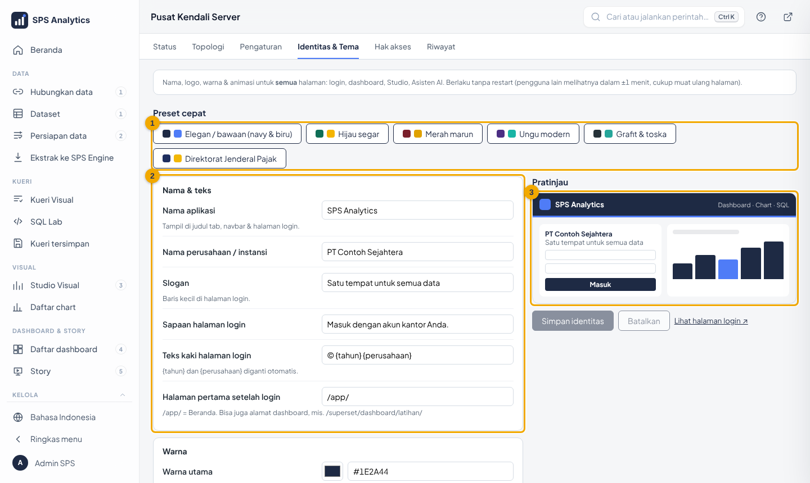

# 09 · Identitas & Tema (white-label)

Nama aplikasi, nama perusahaan, logo, ikon tab, warna, huruf, motif hiasan, dan animasi
**bisa diganti kapan saja tanpa restart**. Berlaku untuk semua halaman: login, dashboard,
Studio Visual, Asisten AI, Pusat Kendali.

| Cara | Kapan |
|---|---|
| **Pusat Kendali → Identitas & Tema** | sehari-hari (disarankan) |
| Halaman **Identitas** di `PASANG.cmd` | saat instalasi pertama |
| `.env` (`SPS_PRESET`, `SPS_NAMA_APLIKASI`, …) | isi awal otomatis (lihat §5) |

---

## 1. Mengubah lewat Pusat Kendali



1. Login sebagai Admin → **Settings → Pusat Kendali Server** → tab **Identitas & Tema**.
2. **(1) Preset cepat**: satu klik mengganti warna & motif (lihat §3). Preset langsung tersimpan.
3. **(2)** Ubah isian; baris yang diubah ditandai kuning. **(3) Pratinjau** di kanan ikut berubah.
4. **Simpan**. Pengguna lain melihat perubahan dalam ±1 menit (cukup muat ulang halaman).

Setiap perubahan tercatat di tab **Riwayat** (siapa, kapan, nilai lama/baru).

## 2. Daftar isian

| Kelompok | Isian | Keterangan |
|---|---|---|
| Nama & teks | Nama aplikasi | judul tab browser, navbar, login (maks 40 huruf) |
| | Nama perusahaan / instansi | login, kaki halaman, Asisten AI. Boleh kosong: login & kaki halaman memakai nama aplikasi |
| | Slogan, Sapaan login, Teks kaki | teks di halaman login; `{tahun}` & `{perusahaan}` diganti otomatis |
| | Halaman pertama setelah login | bawaan `/app/` (Beranda); bisa juga `/superset/dashboard/latihan/`. Bila dashboard tujuannya belum ada atau sudah dihapus, pengguna diarahkan ke daftar dashboard |
| Warna | Warna utama | navbar, tombol, header |
| | Warna aksen | garis hiasan, sorotan, tab aktif |
| | Warna latar halaman | latar belakang |
| Tampilan & animasi | Huruf | Plus Jakarta Sans, Sistem (Segoe UI), Klasik (Georgia) — disimpan lokal, tanpa internet |
| | Sudut | lembut, tegas, bulat |
| | Motif hiasan | tinta (sapuan kuas & percikan, bawaan), gelombang, titik, garis, polos |
| | Animasi halus | latar login bergerak, garis aksen mengalir, chart muncul perlahan |
| Logo & ikon | Logo (latar terang), Logo (latar gelap), Ikon tab | unggah PNG/SVG/JPG/WebP maks 1 MB; **kosong = dibuat otomatis** dari nama & warna |

Warna teks di atas warna utama (hitam/putih) dipilih otomatis agar tetap terbaca.
Animasi **otomatis mati** bagi pengguna yang mengaktifkan *Kurangi gerakan / Show animations: off*
di Windows (aturan aksesibilitas `prefers-reduced-motion`).

## 3. Preset

| Preset | Warna utama / aksen | Motif |
|---|---|---|
| `netral` | **Tinta & Sakura**: hitam `#18181B` / pink `#E11D74`, latar `#F4F4F5` | tinta — juga **mengembalikan semua isian ke bawaan** |
| `navy` | navy `#1E2A44` / biru `#4F7CF7` (tampilan bawaan versi sebelumnya) | polos |
| `hijau` | `#0F6E56` / `#F4B400` | titik |
| `marun` | `#7A1F2B` / `#E0A100` | garis |
| `ungu` | `#4B2E83` / `#19B5A5` | gelombang |
| `grafit` | `#263238` / `#26A69A` | titik |

Preset selain `netral` hanya mengganti warna & motif; nama dan logo Anda tetap.

### Tinta & Sakura (bawaan)

Gradasi **hitam → abu → putih** dengan **semburat pink**, proporsi 60-30-10:

| Porsi | Peran | Warna |
|---|---|---|
| ±60% | latar & permukaan | putih `#FFFFFF`, latar `#F4F4F5`, abu muda turunan utama (`--sps-utama-muda`) |
| ±30% | struktur: navbar gelap, tombol utama, judul, panggung login | hitam tinta `#18181B`, gelap `#121214`, abu `#4A4A4F` (`--sps-utama-terang`) |
| ±10% | sorotan: fokus, tautan, langkah berikutnya, titik logo, motif | pink `#E11D74`; di latar gelap `#E85697` (`--sps-aksen-terang`) |

Kontras (WCAG): putih di atas hitam 17,7:1; pink di atas putih 4,5:1 (AA); pink terang di atas hitam 5,5:1.
Tautan memakai pink hanya bila kontrasnya ≥ 4,5:1 (`tema.warna_tautan()`); preset lain tidak berubah.
Palet **chart** ikut tema: pink lebih dulu, lalu batu permata gelap yang tetap aman buta warna ([12 §1](12-studio-visual.md)).

**Logo "Tebasan"**: huruf A tajam yang condong ke depan dibelah sayatan warna aksen yang naik ke kanan dan menembus
bingkai, melambangkan ambisi, kecepatan, presisi. Tanda yang sama dipakai untuk logo otomatis setiap preset, ikon tab,
dan animasi pemuatan (sayatan melesat).

Instalasi yang sudah berjalan tidak berubah otomatis: pilih preset **netral** di tab ini untuk memakai tampilan baru,
atau **navy** untuk kembali ke tampilan lama.

Logo ALDx tersedia sebagai berkas di `branding\` (`logo-aldx.svg`, `logo-aldx-putih.svg`, `favicon-aldx.svg`) untuk
dipakai lewat `statis:`. Logo perusahaan Anda bisa diunggah di tab ini kapan saja. Bila berkas logo `statis:` tidak ditemukan, logo dibuat otomatis dari nama & warna (tidak ada gambar rusak).

Berkas logo ALDx (hitam dengan titik pink) dibuat dari generator yang sama dengan logo otomatis (`tema.svg_logo()`, warna bawaan),
jadi identitasnya konsisten. Bila bentuk tanda di `tema.py` diubah, buat ulang ketiga berkas itu.

## 4. Halaman login beranimasi

Halaman `/login/` dibuat **bersih**: kanvas gradasi hitam → abu (tanpa motif) dengan logo di kiri atas, nama perusahaan
dan slogan di kiri bawah, lalu panel formulir yang dipotong diagonal oleh sayatan warna aksen. Animasinya halus: tiga
garis data tergambar bergantian, satu titik cahaya terus melaju di garis aksen, dan kilau lembut melintas perlahan.
Formulir minimal bergaris bawah, tombol dengan sapuan aksen saat disorot. Di ponsel, kanvas menjadi kepala bermiring
di atas formulir. Semua warna mengikuti preset. Keamanan tidak berubah: formulir tetap
dikirim ke Superset (LDAP / akun lokal, CSRF, batas percobaan). Pesan galat berbahasa Indonesia.

Bila tampilan bermasalah (mis. browser sangat lama), buka **`/login/?klasik=1`** untuk halaman login bawaan Superset.

## 5. Isi awal dari `.env` (instalasi)

Dibaca **sekali** oleh `scripts\build-dashboards.ps1` bila database belum punya identitas, atau bila
`SPS_IDENTITAS_TERAPKAN=1` (diisi installer saat halaman Identitas diubah).

| Variabel | Contoh |
|---|---|
| `SPS_PRESET` | `netral`, `navy`, `hijau`, `marun`, `ungu`, `grafit` |
| `SPS_NAMA_APLIKASI` | `Analitik Penjualan` |
| `SPS_NAMA_PERUSAHAAN` | `PT Contoh Sejahtera` |
| `SPS_LOGO` | nama berkas di folder `branding\`, mis. `logo-kustom.png` |
| `SPS_HALAMAN_DEPAN` | `/superset/dashboard/latihan/` |

Setelah terpasang, ubah lewat Pusat Kendali (nilai `.env` tidak menimpa lagi).

## 6. Cara kerja (untuk pengembang)

```
Pusat Kendali ─► /identitas/api ─► tabel sps_identitas (+ sps_identitas_berkas) di metadb
                                      │  versi berubah
setiap node, tiap ±10 detik  ◄────────┘
   └─► APP_NAME, APP_ICON, FAVICONS, THEME_DEFAULT (token warna & huruf Superset)
   └─► /identitas/tema.css  (variabel CSS, hiasan, animasi) disisipkan ke semua halaman
   └─► /identitas/berkas/<logo|logo_putih|favicon|spinner>
```
Modul: `config\sps_identitas\` (urutan baca di docstring `__init__.py`).

## 7. Masalah umum

| Gejala | Solusi |
|---|---|
| Logo/warna belum berubah | tunggu 1 menit lalu Ctrl+F5 |
| Unggah logo ditolak | maks 1 MB, format PNG/SVG/JPG/WebP/ICO |
| Halaman login polos tanpa animasi | Windows "kurangi gerakan" aktif, atau isian *Animasi halus* dimatikan |
| Tampilan login rusak | pakai `/login/?klasik=1`, laporkan ke admin |
| Ingin kembali ke awal | preset **Netral** |
