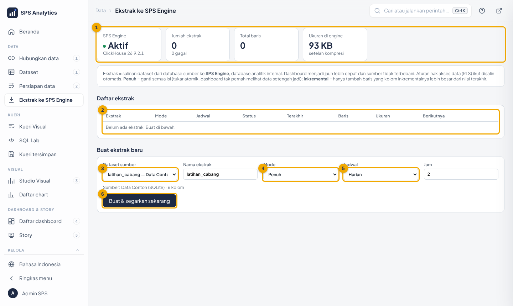

# 13 · ALDx Engine & Ekstrak

**ALDx Engine** adalah database analitik internal ALDx: ClickHouse yang berjalan di
container `engine`.

| Dipakai untuk | Keterangan | Panduan |
|---|---|---|
| **Ekstrak** | Salinan dataset dari sumber mana pun (Oracle, SQL Server, PostgreSQL, Snowflake, …) yang disegarkan terjadwal | bagian 2 |
| **Impor berkas** | Access, Excel, CSV, SQLite, DuckDB, Parquet dari wizard *Hubungkan data* | [06](06-sumber-data.md) |
| **Upload Excel/CSV** | File dari menu Superset masuk ke engine, bukan ke database sumber | bagian 3 |
| **Ramalan** | Hasil ramalan Studio disimpan sebagai dataset agar tampil di dashboard | [17-katalog-chart-peta-prediksi.md](17-katalog-chart-peta-prediksi.md) |
| **Data latihan** | `latihan_penjualan`, `latihan_lokasi_pelanggan`, `latihan_outlet`, `latihan_penjualan_harian` (± 2,3 juta baris, dibangkitkan langsung di engine) (fiktif) | [tutorial/](tutorial/README.md) |

> ALDx Engine **terpisah** dari database sumber mana pun (termasuk ClickHouse lain milik perusahaan).
> Sumber tetap hanya-baca: aplikasi tidak pernah menulis ke sana.

---

## 1. Kenapa perlu ekstrak?

```
TANPA ekstrak (live)                     DENGAN ekstrak
pengguna ─► Superset ─► DB sumber       pengguna ─► Superset ─► ALDx Engine (lokal, kolumnar)
            (tiap klik = query ke sumber)                         ▲
                                                                  │ disegarkan terjadwal (mis. 02:00)
                                                          DB sumber ─┘
```

| | Live (langsung ke sumber) | Ekstrak (ALDx Engine) |
|---|---|---|
| Kecepatan dashboard | tergantung sumber, sering 5–60 detik | biasanya < 1 detik |
| Beban ke database sumber | setiap klik setiap pengguna | sekali per penyegaran |
| Kesegaran data | detik ini | per jadwal (mis. tiap pagi) |
| Cocok untuk | data transaksi hari ini | laporan bulanan/harian, dashboard pimpinan |

---

## 2. Ekstrak

Halaman: menu **Data → Ekstrak ke ALDx Engine** (khusus Admin).

Sumber bisa dataset dari database mana pun, termasuk **dataset virtual yang SQL-nya berjalan di ALDx Engine**
(hasilnya "dibekukan" jadi tabel). Cara tercepat: Kueri Visual › **Simpan jadi dataset** › **Fisik**
([21](21-kueri-visual-dan-alur-menu.md)). Tabel fisik yang sudah ada di ALDx Engine tidak perlu diekstrak.



| No | Bagian | Isi |
|---|---|---|
| 1 | Kartu engine | status engine, jumlah ekstrak, total baris, ukuran setelah kompresi |
| 2 | Daftar ekstrak | mode, jadwal (bisa diubah langsung), status, baris, ukuran, jadwal berikutnya, tombol aksi |
| 3 | Dataset sumber | dataset Superset yang akan disalin |
| 4 | Mode | **Penuh** atau **Inkremental** |
| 5 | Jadwal | Manual · Tiap beberapa jam · Harian (jam) · Mingguan (hari & jam) |
| 6 | Buat & segarkan sekarang | membuat ekstrak lalu langsung menyalin pertama kali |

### 2.1 Mode penyegaran

| Mode | Cara kerja | Pakai bila |
|---|---|---|
| **Penuh** | Salin seluruh isi ke tabel sementara, lalu **tukar atomik** (`EXCHANGE TABLES`). Dashboard tidak pernah melihat data setengah jadi. | data bisa berubah di masa lalu (koreksi), ukuran wajar |
| **Inkremental** | Hanya ambil baris dengan *kolom inkremental* **>** nilai terbesar sebelumnya, lalu tambahkan. | data hanya bertambah: tanggal transaksi, periode, ID naik |

Tombol **Penuh** pada ekstrak inkremental = salin ulang semuanya (misalnya setelah ada koreksi data lama).

### 2.2 Hak akses ikut tersalin

Saat penyegaran pertama, sistem otomatis:

1. membuat dataset `ekstrak__<nama>` di koneksi **ALDx Engine (ClickHouse)**;
2. menyalin **aturan RLS** dataset sumber (pengguna Cabang Jakarta tetap hanya melihat Jakarta);
3. memberi akses dataset ke **role yang sama** dengan dataset sumber;
4. menyalin metrik tersimpan (cek rumus yang memakai fungsi khas database sumber).

Kolom hak akses (mis. `kd_cabang`) dipakai sebagai urutan penyimpanan tabel, sehingga filter per pengguna cepat.

### 2.3 Memakai ekstrak di chart

| Tombol | Fungsi |
|---|---|
| **Pakai di chart** | semua chart yang memakai dataset sumber dipindah ke ekstrak, termasuk target filter dashboard |
| **Kembalikan chart** | chart dipindah lagi ke dataset sumber (live) |
| **Hapus** | ditolak bila masih ada chart memakai ekstrak, supaya dashboard tidak rusak |

### 2.4 Jadwal & backgrounder

```
superset-beat  ──tiap 5 menit──► sps.ekstrak.jadwal  ──► antrean "ekstrak" ──► superset-worker
                                (ekstrak yang jatuh tempo)                     sps.ekstrak.segarkan
```

- Jumlah penyegaran bersamaan = **Pusat Kendali → Pengaturan → Backgrounder: ekstrak** (bawaan 1).
- Batas waktu satu penyegaran: 6 jam.
- Data dibaca per potongan 50.000 baris (hemat memori).
- Riwayat setiap penyegaran: tombol **Riwayat** (mulai, selesai, pemicu, baris, pesan galat).

### 2.5 Batasan

| Batasan | Alasan / solusi |
|---|---|
| Baris & kuota disk dibatasi Superadmin (Pusat Kendali › **Batas data**) | melebihi batas = penyegaran dihentikan, data lama tetap utuh. `0` = tanpa batas ([24](24-superadmin-dan-batas-data.md)) |
| Dataset dengan template `{{ ... }}` tidak bisa diekstrak | isinya berubah per filter/pengguna. Buat dataset tanpa template (Persiapan data) |
| Kolom hasil hitungan (calculated column) tidak ikut | buat kolomnya di SQL dataset atau Persiapan data |
| Rumus metrik khas sumber (mis. Oracle `NVL`) | ganti dengan rumus ClickHouse (`ifNull`) di dataset ekstrak |

---

## 3. Upload Excel/CSV ke engine

Menu Superset **+ → Data → Upload CSV / Excel / Columnar** → pilih database **ALDx Engine (ClickHouse)**.

- Tipe kolom ditebak otomatis (angka, tanggal, teks berulang → `LowCardinality`).
- Batas ukuran, jumlah baris, jenis file & role yang boleh: **Pusat Kendali → Pengaturan → Upload**.
- Upload ke koneksi ClickHouse lain **ditolak** oleh sistem.
- Dataset hasil upload **tidak punya RLS**: semua yang diberi akses melihat semua baris. Jangan upload data per-cabang/per-orang tanpa membuat aturan RLS.

Data upload versi lama (database `sps_upload` di XAMPP/MariaDB) dipindah ke **ALDx Engine** oleh
`scripts\pindah-metadata.ps1`; dataset & chart lamanya diarahkan ke engine otomatis.

---

## 4. Struktur kode (`config/sps_engine/`)

| Berkas | Isi |
|---|---|
| `klien.py` | koneksi ke engine (`clickhouse-connect`); `SPS_ENGINE_CHDB` = chDB untuk pengujian |
| `tabel.py` | tebak tipe kolom, buat tabel MergeTree, isi penuh (tukar atomik) / tambahan, statistik |
| `ekstrak.py` | daftar ekstrak, jadwal, penyegaran, dataset + RLS + akses, pindah/kembalikan chart |
| `tugas.py` | tugas Celery `sps.ekstrak.segarkan`, `sps.ekstrak.jadwal`, `sps.ramalan.segarkan` |
| `upload.py` | izinkan upload hanya ke ALDx Engine |
| `tampilan.py` | API tab Ekstrak (`/pusat-kendali/api/ekstrak/...`) |

Tabel metadata (di metadb): `sps_ekstrak` (daftar) dan `sps_ekstrak_log` (riwayat).

## 5. Pengaturan `.env`

| Variabel | Bawaan | Arti |
|---|---|---|
| `ENGINE_DATABASE` | `sps_engine` | nama database di engine |
| `ENGINE_USER` / `ENGINE_PASSWORD` | `sps` / dibuat installer | akun engine |
| `ENGINE_PORT_HOST` | `8124` | port engine di komputer (diagnosa & node tambahan) |
| `ENGINE_VERSI` | `25.8` | versi ClickHouse ([16-upgrade-downgrade.md](16-upgrade-downgrade.md)) |
| `ENGINE_MEM` | otomatis | batas RAM container (Pusat Kendali → Sumber daya) |

## 6. Masalah umum

| Gejala | Penyebab | Solusi |
|---|---|---|
| Kartu engine "Mati" | container `engine` berhenti / RAM kurang | `docker compose ps engine`, `docker compose logs engine`, naikkan RAM engine |
| Status ekstrak "gagal" + pesan database sumber | sumber tidak terjangkau / password salah | perbaiki koneksi sumber, klik **Segarkan** |
| Ekstrak lama "berjalan" terus | worker mati saat proses | `docker compose restart superset-worker`, lalu **Segarkan** |
| Chart ekstrak error fungsi | metrik memakai fungsi khas sumber | ubah rumus metrik di dataset ekstrak |
| Disk penuh | ekstrak besar / banyak | hapus ekstrak tak terpakai; lihat [15-sizing.md](15-sizing.md) |
