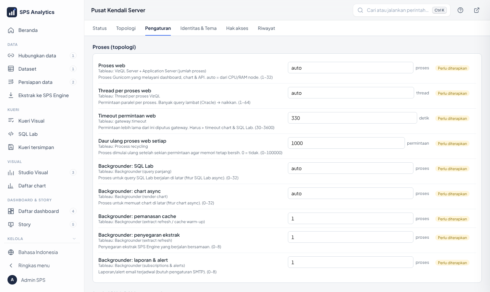

# 15 · Sizing: CPU, RAM & Disk

Panduan menentukan spesifikasi server, dan cara sistem membagi sumber daya secara otomatis.

## 1. Ringkasan cepat

| Skala | Pengguna terdaftar | Aktif bersamaan* | CPU | RAM | Disk bebas | Topologi |
|---|---|---|---|---|---|---|
| Uji coba / pelatihan | ≤ 50 | ≤ 10 | 4 | 8 GB | 40 GB | 1 node |
| Unit / kantor wilayah | ≤ 600 | ≤ 60 | 8 | 16 GB | 100 GB | 1 node |
| Beberapa wilayah | ≤ 1.500 | ≤ 150 | 16 | 32 GB | 250 GB SSD | 1 node |
| Nasional | ≤ 3.000 | ≤ 300 | 32 | 64 GB | 500 GB SSD | 1 node, atau node utama 16/32 + node tambahan |
| > 3.000 | – | > 300 | – | – | – | tambah node web ([11](11-pusat-kendali-server.md)) |

\* *Aktif bersamaan* = sedang membuka/menyaring dashboard pada menit yang sama, biasanya 5–10% dari pengguna terdaftar.
Angka di atas berlaku bila dashboard memakai **ekstrak** (ALDx Engine). Dashboard **live** ke database sumber
dibatasi kemampuan sumber itu, bukan server ini; pindahkan dashboard yang ramai ke ekstrak ([13](13-sps-engine-ekstrak.md)).

> Docker Desktop di Windows hanya memakai CPU/RAM yang diizinkan: **Settings → Resources**
> (atau berkas `%UserProfile%\.wslconfig`). Angka "RAM" di atas adalah RAM untuk Docker, bukan RAM fisik.
> Sisakan minimal 4 GB untuk Windows.

---

## 2. Pembagian otomatis (auto-tuning)

`scripts\terapkan-server.ps1` (juga dijalankan installer) membaca CPU/RAM Docker lalu menghitung
jatah setiap container. Sumber rumus: `config/sps_server/tuning.py`.

```
RAM Docker
 └─ dikurangi cadangan 15% (sistem)
     ├─ redis   10%   (256 MB – 2 GB)
     ├─ engine  25%   (1 – 16 GB)
     ├─ metadb   6%   (512 MB – 1 GB)
     ├─ beat    256 MB
     └─ sisanya: web 60% · backgrounder 40%
```

Hasil perhitungan untuk beberapa ukuran (nilai bawaan):

| CPU / RAM Docker | Web (RAM · CPU) | Proses web × thread | Backgrounder (RAM · CPU) | Antrean SQL Lab | Engine | Redis | metadb |
|---|---|---|---|---|---|---|---|
| 4 / 8 GB | 2,2 GB · 2 | 3 × 4 | 1,5 GB · 2 | 1 | 1,7 GB | 696 MB | 512 MB |
| 8 / 16 GB | 4,7 GB · 5 | 6 × 4 | 3,1 GB · 4 | 4 | 3,4 GB | 1,4 GB | 835 MB |
| 16 / 32 GB | 10,3 GB · 10 | 15 × 4 | 6,9 GB · 8 | 12 | 6,8 GB | 2 GB | 1 GB |
| 32 / 64 GB | 22,5 GB · 19 | 16 × 8 | 15 GB · 16 | 21 | 13,6 GB | 2 GB | 1 GB |

Antrean *cache*, *laporan*, dan *ekstrak* masing-masing 1 proses (bisa diubah).

Semua angka bisa ditimpa di **Pusat Kendali → Pengaturan → Sumber daya / Proses / Backgrounder**
(isi angka menggantikan `auto`), lalu jalankan `scripts\terapkan-server.ps1`.



---

## 3. Memperkirakan disk

| Komponen | Perkiraan |
|---|---|
| Image Docker (Superset, ClickHouse, PostgreSQL, Redis, nginx) | ± 6 GB |
| metadb | 0,5–2 GB (bertambah dengan log aktivitas; dibersihkan otomatis sesuai *Simpan log … hari*) |
| Cadangan `backup\metadb-*.dump` (14 terakhir) | 14 × ukuran metadb |
| **ALDx Engine (ekstrak)** | lihat rumus di bawah |
| Log ClickHouse (14 hari, dibatasi `server/engine.xml`) | < 1 GB |

**Rumus ekstrak:** ClickHouse memampatkan data kolumnar sekitar 5–15×.

```
ukuran ≈ jumlah_baris × jumlah_kolom × 4 byte      (perkiraan konservatif setelah kompresi)
contoh: 100 juta baris × 15 kolom × 4 B ≈ 6 GB
```

Ukuran sebenarnya terlihat di **Data → Ekstrak ke ALDx Engine** (kolom Ukuran, "setelah kompresi").
Saat penyegaran **penuh**, butuh ruang sementara 2× ukuran ekstrak itu (tabel lama + baru).

---

## 4. Tanda-tanda perlu menambah sumber daya

Pantau **Pusat Kendali → Status**:

| Gejala di Status | Artinya | Tindakan |
|---|---|---|
| RAM web > 85% (merah) terus-menerus | proses web kekurangan memori | naikkan RAM Docker / jatah web |
| CPU web > 85% saat jam sibuk | permintaan melebihi kemampuan | tambah CPU atau node tambahan |
| Antrean SQL Lab / grafik "tugas menunggu" > 0 lama | backgrounder kurang | naikkan proses backgrounder |
| Chart paling lambat > 10 dtk dari database sumber | sumber lambat | gunakan ekstrak, atau aktifkan cache lebih lama |
| Container `engine` sering restart | engine kehabisan RAM | naikkan *RAM ALDx Engine* |
| Disk < 15% bebas | – | hapus ekstrak tak terpakai, `scripts\cleanup.ps1`, tambah disk |

---

## 4b. Membuktikan dengan uji beban

Angka di dokumen ini perkiraan. Buktikan di server Anda sendiri (di luar jam kerja):
```powershell
powershell -ExecutionPolicy Bypass -File scripts\uji-beban.ps1 -Akun admin@perusahaan.co.id -Pengguna 50 -Detik 120
powershell -ExecutionPolicy Bypass -File scripts\uji-beban.ps1 -Akun admin@perusahaan.co.id -Pengguna 50 -TanpaCache
```
N pengguna maya membuka dashboard (bawaan `latihan`; `-Dashboard <slug/id>` untuk dashboard Anda), memuat semua
chart-nya, membaca 2–6 detik, lalu mengulang. Keluaran: jumlah permintaan, gagal, **median & p95** waktu muat, dan
kesimpulan **CUKUP** (p95 < 5 detik dan gagal < 1%) atau **KURANG** (lihat §4). `-TanpaCache` mengukur database
sumber/engine tanpa bantuan cache (kasus terburuk). Uji langsung ke proses web, jadi batas per IP di gateway tidak ikut.

Contoh di server uji (1 proses web, data latihan, cache aktif): 10 pengguna → median 0,06 dtk, p95 0,78 dtk, 0% gagal.

## 5. Contoh: dari uji coba ke produksi

1. Uji coba di laptop 4 CPU / 8 GB → semua `auto`.
2. Pindah ke server 16 CPU / 64 GB fisik → Docker Desktop **Resources**: 14 CPU, 48 GB.
3. `scripts\terapkan-server.ps1` → jatah dihitung ulang (lihat tabel bagian 2).
4. Dashboard pimpinan → **ekstrak** harian 02:00.
5. Pengguna bertambah > 150 aktif → tambah node web dengan `scripts\gabung-node.ps1`
   (metadb, engine, dan Redis tetap di node utama).
