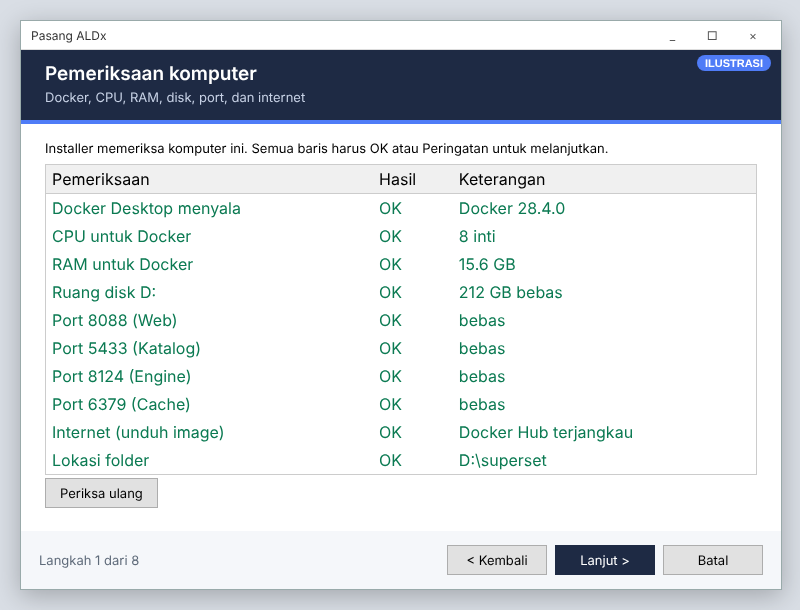
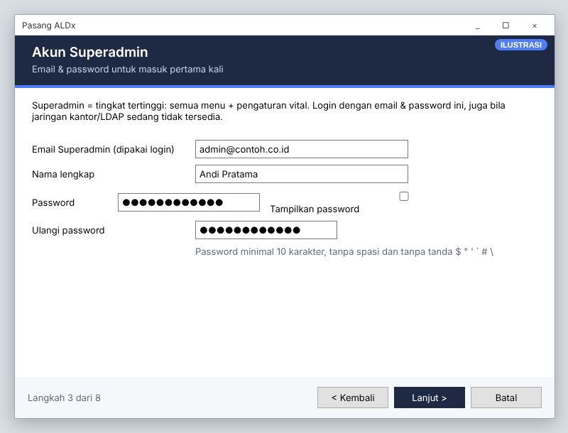
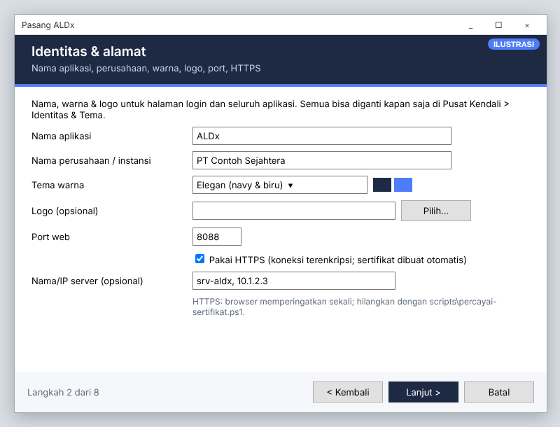
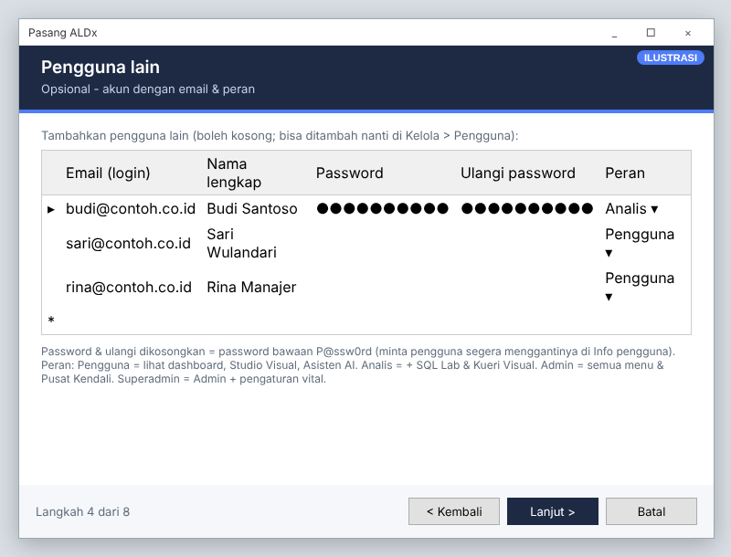
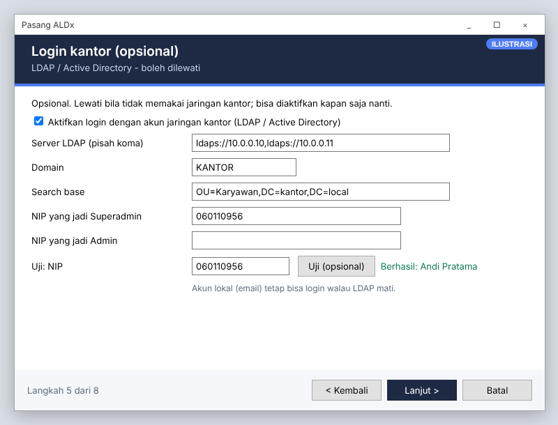
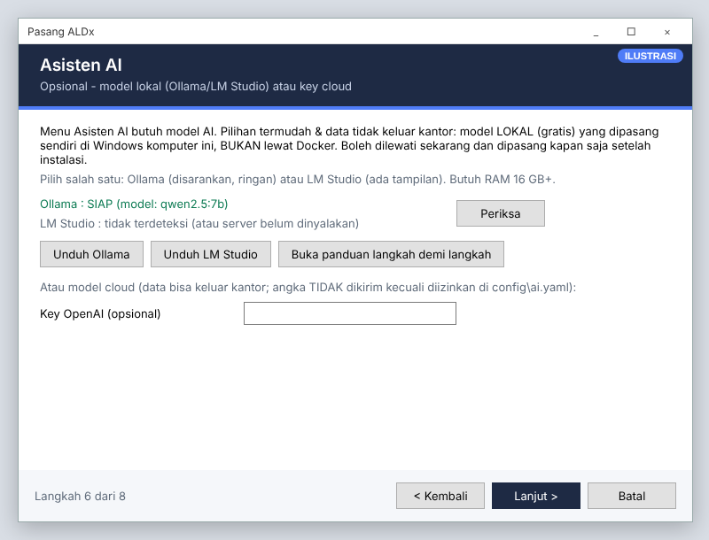
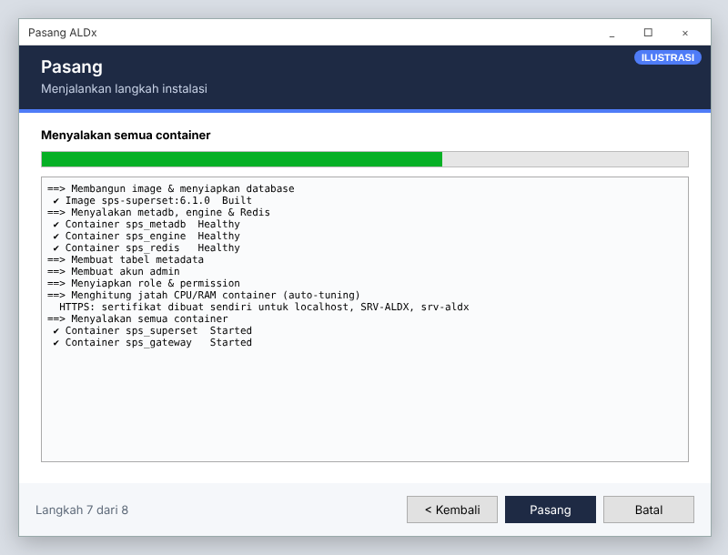
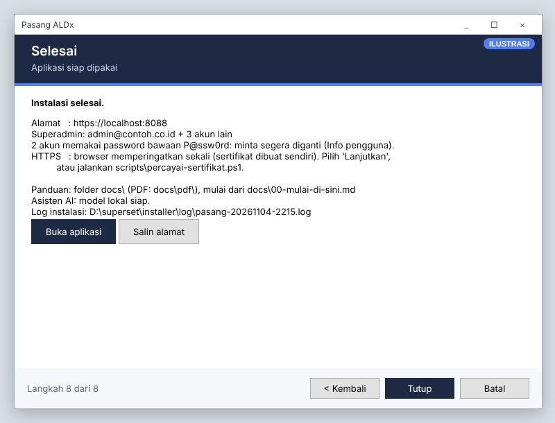

# 18 · Installer `ALDx-Setup.exe` & `PASANG.cmd` (Next-Next)

Cara termudah memasang, memperbarui, atau memindahkan ALDx. Yang **wajib** hanya akun **Superadmin**
(email & password). Semua isian lain memakai nilai bawaan dan bisa diatur nanti. Panduan awam: [CARA-PASANG.md](../CARA-PASANG.md).

| Pintu masuk | Untuk | Isi |
|---|---|---|
| **`ALDx-Setup.exe`** | pengguna biasa (disarankan) | menyalin berkas ke folder (bawaan `D:\superset`), membuat pintasan, lalu membuka wizard pengaturan |
| `PASANG.cmd` | folder hasil salin / ZIP / `git clone`, pasang ulang | langsung membuka wizard pengaturan |

### Peringatan Windows & antivirus

`ALDx-Setup.exe` aman (dibangun otomatis GitHub Actions dari kode di repo ini), tetapi **belum bertanda tangan digital**
dan masih baru, jadi Windows **SmartScreen** ("Windows protected your PC") dan sebagian **antivirus** curiga.
Ini wajar untuk semua program baru tanpa tanda tangan, bukan berarti ada virus.

| Cara | Untuk | Langkah |
|---|---|---|
| **Salin lewat flashdisk / folder jaringan** | cara cepat | berkas yang tidak diunduh lewat browser tidak diberi tanda "dari internet", jadi SmartScreen tidak muncul. Bila terlanjur diunduh: klik kanan berkas › *Properties* › centang **Unblock** › OK |
| **Pengecualian antivirus kantor** | tim TI | tambahkan pengecualian untuk berkas Setup (berdasarkan hash SHA-256: `Get-FileHash ALDx-Setup.exe`, cocokkan dengan `ALDx-SHA256.txt` di rilis) dan folder `D:\superset` di konsol antivirus kantor |
| **Laporkan salah deteksi** | sekali per versi | Microsoft Defender: <https://www.microsoft.com/wdsi/filesubmission> (pilih *Software developer*, *Incorrectly detected*). Antivirus lain: formulir *false positive* di situs vendornya. Jangan mengunggah ke situs pemindai publik bila kode dianggap rahasia |
| **Tanda tangan digital** (permanen) | produksi | beli sertifikat *code signing* (penerbit tepercaya, mis. lewat layanan tanda tangan cloud) atau minta sertifikat dari CA internal kantor. Simpan sebagai secret GitHub `CODESIGN_PFX_BASE64` (isi berkas .pfx dalam base64) & `CODESIGN_PASSWORD`; `setup.yml` & `setup-offline.yml` otomatis menandatangani Setup dan uninstaller-nya (`/DTandaTangan`, `signtool`). Reputasi SmartScreen tetap naik bertahap seiring banyaknya pengguna |

Agar tidak mirip pola program jahat, pintasan **ALDx** memakai `scripts\buka.cmd` (bukan PowerShell tersembunyi) dan
berkas Setup memuat keterangan penerbit/versi.

**Wizard ringkas (bawaan):** Pemeriksaan › Akun Superadmin › Pasang › Selesai. Centang **Atur pengaturan lanjutan**
di halaman Superadmin untuk menampilkan Identitas & alamat, Pengguna lain, Login kantor. Halaman **Asisten AI** selalu tampil (boleh dilewati)
(§2). Pada pasang ulang, centang ini otomatis aktif agar isian lama bisa ditinjau. Halaman yang tidak relevan
dilewati otomatis.

### ALDx-Setup.exe

| Hal | Keterangan |
|---|---|
| Diterbitkan | `installer\setup\terbitkan.ps1`: memastikan semua perubahan sudah di-commit & di-push, membangun installer online, pembersih total & offline, lalu mengunggahnya ke GitHub Releases **kedua repo** (*ALDx terbaru* & *ALDx offline*) dengan pencocokan ukuran. Dijalankan **setiap kali ada perbaikan** |
| Dibangun | **lokal (disarankan):** `installer\setup\buat-installer.ps1` (online) atau `... -Offline` (+ paket offline) → `installer\setup\Output\`; butuh Inno Setup 6 (`winget install JRSoftware.InnoSetup`). Setiap hasil dipindai **Windows Defender**, dan **isinya diperiksa** dari manifest Inno Setup (berkas fitur AI, panduan & hapus bersih wajib ada; catatan AI, log, `.env`, `unins*` tidak boleh ikut). Gagal bila salah satu tidak terpenuhi. Otomatis: GitHub Actions (`setup.yml`) di setiap push ke `main` → Releases › **ALDx terbaru** (hanya bila Actions berjalan) |
| Skrip | `installer/setup/aldx-setup.iss` (teks Indonesia, ikon `aldx.ico`); bangun manual: `iscc /DVersi=2026.11.05 installer\setup\aldx-setup.iss` |
| Hak admin | tidak perlu (`PrivilegesRequired=lowest`); berkas hasil salin tidak bertanda "dari internet", jadi tidak diblokir PowerShell |
| Pemeriksaan | Docker Desktop belum terpasang → pesan + tautan unduh; folder berspasi / Desktop / OneDrive ditolak |
| Isi | berkas proyek **tanpa** `.env`, cadangan, log, kunci TLS, `.git`, sisa pemasangan lokal (`unins*`), log pengembangan (CHANGELOG, laporan QA), catatan AI, dan perkakas pengembang (`tests`, CI, situs dok) |
| Pintasan | **ALDx** (Desktop & Start, `scripts\buka.ps1`: menyalakan Docker bila perlu, membuka alamat dari `.env`) · *Pasang - ubah pengaturan ALDx* · *Panduan pasang* · *Folder ALDx* |
| Memperbarui | jalankan Setup versi baru ke folder yang sama: berkas program diganti, `.env` & data tetap; wizard lalu menerapkan pembaruan |
| Menghapus | Settings › Apps › ALDx › Uninstall → pertanyaan *hapus bersih semua data?* · **Tidak** = `scripts\hapus-aldx.ps1`: container & image dihapus, data tetap untuk pasang ulang · **Ya** = `scripts\hapus-total.ps1 -Ya -SimpanFolder`: cadangan ke *Dokumen\ALDx-cadangan-…*, lalu container, image, volume, jaringan, objek Kubernetes ALDx, sertifikat, tugas terjadwal, dan seluruh folder ALDx dihapus (cadangan gagal → tidak ada yang dihapus). Docker mati → bisa ditunggu atau hanya berkas program. **Hapus total** (tanpa sisa): menu Start › *Hapus total (bersih)* = `scripts\hapus-total.ps1` ([29](29-versi-pembaruan-hapus-total.md)) |
| Lupa password | menu Start › ALDx › *Atur ulang password* (`scripts\atur-password.ps1`, password lewat stdin, kunci akun dibuka) |
| Paket offline | `ALDx-Setup-Offline.exe` + `.bin`: lihat §6 |
| Dibangun otomatis | `.github/workflows/rilis.yml` (GitHub Actions, setiap push ke `main`): job *online* (Windows) → rilis **terbaru**; job *image* (Linux: bangun & simpan image) + *offline* (Windows) → rilis **offline**. Memakai `installer\setup\buat-installer.ps1` yang sama dengan build lokal; berkas rilis lama baru dihapus setelah yang baru terunggah |
| Pembersih total | `ALDx-HapusTotal.exe` (`installer/setup/aldx-hapus-total.iss`, dibangun bersama Setup.exe): menjalankan salinan `scripts\hapus-total.ps1 -Akar <folder>` dari folder sementara; folder diisi dari entri Apps; tanpa memasang apa pun ([29](29-versi-pembaruan-hapus-total.md)) |
| Data sebelumnya | volume Docker `sps_metadb_pg` ada tetapi `.env` hilang (folder dihapus) → halaman **Data sebelumnya**: *Mulai baru* (`hapus-aldx.ps1 -MulaiBaru`: cadangkan lalu hapus volume data) atau *Pakai data lama* (`Sync-MetadbPassword` menyamakan password metadb dengan `.env` baru; password koneksi sumber perlu diisi ulang) |
| SmartScreen / antivirus | Setup belum ditandatangani digital → peringatan. Lihat [§ Peringatan Windows & antivirus](#peringatan-windows--antivirus) |

> Gambar di halaman ini adalah **ilustrasi** tata letak wizard. Tampilan sebenarnya mengikuti gaya
> jendela Windows di komputer Anda.

## 1. Sebelum mulai

| Syarat | Keterangan |
|---|---|
| Windows 10/11 64-bit atau Windows Server 2019+ | dengan WSL 2 |
| **Docker Desktop** terpasang & menyala | ikon paus di taskbar diam (tidak bergerak) |
| Resources Docker | minimal 2 CPU / 4 GB; disarankan 4 CPU / 8 GB+ ([15-sizing.md](15-sizing.md)) |
| Folder | `D:\superset` atau folder lain **tanpa spasi**, bukan di dalam ZIP / OneDrive. Dari GitHub: *Download ZIP* › Extract All, atau `git clone` (akhir baris diatur `.gitattributes`) |
| Akun Windows | **tidak perlu admin**, asal akun itu anggota grup `docker-users` (dikerjakan TI sekali) |
| Jaringan | akses ke Docker Hub untuk mengunduh image (pertama kali ± 3 GB). Tanpa internet: §6 |
| LDAP / Active Directory | **tidak wajib**. Boleh diaktifkan saat instalasi atau kapan saja sesudahnya |
| Instalasi lama (metadata di XAMPP / MariaDB) | dipindah otomatis ke PostgreSQL. Versi XAMPP: MySQL XAMPP **menyala** saat installer berjalan |

## 2. Menjalankan

1. Buka folder proyek (mis. `D:\superset`).
2. Klik dua kali **`PASANG.cmd`**. Tidak perlu *Run as administrator*. Peringatan SmartScreen: **More info › Run anyway**.

Yang dikerjakan `PASANG.cmd` sebelum wizard terbuka:

| Langkah | Bila gagal |
|---|---|
| pindah ke folder `PASANG.cmd` sendiri (jadi aman dijalankan dari CMD admin, Terminal, atau jalan pintas) | – |
| menolak bila dibuka dari dalam ZIP | pesan "Extract All dulu" |
| membuka blokir berkas hasil unduhan (*Unblock-File*) | – |
| memilih PowerShell yang diizinkan: Windows PowerShell, lalu PowerShell 7 (`pwsh`) | pesan "PowerShell tidak diizinkan (GPO)" |
| menjalankan `installer\pasang.ps1`; jendela tetap terbuka bila ada galat | log di `installer\log\` |

Dari Terminal/PowerShell ketik `.\PASANG.cmd`; dari CMD ketik path lengkap `D:\superset\PASANG.cmd`.
3. Ikuti halaman wizard, lalu klik **Pasang**. Tombol **Kembali** selalu bisa dipakai untuk memperbaiki isian,
   juga setelah Pasang gagal.

### Halaman 1: Pemeriksaan komputer


| Baris GAGAL / Peringatan | Perbaikan |
|---|---|
| Docker Desktop menyala | buka Docker Desktop, tunggu siap, klik **Periksa ulang** |
| RAM / CPU untuk Docker | Docker Desktop → Settings → Resources → naikkan → Apply & restart |
| Ruang disk | kosongkan disk atau pindahkan folder ke drive lain |
| Port … dipakai program '…' | port **web** diganti otomatis ke port bebas (Peringatan). Port lain: tutup program tersebut |
| Internet (unduh image) | hanya peringatan. Pasang pertama butuh internet / proxy kantor; tanpa internet lihat §6 |

### Halaman 2: Akun Superadmin (wajib)

Di bawah isian ada centang **Atur pengaturan lanjutan**: tidak dicentang = langsung ke halaman Pasang; dicentang = halaman *Lanjutan* di bawah ikut tampil.


Superadmin = tingkat tertinggi: semua menu + pengaturan vital ([24](24-superadmin-dan-batas-data.md)).
Akun ini **akun lokal**: login dengan **email & password**, tetap bisa masuk walau jaringan kantor/LDAP mati.

| Isian | Keterangan |
|---|---|
| Email Superadmin | dipakai untuk login |
| Nama lengkap | tampil di aplikasi |
| Password + ulangi | minimal 10 karakter, **tanpa** spasi dan tanpa `$ " ' \` # \`. Centang *Tampilkan password* untuk memeriksa ketikan. Dihapus dari `.env` setelah instalasi |

Instalasi ulang: kosongkan email & password bila Superadmin tidak ingin diubah.

### Lanjutan: Identitas & alamat


| Isian | Keterangan |
|---|---|
| Nama aplikasi, perusahaan, tema warna, logo | nilai **awal**; diubah kapan saja di **Pusat Kendali → Identitas & Tema** tanpa restart ([09](09-identitas-tema.md)) |
| Port web | bawaan 8088 (1–65535) |
| **Pakai HTTPS** | koneksi browser ↔ server terenkripsi (password & data tidak bisa disadap di jaringan). Sertifikat dibuat otomatis; browser memperingatkan **sekali**. Hilangkan peringatan dengan `scripts\percayai-sertifikat.ps1` di komputer pengguna. Punya sertifikat kantor: taruh di `server\tls\` ([11 §HTTPS](11-pusat-kendali-server.md#https)) |
| Nama/IP server | alamat yang diketik pengguna, mis. `srv-aldx, 10.1.2.3` (masuk ke sertifikat HTTPS) |

### Lanjutan: Pengguna lain (opsional)


| Kolom | Aturan |
|---|---|
| Email (login) | satu email = satu akun |
| Nama lengkap | wajib |
| Password + Ulangi password | minimal 8 karakter dan harus sama. **Dikosongkan = password bawaan `P@ssw0rd`**: minta pengguna segera menggantinya (Info pengguna → ganti password) |
| Peran | **Pengguna** = lihat dashboard, Studio Visual, Asisten AI · **Analis** = + SQL Lab & Kueri Visual · **Admin** = semua menu · **Superadmin** = Admin + pengaturan vital |

Password dikirim langsung ke aplikasi, **tidak** disimpan di `.env`/berkas. Mengulang installer dengan email yang
sama = nama, password & peran diperbarui.

### Lanjutan: Login kantor / LDAP (opsional)


Lewati bila tidak memakai jaringan kantor. Bila dicentang:

| Isian | Keterangan |
|---|---|
| Server LDAP, Domain, Search base | dari tim jaringan. Sebaiknya `ldaps://` (terenkripsi); `ldap://` memunculkan peringatan merah |
| Username yang jadi Superadmin / Admin | opsional, pisah koma. Orang itu otomatis mendapat peran tersebut saat login |
| **Uji (opsional)** | mencoba login username & password ke LDAP (password tidak disimpan). **Tidak wajib**: boleh lanjut walau komputer belum terhubung jaringan kantor |

Pengguna lain cukup login dengan username & password jaringan kantor; akunnya dibuat otomatis saat login pertama.
Akun ber-email (Superadmin & pengguna halaman 4) selalu login sebagai akun lokal. Detail: [05](05-login-ldap.md).

Sumber data dihubungkan setelah instalasi lewat **Data → Hubungkan data** ([06](06-sumber-data.md)).

### Asisten AI (opsional, selalu tampil)


Memberi tahu bahwa **model AI lokal dipasang sendiri di Windows** (bukan lewat Docker), lalu:
- **Periksa** (otomatis saat halaman dibuka, jendela tetap responsif): mendeteksi Ollama (port 11434) dan LM Studio (port 1234);
- **Unduh Ollama / Unduh LM Studio**: membuka halaman unduhan resmi;
- **Buka panduan langkah demi langkah**: membuka [20-model-ai-lokal.md](20-model-ai-lokal.md) (versi PDF).

Boleh dilewati: setelah terpasang, AI disambungkan dari panel Asisten AI (`Ctrl + I`) › **Sambungkan AI**
([28](28-sambungkan-asisten-ai.md)). Model lokal apa pun yang sudah diunduh terdeteksi otomatis. Key model cloud diisi di halaman ini
(kosong = tidak dipakai): pilih **Layanan cloud** (Gemini, Groq, OpenRouter, Cerebras, Mistral, GitHub Models = gratis;
Grok/xAI, OpenAI, Anthropic, DeepSeek = berbayar), tempel **API key**, ulangi untuk layanan lain. Tombol **? Cara membuat key**
menampilkan langkahnya dan membuka halaman pembuatan key. Daftar & langkah lengkap: [28-sambungkan-asisten-ai.md](28-sambungkan-asisten-ai.md).

Setiap isian penting di installer (nama, port, email/password Superadmin, LDAP) punya tombol **?** berisi cara mengisinya.

### Data lama (hanya bila ada instalasi versi lama)
Muncul bila metadata masih di **MySQL XAMPP** atau **MariaDB** (versi sebelumnya). Centang **Pindahkan …**
(wajib). Sumber lama hanya **dibaca**; volume MariaDB lama (`sps_metadb`) disimpan sebagai cadangan.

### Halaman 3: Pasang


| Urutan | Langkah | Skrip yang dijalankan |
|---|---|---|
| 1 | simpan isian ke `.env`, buat password container acak | (installer) |
| 2 | pindah metadata lama (XAMPP/MariaDB) → PostgreSQL *(bila ada)* | `scripts\pindah-metadata.ps1` |
| 3 | bangun image, nyalakan metadb/engine/Redis, buat tabel, akun admin, role, auto-tuning, sertifikat HTTPS | `scripts\init.ps1` |
| 4 | nyalakan semua container | `scripts\start.ps1` |
| 6 | identitas awal, menu, izin, ALDx Engine | `scripts\build-dashboards.ps1` |
| 7 | **data contoh dibangkitkan di setiap instalasi** (± 20 detik, tanpa internet): dataset latihan, 2,3 juta baris data harian, 2 dashboard contoh, database sumber contoh, role RLS contoh. Bisa dibuat ulang kapan saja; isinya selalu sama. Peta lengkap: [bahan ajar](bahan-ajar/README.md#peta-fitur--data-contoh) | `scripts\data-latihan.ps1` |
| 8 | buat akun pengguna, tunggu web siap (maks. 5 menit), hapus password admin dari `.env` | (installer) |

Pertama kali 15–40 menit (unduh & bangun image). Instalasi ulang 2–5 menit. Jendela tidak bisa ditutup selama
Pasang berjalan (agar instalasi tidak setengah jadi).
Bila gagal: baca pesan terakhir di log, perbaiki (klik **Kembali** bila isian yang salah), lalu **Pasang** lagi.
Semua langkah aman diulang.

### Halaman 4: Selesai


**Buka aplikasi** atau **Salin alamat**. Bila web belum menjawab dalam 5 menit, halaman ini menulis peringatan
kuning: tunggu 2–3 menit lalu buka lagi, atau jalankan `scripts\diagnose.ps1`. Setelah login, jalankan uji otomatis:
```powershell
powershell -ExecutionPolicy Bypass -File scripts\uji.ps1
```

## 3. Kapan menjalankan `PASANG.cmd` lagi

| Situasi | Hasil |
|---|---|
| Memperbarui ke versi proyek terbaru (folder baru disalin) | image dibangun ulang, menu/izin diperbarui, data tetap |
| Mengganti password admin | password diganti lewat `superset fab reset-password` |
| Mengaktifkan LDAP / menambah akun lokal | `.env` diperbarui / akun dibuat atau diperbarui |
| Versi lama masih memakai XAMPP / MariaDB | metadata dipindah otomatis ke PostgreSQL |
| Pindah ke server baru | lihat [14-akun-dan-akses.md](14-akun-dan-akses.md) bagian 4.6 |

## 4. Log & berkas

| Berkas | Isi |
|---|---|
| `installer\log\pasang-<waktu>.log` | seluruh keluaran instalasi (password tidak dicatat) |
| `.env` | konfigurasi + password container (rahasia) |
| `installer\pasang.ps1` | kode wizard (PowerShell + Windows Forms, tanpa aplikasi tambahan) |

## 5. Tanpa jendela (untuk admin berpengalaman)

Installer hanya memanggil skrip di `scripts\`. Urutan manual yang sama:
```powershell
Copy-Item .env.example .env        # lalu isi ADMIN_PASSWORD (dan opsional LDAP)
powershell -ExecutionPolicy Bypass -File scripts\init.ps1
powershell -ExecutionPolicy Bypass -File scripts\start.ps1
powershell -ExecutionPolicy Bypass -File scripts\build-dashboards.ps1
powershell -ExecutionPolicy Bypass -File scripts\data-latihan.ps1
powershell -ExecutionPolicy Bypass -File scripts\uji.ps1
```

## 6. Jaringan tanpa akses Docker Hub (paket offline)

**Cara mudah: `ALDx-Setup-Offline.exe`** (Releases › *ALDx offline*, dibangun `.github/workflows/setup-offline.yml`).
Isinya: semua image siap pakai (`offline\aldx-images.tar.gz`: Superset ALDx yang sudah dibangun, PostgreSQL, ClickHouse,
Redis, nginx), `offline\versi.txt`, dan Docker Desktop Installer. Berkas `.exe` + semua `.bin` harus satu folder.

Semua fitur jalan **tanpa internet**: ECharts, peta provinsi, 10 huruf dashboard, dan gambar dashboard tersimpan lokal;
sematan dashboard hanya butuh jaringan antara web Anda dan server ALDx. Yang baru di tiap versi:
[31 · Catatan versi](31-catatan-versi.md).

| Tahap | Yang terjadi |
|---|---|
| Setup | Docker belum ada → tawaran memasang Docker Desktop dari paket (UAC admin) |
| Pemeriksaan | *Internet*: "paket offline" (OK) |
| `scripts\init.ps1` | `Import-ImageOffline` (`scripts\_umum.ps1`): `docker load` sekali per versi paket (`.env` `SPS_OFFLINE_VERSI`), image tidak dibangun |

Catatan: Oracle Instant Client (mode *thick*, Oracle < 12.1) dan driver SAP HANA (`hdbcli`) tidak termasuk; lihat
`docker/oracle/README.md` dan `docker/wheels/README.md`. **Membangun paket offline untuk dibagikan:** pastikan tidak ada
`docker\wheels\hdbcli-*.whl` maupun zip Instant Client di komputer pembangun, karena keduanya ikut masuk ke image
dan lisensinya melarang dibagikan ulang ([THIRD-PARTY-LICENSES.md](../THIRD-PARTY-LICENSES.md) §4).
WSL 2 di Windows yang sangat lama mungkin perlu pembaruan (`wsl --update` dari berkas, minta TI).

**Cara manual**, di komputer yang punya internet:
```powershell
docker pull postgres:17-alpine; docker pull clickhouse/clickhouse-server:25.8
docker pull redis:7.4-alpine; docker pull nginx:1.28-alpine; docker pull apache/superset:6.1.0
docker save -o sps-images.tar postgres:17-alpine clickhouse/clickhouse-server:25.8 redis:7.4-alpine nginx:1.28-alpine apache/superset:6.1.0
```
Salin `sps-images.tar` ke server → `docker load -i sps-images.tar` → jalankan `PASANG.cmd`.
Instalasi lama yang perlu dipindah dari MariaDB juga butuh `mariadb:11.4` (tambahkan ke perintah di atas).
