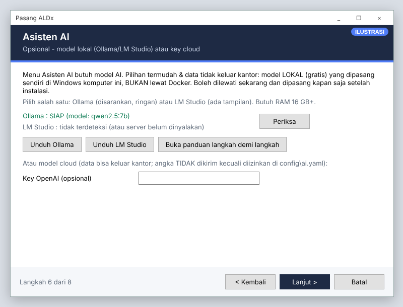

# 20 · Memasang Model AI Lokal (Ollama / LM Studio)

> **Mulai dari [28 · Menyambungkan Asisten AI](28-sambungkan-asisten-ai.md)**: panduan satu pintu (lokal, cloud
> gratis, cloud berbayar). Bab ini berisi rincian model lokal: kebutuhan komputer, jaringan kantor, dan masalah umum.
> Sejak versi 2026.11.10, **semua model yang sudah diunduh terdeteksi otomatis**, jadi nama model tidak perlu
> disamakan dengan `config\ai.yaml`.

Panduan untuk admin **tanpa latar belakang IT**. Hasil akhirnya: menu **Asisten AI** bisa menjawab
pertanyaan, dan **data tidak keluar** dari komputer kantor.

> **Penting:** model AI lokal **tidak** berjalan di Docker dan tidak ikut terpasang oleh `PASANG.cmd`.
> Model dipasang sendiri di **Windows komputer server yang sama**. Boleh dipasang sebelum, saat, atau
> sesudah instalasi. Tidak perlu memasang ulang aplikasi.

```
Browser ─► ALDx (di Docker)
              │  host.docker.internal
              ▼
          Ollama :11434   atau   LM Studio :1234   (dipasang sendiri di Windows)
```

## 1. Pilih salah satu

| | **Ollama** (disarankan) | **LM Studio** |
|---|---|---|
| Tampilan | tanpa jendela, berjalan di tray | aplikasi berjendela, mudah dilihat |
| Menyala sendiri saat Windows menyala | ya | perlu diatur (§3 langkah 7) |
| Cara memasang model | satu perintah | klik di menu *Discover* |
| Alamat untuk ALDx | `http://host.docker.internal:11434/v1` | `http://host.docker.internal:1234/v1` |
| Terdeteksi otomatis oleh ALDx | ya, semua model yang diunduh | ya, semua model yang diunduh |

**Kebutuhan komputer** (selain jatah Docker):

| Model | RAM tambahan | Disk | Kecepatan tanpa GPU |
|---|---|---|---|
| Qwen 2.5 7B (disarankan) | ± 6 GB | ± 5 GB | 10–40 detik per jawaban |
| Qwen 2.5 14B (lebih pintar) | ± 12 GB | ± 9 GB | 30–90 detik |

Total RAM server disarankan **16 GB atau lebih**. Kartu grafis (GPU NVIDIA) membuat jawaban jauh lebih cepat
tetapi tidak wajib. Model **wajib mendukung "tool calling"**; Qwen 2.5 dan Llama 3.1 sudah mendukung.

---

## 2. Cara A: Ollama

1. **Unduh** di komputer server: <https://ollama.com/download/windows> → jalankan `OllamaSetup.exe` →
   *Install*. (Dari installer ALDx: halaman **Asisten AI → Unduh Ollama**.)
2. Setelah selesai, ikon llama muncul di tray (pojok kanan bawah). Ollama otomatis menyala setiap Windows menyala.
3. Buka **PowerShell**, unduh model (sekali, ± 4,7 GB, butuh internet):
   ```powershell
   ollama pull qwen2.5:7b
   ```
4. **Uji** di PowerShell (jawaban muncul dalam beberapa detik):
   ```powershell
   ollama run qwen2.5:7b "Sebutkan tiga warna primer"
   ```
   Tekan `Ctrl+D` untuk keluar.
5. **Izinkan Docker menghubungi Ollama** (sekali): Windows → cari *Edit the system environment variables* →
   **Environment Variables…** → bagian *User variables* → **New…**
   - Variable name: `OLLAMA_HOST`
   - Variable value: `0.0.0.0`

   **OK**, lalu klik kanan ikon llama di tray → **Quit Ollama** → buka lagi **Ollama** dari menu Start.
   Bila Windows Firewall bertanya, pilih **Allow** (jaringan *Private*).
6. Lanjut ke [§4 Memeriksa dari ALDx](#4-memeriksa-dari-aldx).

## 3. Cara B: LM Studio

1. **Unduh** di komputer server: <https://lmstudio.ai/download> → pilih **Windows** → jalankan installer.
   (Dari installer ALDx: halaman **Asisten AI → Unduh LM Studio**.)
2. Buka **LM Studio**. Klik ikon kaca pembesar **Discover** di kiri.
3. Ketik `qwen2.5 7b instruct` → pilih **Qwen2.5 7B Instruct** (format GGUF, kuantisasi *Q4_K_M*) → **Download**
   (± 4,7 GB).
4. Klik ikon **Developer** (atau *Local Server*) di kiri → pilih model yang diunduh di atas → aktifkan
   **Start Server** / status **Running**. Port bawaan **1234**.
5. Di pengaturan server, aktifkan **Serve on Local Network** (agar Docker bisa menghubungi). Bila Windows
   Firewall bertanya, pilih **Allow**.
6. Nama model tidak perlu disamakan: ALDx membaca daftar model LM Studio secara otomatis.
7. Agar menyala sendiri: LM Studio → **Settings** → aktifkan *Start LM Studio on login* dan
   *Start server automatically* (nama menu bisa sedikit berbeda antar versi).

## 3b. Bila jaringan kantor memblokir unduhan model

Gejala: di LM Studio *Discover* kosong / *network error* / *certificate*, atau `ollama pull` gagal.
Penyebab: keamanan jaringan kantor (SSL inspection / blokir situs model). Coba berurutan:

**Cara 1 — Proxy bawaan LM Studio (paling cepat dicoba).**
LM Studio → **Settings** (ikon roda gigi) → cari opsi *Use LM Studio's Hugging Face Proxy* → aktifkan →
ulangi pencarian model di *Discover*. (Nama opsi bisa sedikit berbeda antar versi; tidak semua jaringan
mengizinkan.)

**Cara 2 — Unduh berkas model lewat browser, lalu impor (biasanya berhasil, karena browser
memakai sertifikat kantor).**

1. Di browser (Chrome/Edge), buka alamat berikut dan tunggu unduhan selesai (± 4,7 GB):
   `https://huggingface.co/lmstudio-community/Qwen2.5-7B-Instruct-GGUF/resolve/main/Qwen2.5-7B-Instruct-Q4_K_M.gguf`
2. Buat folder (ganti `<nama>` dengan nama pengguna Windows Anda):
   `C:\Users\<nama>\.lmstudio\models\lmstudio-community\Qwen2.5-7B-Instruct-GGUF\`
3. Pindahkan berkas `Qwen2.5-7B-Instruct-Q4_K_M.gguf` ke folder itu.
   (Alternatif: PowerShell `lms import "C:\Users\<nama>\Downloads\Qwen2.5-7B-Instruct-Q4_K_M.gguf"`.)
4. Tutup & buka lagi LM Studio → **My Models**: model muncul. Lanjutkan [§3](#3-cara-b-lm-studio) langkah 4–7.
5. Lihat nama model di tab **Developer**; bila berbeda dari `qwen2.5-7b-instruct`, samakan `model:` di
   `config\ai.yaml`.

**Cara 3 — Unduh dari jaringan lain.** Unduh berkas `.gguf` di atas dari jaringan rumah/tethering, salin ke
server dengan flashdisk/berbagi folder (perhatikan aturan keamanan kantor), lalu ikuti Cara 2 langkah 2–5.

**Cara 4 — Minta tim jaringan membuka akses** ke `huggingface.co` dan `*.hf.co` (untuk LM Studio) atau
`ollama.com` dan `registry.ollama.ai` (untuk Ollama). Hanya dibutuhkan saat mengunduh model; setelah itu
model berjalan **tanpa internet**.

> Model cloud (key OpenAI/Gemini) juga terkena aturan jaringan yang sama; bila diblokir, model lokal
> lewat Cara 2 adalah jalan paling mudah.

## 4. Memeriksa dari ALDx




| Cara | Hasil yang benar |
|---|---|
| Installer `PASANG.cmd` → halaman **Asisten AI** → **Periksa** | `Ollama : SIAP (model: qwen2.5:7b)` atau `LM Studio : SIAP (...)` |
| Browser di server: `http://localhost:11434/api/tags` (Ollama) atau `http://localhost:1234/v1/models` (LM Studio) | daftar model dalam teks JSON |
| Dari dalam container: `docker compose exec superset curl -s http://host.docker.internal:11434/api/tags` | sama seperti di atas |
| Aplikasi → menu **Asisten AI** → pilih model lokal → tanya *"Dataset apa saja yang tersedia?"* | daftar dataset muncul |

Hanya model yang **aktif** yang tampil di pilihan model. Bila belum ada satu pun, panel Asisten AI menampilkan
layar **Sambungkan Asisten AI** berisi status tiap aplikasi lokal dan langkah memasangnya. Setelah Ollama/LM Studio
dinyalakan, klik **Periksa lagi** (tanpa menunggu, tanpa restart).

## 5. Masalah umum

| Gejala | Penyebab | Solusi |
|---|---|---|
| "Model tidak bisa dihubungi" / *connection refused* | Ollama/LM Studio mati, atau hanya menerima dari komputer itu sendiri | nyalakan; Ollama: `OLLAMA_HOST=0.0.0.0` lalu buka ulang; LM Studio: *Serve on Local Network* |
| Installer: *tidak terdeteksi* padahal sudah dipasang | aplikasi belum dibuka / server LM Studio belum *Start* | buka aplikasinya, klik **Periksa** lagi |
| "model not found" | model dihapus setelah terdeteksi | klik **Periksa lagi** di layar Sambungkan AI, atau pilih model lain |
| Jawaban sangat lambat (> 2 menit) | RAM kurang / tanpa GPU | tutup aplikasi lain, pakai model 7B, atau naikkan `batas_detik_lokal` di `ai.yaml` |
| Permintaan bertahap (gabung dataset, buat dashboard) berhenti *"belum selesai dalam 15 menit"* | tiap langkah model lokal butuh 1–3 menit | pakai model dengan GPU / cloud, atau minta satu hal per pertanyaan |
| Jawaban ngawur / tidak memakai data | model terlalu kecil / tanpa tool calling | pakai Qwen 2.5 7B ke atas |
| Komputer jadi berat | model memakai RAM besar | Ollama melepas model setelah ± 5 menit tidak dipakai; LM Studio: *Eject* model |
| `ollama pull` / LM Studio gagal mengunduh: sertifikat / TLS / *network error* | keamanan jaringan kantor | [§3b](#3b-bila-jaringan-kantor-memblokir-unduhan-model): unduh `.gguf` lewat browser lalu impor ke LM Studio |

## 6. Keamanan

- Model lokal berjalan di komputer kantor: pertanyaan & angka **tidak dikirim ke internet**
  (internet hanya dipakai saat mengunduh model).
- Asisten AI selalu bertanya ke data **sebagai pengguna yang login**, jadi hak akses data (RLS) tetap berlaku.
- **Ringkasan AI otomatis di dashboard** mendahulukan model lokal (boleh membaca angka tanpa data keluar kantor);
  model cloud `kirim_data: false` tidak pernah dipakai untuk ringkasan ([23 §1c](23-asisten-ai-peran-ahli.md#1c-ringkasan-ai-otomatis-di-dashboard)).
- Model cloud (Gemini, Groq, OpenRouter, Cerebras, Mistral, GitHub Models, Grok, OpenAI, Anthropic) memakai `kirim_data: false`: angka hasil query tidak dikirim ke
  penyedia kecuali admin mengubahnya dengan izin resmi ([10-asisten-ai.md](10-asisten-ai.md)).
