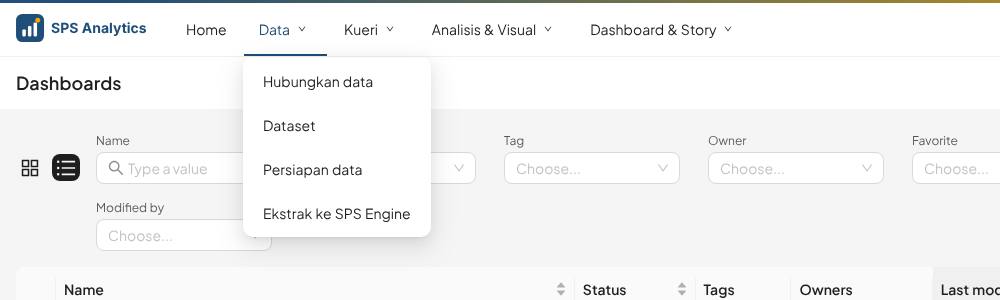
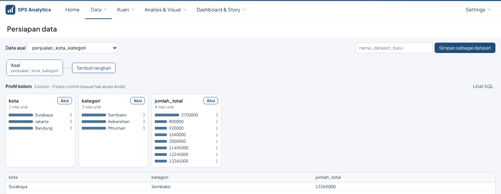
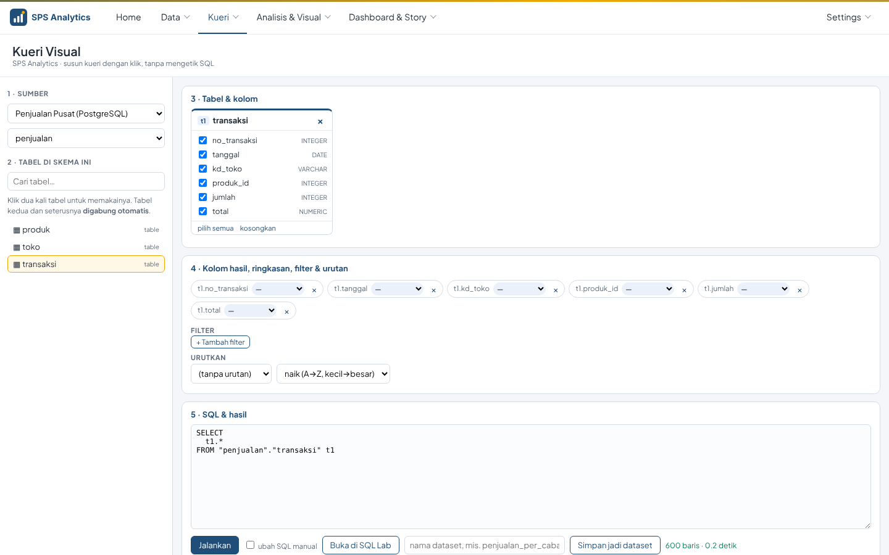
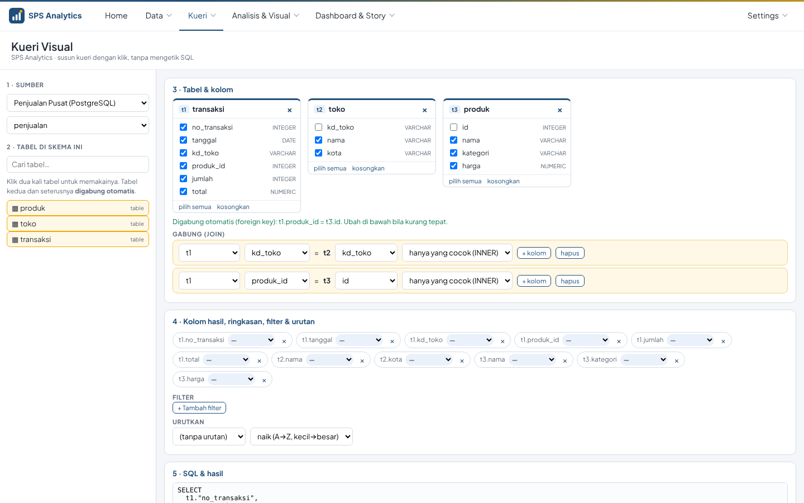
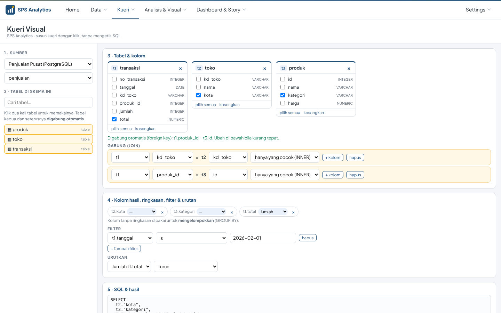
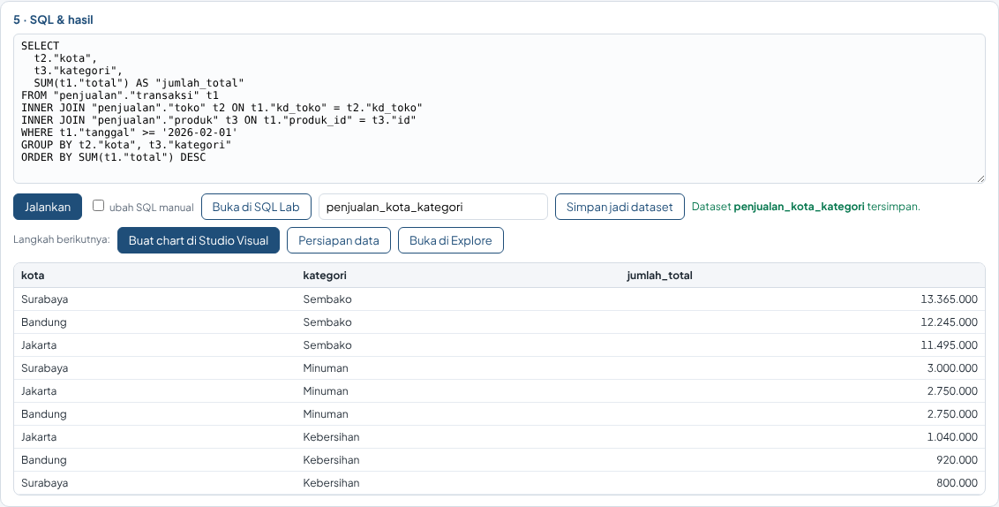
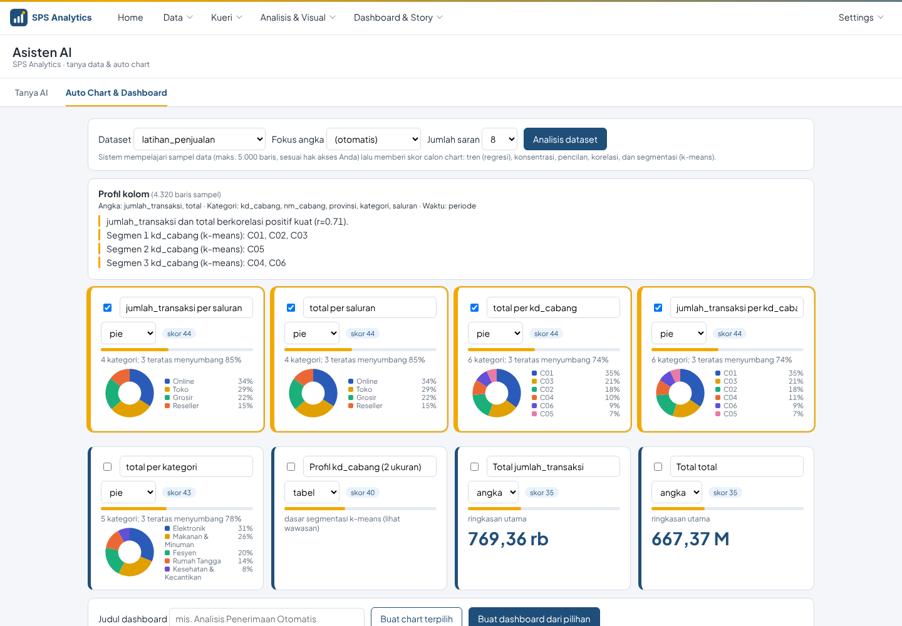
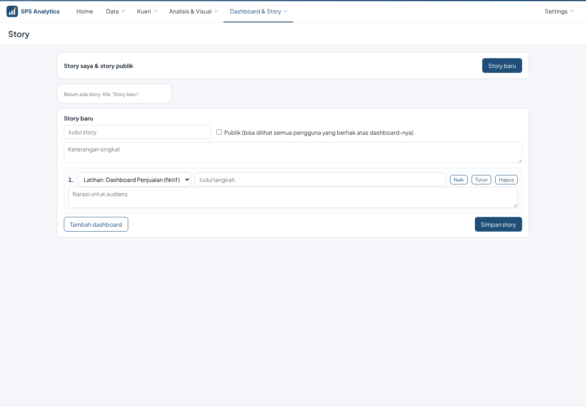

# 21 · Menu Aplikasi & Kueri Visual

Menu aplikasi disusun mengikuti **urutan kerja membuat laporan** , dibaca dari
kiri ke kanan: **Data › Kueri › Visual › Dashboard & Story** (lihat juga [22 · Cangkang aplikasi](22-cangkang-aplikasi.md)).

Prinsipnya: **satu fungsi = satu item menu**. Tidak ada dua menu yang mirip; menu yang fungsinya sudah
tercakup menu lain dipindah ke **Settings** untuk admin.

## 1. Susunan menu

| Menu | Isi | Untuk |
|---|---|---|
| **Data** | Hubungkan data · Dataset · Jejak data · Persiapan data · Ekstrak ke ALDx Engine | menyambung sumber, membuat & membersihkan dataset |
| **Kueri** | **Kueri Visual** (tanpa SQL) · SQL Lab · Kueri tersimpan | mengambil & menggabung tabel |
| **Visual** (+ **Asisten**) | Studio Visual · Daftar chart · Asisten AI | membuat chart & analisis |
| **Dashboard & Story** | Daftar dashboard · Story · Langganan laporan · Peringatan data | melihat, menyusun & membagikan |
| **Settings** (kanan, admin) | Keamanan; Kelola: Pusat Kendali Server, Koneksi database (lanjutan), Riwayat kueri, … | pengelolaan |

Aturan tampil:
- Item hanya tampil bila pengguna **berhak**; kategori tampil bila minimal satu isinya boleh dibuka.
- *Hubungkan data* & *Ekstrak* hanya untuk **Admin**.
- *Kueri Visual* mengikuti izin **SQL Lab** (peran **Analis** atau role `sql_lab`).
- **SQL Lab, seret tabel dari pohon kiri:** ke editor kosong = kueri lengkap `SELECT ... LIMIT 100`; setelah Anda
  mengetik `SELECT * FROM ` atau `JOIN ` = hanya nama tabel yang disisipkan (dirapikan otomatis oleh ALDx).
- *Asisten AI* hanya tampil bila ada **model AI yang aktif** (LM Studio/Ollama menyala, atau key cloud terisi).
  *Story* tetap tampil (narasi AI hanya muncul bila ada model aktif).
- *Koneksi database* (daftar bawaan Superset) dan *Riwayat kueri* ada di **Settings**, karena sudah tercakup
  *Data → Hubungkan data* (daftar "Koneksi tersimpan") dan panel riwayat di SQL Lab.

**Satu tampilan untuk semua halaman.** Semua halaman, baik Superset maupun ALDx, dibuka di **cangkang aplikasi**
dengan sidebar yang sama ([22](22-cangkang-aplikasi.md)). Isi menunya diambil dari Superset sehingga hak akses ikut.
Di dalam halaman hanya ada tab untuk bagian kecil halaman itu. Fungsi yang punya item menu
sendiri tidak tampil lagi sebagai tab: misalnya *Data → Hubungkan data* membuka halaman berjudul
"Hubungkan data" tanpa tab Pusat Kendali, dan *Dashboard & Story → Story* membuka halaman "Story".

## 2. Kueri Visual (Kueri › Kueri Visual)

Menyusun kueri **tanpa mengetik SQL**. Hasilnya bisa dijalankan, dibuka di SQL Lab, atau disimpan
jadi dataset lalu langsung dibuat chart.

| Langkah | Yang dilakukan |
|---|---|
| 1. Sumber | pilih **database** lalu **skema**; hanya tabel di skema itu yang tampil (beda dengan SQL Lab yang menampilkan pohon semua skema). **Dataset virtual** (berbasis SQL) di koneksi & skema itu tampil paling atas bertanda ◇ *virtual* |
| 2. Tabel | **klik dua kali** tabel → kueri langsung dibuat & dijalankan. Dataset virtual dipakai sebagai subkueri `FROM (<SQL dataset>) t1`, jadi bisa digabung dengan tabel lain |
| 3. Gabung | klik dua kali tabel **kedua** → **digabung otomatis** (lihat §3) |
| 4. Kolom | centang/lepas kolom; pilih ringkasan **Jumlah, Rata-rata, Hitung, Hitung unik, Minimum, Maksimum** → otomatis dikelompokkan (GROUP BY) |
| 5. Filter & urutan | sama dengan, lebih dari, memuat teks, salah satu dari, kosong … ; urut naik/turun |
| 6. Hasil | **Jalankan** (maks. 1.000 baris tampil) · **Buka di SQL Lab** · **Simpan jadi dataset** · **Simpan kueri** (buka lagi dari *Kueri tersimpan…*, [26 §6](26-langganan-versi-ponsel-lihat-sebagai.md)) |

Setelah disimpan, muncul tombol langkah berikutnya: **Buat chart di Studio Visual**,
**Persiapan data**, atau **Buka di Explore** (dataset baru langsung terpilih).

**Virtual atau Fisik?** Pilih di sebelah tombol **Simpan jadi dataset**:

| Pilihan | Yang disimpan | Cocok untuk |
|---|---|---|
| **Virtual · selalu terbaru** (bawaan) | SQL-nya saja; setiap chart menjalankan SQL itu ke sumber | data yang sering berubah, kueri ringan |
| **Fisik · tabel ALDx Engine** (Admin) | hasil kueri disalin jadi tabel `ekstrak__<nama>` di ALDx Engine; pilih penyegaran **manual / harian 02.00 / setiap jam** | gabungan besar, dashboard yang harus cepat |

Pilihan Fisik membuat **dua dataset**: `<nama>` (virtual, selalu terbaru) dan `ekstrak__<nama>` (tabel, cepat).
Penyalinan berjalan di latar; kemajuannya tampil di bawah tombol. Jadwal, penyegaran ulang, dan hapus diatur di
**Pusat Kendali › Ekstrak** ([13](13-sps-engine-ekstrak.md)).

### Catatan per database

- **Skema** awal = skema yang dipilih di Hubungkan data → *Atur skema* ([06 §2a](06-sumber-data.md)).
- **Oracle / Snowflake / DB2**: nama tabel & kolom ditulis tanpa kutip (Oracle menyimpannya huruf besar);
  nama berupa kata khusus (mis. `LEVEL`) otomatis dikutip huruf besar. Aturannya dibaca dari `/kueri/api/dialek/<id>`.
- **Oracle 11g**: batas 1.000 baris memakai `ROWNUM`, bukan `FETCH FIRST`.
- **Buka di SQL Lab** membuat tautan permanen SQL Lab (tidak lewat alamat URL panjang).

## 3. Cara gabung otomatis bekerja

Saat tabel baru ditambahkan, sistem mencari kolom penghubung ke tabel yang sudah ada, berurutan:

| Prioritas | Aturan | Contoh |
|---|---|---|
| 1 | **Foreign key** yang tercatat di database | `transaksi.produk_id → produk.id` |
| 2 | pola `<nama_tabel>_id` = `id` | `pelanggan_id` = `pelanggan.id` |
| 3 | kolom **bernama sama** yang mirip kunci (`kd_`, `kode`, `id_`, `no_`, `npwp`, `nip`, `nik`, akhiran `_id`, `_kd`, `_kode`) | `kd_toko` = `kd_toko` |
| 4 | kolom bernama sama lainnya | `kota` = `kota` |

Kolom umum seperti `id`, `nama`, `status`, `tanggal`, `tahun`, `total` **tidak** dipakai untuk menebak.
Jika tidak ada yang cocok, muncul pesan merah: pilih kolom penghubung sendiri di kotak **Gabung**.
Jenis gabung bisa diganti: *hanya yang cocok* (INNER) atau *semua dari kiri* (LEFT). Tombol **+ kolom**
menambah kolom penghubung kedua (kunci gabungan).

> Selalu periksa hasil gabung: jumlah baris yang melonjak berarti kolom penghubungnya kurang tepat.

## 4. Keamanan

- Kueri Visual hanya halaman HTML/JavaScript. Daftar tabel, kolom, dan eksekusi memakai **API resmi
  Superset** (`/api/v1/database`, `/api/v1/sqllab/execute`, `/api/v1/dataset`) sebagai pengguna yang login,
  jadi izin database, SQL Lab, dan **aturan RLS** berlaku sama persis dengan SQL Lab.
- Koneksi dari wizard Hubungkan data selalu **read-only**; Kueri Visual hanya menyusun `SELECT`.
- Menyimpan dataset butuh kemampuan **Kelola dataset**.

## 5. Asisten AI & Story (perubahan)

- Pratinjau **Auto Chart** kini sesuai jenisnya (pie, garis, angka besar, tabel, batang) dan ikut berubah
  bila jenis chart diganti. Dimensi kembar (mis. kode & nama cabang) tidak diusulkan dua kali.

  
- Pilihan dashboard di **Story** hanya dashboard yang **selesai**: sudah berisi chart dan diterbitkan,
  atau milik Anda sendiri (ditandai *draf*).

  

## 6. Untuk pengembang

| Berkas | Isi |
|---|---|
| `config/sps_menu.py` | susunan menu (`SUSUNAN`), menu yang dipindah ke Settings (`KE_PENGATURAN`), izin item tambahan (`IZIN_DASAR`) |
| `config/sps_security.py` → `get_user_menu_access` | memperluas izin menu untuk item & kategori ALDx |
| `config/sps_kueri/` | halaman `/kueri/` (`tampilan.py`, `halaman.html`, `static/kueri.js`) |
| `config/sps_identitas/alur.js` | navbar halaman ALDx (dari `/api/v1/menu/`), tab mandiri (`MANDIRI`), tautan `?tab=` (mis. `/studio/?tab=prep&dataset=12`) |
| `config/sps_ai/status.py` | pemeriksaan model AI aktif (cache 60 detik) |

Menambah item menu: tambahkan baris di `SUSUNAN` (href `None` = memindah menu Superset yang sudah ada);
item baru tanpa izin sendiri didaftarkan di `IZIN_DASAR`.
