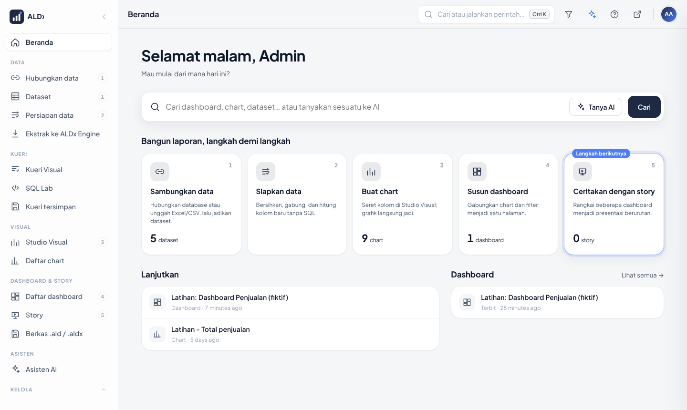
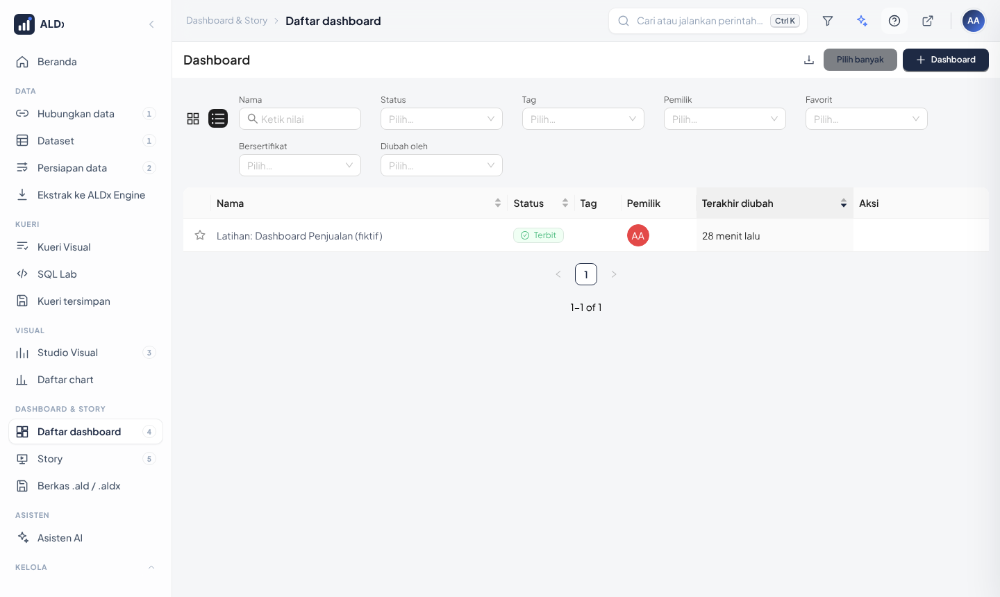
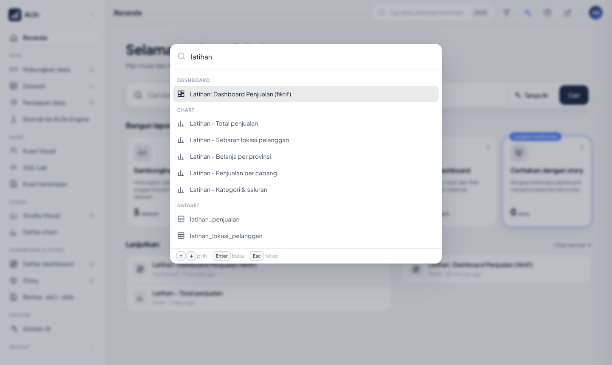
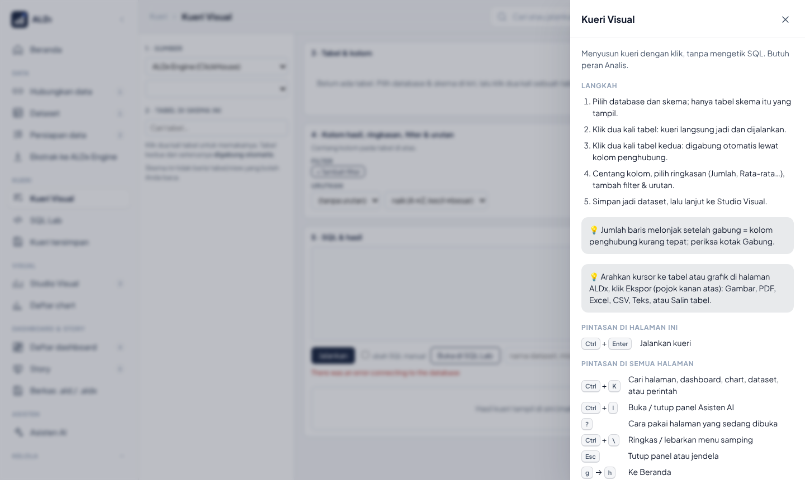
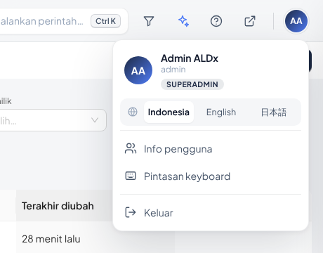
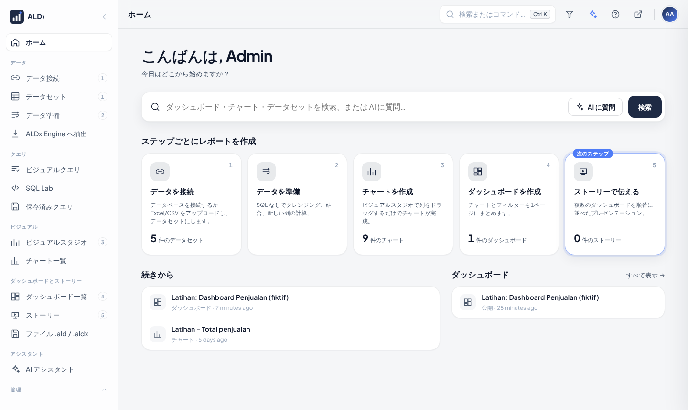
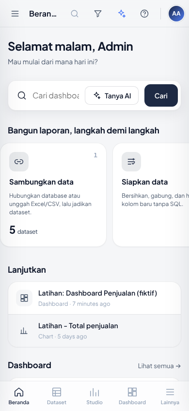
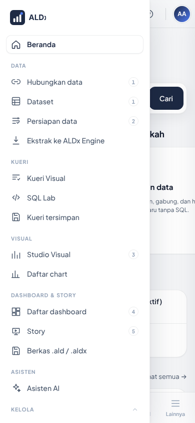
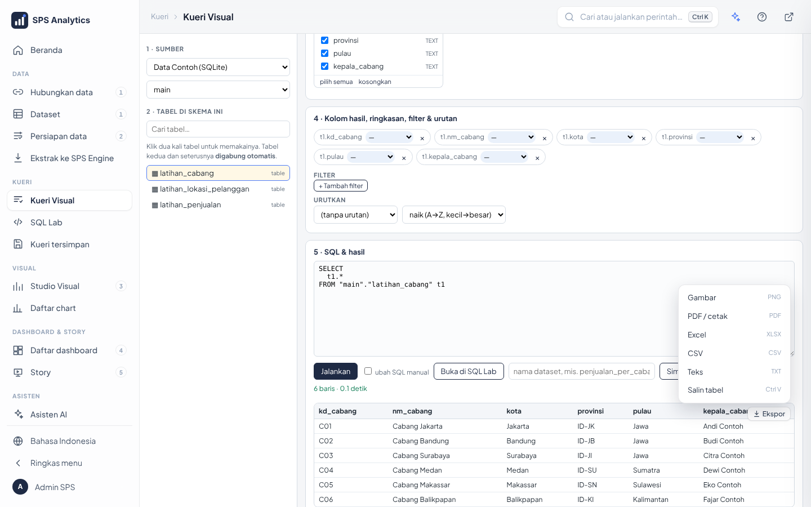

# 22 · Cangkang Aplikasi ALDx (Beranda, navigasi, bahasa, bantuan)

Sejak Tahap 1 desain baru, seluruh aplikasi dibuka di **satu cangkang** di alamat `/app/`. Halaman bawaan
Superset (Explore, SQL Lab, daftar dashboard) dan halaman ALDx (Studio, Kueri Visual, Asisten, Pusat Kendali)
tampil di dalamnya. Navigasi, judul, pencarian, bantuan, dan bahasa sama di semua halaman.

## 1. Arah desain

| Prinsip | Wujud di ALDx |
|---|---|
| Mulai dari pertanyaan | Beranda dibuka dengan kotak **Cari / Tanya AI** |
| Tunjukkan langkah berikutnya | Kartu **Bangun laporan** berisi jumlah & sorotan *Langkah berikutnya* |
| Bantuan di tempat kerja | **Panel Asisten AI** (`Ctrl + I`) dengan peran ahli, lihat [23](23-asisten-ai-peran-ahli.md) |
| Satu pilihan, semua laporan | Filter global dashboard & story ([25](25-berkas-filter-global-ulasan.md)) |
| Nyaman di ponsel | Bilah tab bawah di ponsel, laci menu |
| Semua bisa dari keyboard | **Palet perintah** `Ctrl + K` |

Prinsip visual: tenang dan lega. Abu-abu netral dipadukan dengan satu warna aksen dari Identitas & Tema,
sudut membulat, dan bayangan tipis berlapis. Gerakannya singkat dan halus (160–260 ms), tanpa animasi berulang,
dan otomatis mati bila pengguna memilih *kurangi gerakan* di sistem operasinya. Preset bawaan instalasi baru
bernama **Elegan** (navy `#1E2A44`, biru `#4F7CF7`, latar `#F5F6F8`).

## 2. Susunan layar

| Bagian | Isi |
|---|---|
| **Sidebar** (kiri) | Beranda · Data · Kueri · Visual · Dashboard & Story · Asisten · Kelola. Angka kecil 1–5 = urutan membuat laporan (tampil saat menu disorot/aktif agar tetap bersih). Grup *Kelola* bisa dilipat. *Kelola › Pengguna/Role* membuka halaman pengguna & role versi baru |
| **Bilah atas** | jejak (grup › halaman), **Cari atau jalankan perintah** (`Ctrl + K`), **komentar & rating** (saat dashboard/chart dibuka), **corong** filter global, **✦** Asisten AI (`Ctrl + I`), **?** cara pakai, buka di tab baru ([25](25-berkas-filter-global-ulasan.md)) |
| **Isi** | Beranda dibangun ALDx; halaman lain tampil di bingkai tanpa navbar ganda |
| **Kepala sidebar** | logo + tombol ringkas/lebarkan menu (`Ctrl + \`) |
| **Avatar** (kanan atas) | menu akun: nama & peran, **bahasa** (Indonesia · English · 日本語), **tampilan** (Terang · Gelap · Ikuti sistem), **pemberitahuan** (@sebut & balasan; titik di avatar = belum dibaca), info pengguna, pintasan, keluar |

Hanya menu yang boleh dibuka pengguna yang tampil. Hak aksesnya diambil dari izin Superset.

## 3. Beranda

Urutan Beranda mengikuti cara orang bekerja:

0. **Siapkan ALDx** (khusus Admin): daftar periksa sesudah instalasi dengan cincin progres: *Sambungkan Asisten AI*,
   *Hubungkan data kantor*, *Tambahkan pengguna*, *Pasang nama & logo*, *Jadwalkan cadangan*. Klik satu langkah untuk
   langsung ke tempatnya. Kartu hilang sendiri bila semua selesai, atau sembunyikan dengan ✕.
1. **Cari / Tanya AI**: nama dashboard, chart, dataset; atau pertanyaan untuk Asisten AI (belum tersambung? panel AI membuka layar Sambungkan AI).
2. **Bangun laporan, langkah demi langkah**: *Sambungkan data → Siapkan data → Buat chart → Susun dashboard →
   Ceritakan dengan story*. Setiap kartu menampilkan jumlah yang sudah ada; kartu pertama yang masih 0 ditandai
   **Langkah berikutnya**. Kartu hanya muncul untuk langkah yang boleh dikerjakan pengguna itu.
3. **Lanjutkan**: chart & dashboard yang terakhir dibuka.
4. **Dashboard**: favorit (berbintang) lalu yang terbaru.

## 3b. Panduan di dalam aplikasi

Menu **Asisten › Panduan** (`/panduan/`) menampilkan seluruh dokumentasi ini sebagai situs: sidebar per peran,
**pencarian teks penuh** (tekan `/`), daftar isi halaman, tombol **Salin** di setiap perintah, gambar, dan unduhan PDF.
Tanpa internet dan tanpa hosting terpisah: isinya dibaca langsung dari folder `docs` instalasi (mount hanya-baca),
jadi selalu sama dengan versi yang terpasang.

## 4. Palet perintah, bantuan, dan pintasan

`Ctrl + K` (Mac: `⌘ K`) membuka pencarian halaman, dashboard, chart, dataset, dan perintah (bahasa, ringkas menu,
keluar). Panah ↑ ↓ memilih, `Enter` membuka.

Tombol **?** (atau tekan `?`) membuka **Cara pakai** halaman yang sedang dibuka: langkah, tips, dan pintasan
khusus halaman itu (mis. SQL Lab: `Ctrl + Enter` jalankan, `Ctrl + Shift + F` rapikan SQL).

| Pintasan | Fungsi |
|---|---|
| `Ctrl + K` | Cari & perintah |
| `Ctrl + I` | Buka / tutup panel Asisten AI |
| `?` | Cara pakai halaman ini |
| `Ctrl + \` | Ringkas / lebarkan sidebar |
| `Esc` | Tutup panel |
| `g` lalu `h` / `t` / `k` / `q` / `s` / `c` / `d` / `y` | Ke Beranda / Dataset / Kueri Visual / SQL Lab / Studio / Daftar chart / Daftar dashboard / Story |

Pintasan tetap berfungsi saat kursor berada di dalam halaman, kecuali saat sedang mengetik di kotak isian.

## 5. Bahasa

Klik **avatar** di kanan atas, lalu pilih **Indonesia**, **English**, atau **日本語**. Pilihan disimpan di browser (cookie `sps_bahasa`).

| Bagian | Indonesia | English | 日本語 |
|---|---|---|---|
| Cangkang, Beranda, bantuan | ✔ | ✔ | ✔ |
| Studio, Kueri Visual, Asisten, Pusat Kendali | ✔ (asli) | ✔ kamus ALDx | ✔ kamus ALDx |
| Halaman bawaan Superset | ✔ kamus ALDx (± 470 teks: daftar, Explore & panel data, dashboard, SQL Lab, pengguna/role, database) | ✔ asli Superset | ✔ terjemahan Superset |

Isi data (nama cabang, nilai, judul chart buatan pengguna) tidak pernah diterjemahkan. Teks yang belum ada di
kamus tetap tampil dalam bahasa aslinya. Nama bulan & hari di sumbu chart memakai bahasa Indonesia (`D3_TIME_FORMAT`
di `config/superset_config.py`), format angka 1.234,5.

## 6. Ponsel & tablet

Di layar ≤ 760 px, sidebar menjadi **laci** (tombol ☰), dan muncul **bilah tab bawah**: Beranda, Dataset, Studio,
Dashboard, Lainnya. Tombol komentar, filter global, Asisten & bantuan dikumpulkan di tombol **…** bilah atas agar
judul halaman tidak terpotong. Kartu Beranda bergeser ke samping. Studio Visual menumpuk panelnya ke bawah; di ponsel,
**ketuk dua kali** kolom untuk menambahkannya ke rak. Dashboard di ponsel: panel filter otomatis dilipat
(ketuk ikon filter di kiri untuk membuka) dan chart ditumpuk satu kolom. Kartu *Petunjuk* melipat diri menjadi tombol
💡 setelah beberapa detik.

| Beranda di ponsel | Menu di ponsel |
|---|---|
|  |  |

## 6b. Mode gelap

Avatar › **Tampilan**: *Terang*, *Gelap*, atau *Ikuti sistem* (mengikuti pengaturan Windows/ponsel). Berlaku untuk
cangkang, dashboard, chart, SQL Lab, halaman bawaan Superset, **Panduan**, dan halaman ALDx (Pusat Kendali, Kueri Visual,
Studio, Asisten, Berkas; berganti langsung tanpa muat ulang). Pilihan disimpan di browser. Cocok untuk layar monitor
di ruang pantau.

**Pembaruan tampilan** termuat otomatis setelah server diperbarui: setiap berkas tampilan membawa nomor versi, jadi
tidak perlu menekan `Ctrl + F5`.

## 7. Ekspor: gambar, PDF, Excel, CSV, TXT

Setiap tabel & grafik di halaman ALDx (Kueri Visual, Studio Visual, Persiapan data, Asisten AI, Pusat Kendali)
punya tombol **Ekspor** di pojok kanan atas (muncul jelas saat kursor di atasnya; di ponsel selalu tampil).

| Pilihan | Hasil |
|---|---|
| Gambar | PNG resolusi 2×, seluruh isi (termasuk bagian tabel yang perlu digulir) |
| PDF / cetak | dialog cetak browser → pilih **Simpan sebagai PDF**; tabel dicetak sebagai tabel, grafik sebagai gambar |
| Excel | `.xlsx` dengan judul, waktu ekspor, kepala berwarna, filter, angka tersimpan sebagai **angka** |
| CSV | dipisah koma, UTF-8 (langsung terbaca Excel) |
| Teks | `.txt` dipisah tab |
| Salin tabel | ke clipboard, tempel di Excel dengan `Ctrl + V` |

Nama berkas: `<judul>_<tahun bulan tanggal>_<jam menit>`. Ekspor hanya berisi data yang **sudah tampil**
di layar Anda, jadi hak akses data tetap berlaku. Halaman bawaan Superset memakai menu unduhnya sendiri:
chart › **⋯ › Download** (CSV, Excel, gambar), dashboard › **⋯ › Download** (PDF, gambar).

Untuk pengembang: beri atribut `data-ekspor="Judul"` pada pembungkus tabel/grafik, lalu muat
`/app/static/ekspor.js`. Data mentah (lebih akurat dari teks layar) bisa dipasang dengan
`SPS.ekspor.data(elemen, {kolom, baris})`. Excel dibuat server (`POST /app/api/ekspor`, `sps_app/ekspor.py`).

## 8. Alamat & tautan

| Alamat | Hasil |
|---|---|
| `/` | Beranda di `/app/` (atau halaman depan pilihan admin) |
| `/app/?p=/dashboard/list/` | halaman itu di dalam cangkang; bisa dibagikan |
| alamat lama (mis. `/superset/dashboard/latihan/`) dibuka langsung | otomatis dialihkan ke `/app/?p=...` |
| tambah `?sps_bebas=1` | membuka halaman tanpa cangkang (untuk pemecahan masalah) |

## 9. Untuk pengembang

| Berkas | Isi |
|---|---|
| `config/sps_app/tampilan.py` | blueprint `/app`, pengalihan halaman lama, penyisipan `bingkai.js` |
| `config/sps_app/halaman.html`, `static/app.css` | kerangka & design system (token warna, radius, bayangan, gerak, responsif) |
| `static/app.js` | daftar menu `NAV` (urutan, ikon, izin), bingkai, palet, pintasan, bantuan, bahasa |
| `static/beranda.js` | Beranda |
| `static/bingkai.js` | di setiap halaman dalam bingkai: sembunyikan navbar lama, lapor alamat & judul, teruskan pintasan, tab mandiri, terjemahan |
| `static/i18n.js` | `SPS.i18n.t()`, penerjemah DOM; kamus di `static/bahasa/*.json` |
| `terjemahan.py` | sumber kamus (Indonesia → English, 日本語; Superset Inggris → Indonesia). Jalankan `python config/sps_app/terjemahan.py` setelah mengubah |
| `static/bantuan/{id,en,ja}.json` | isi panel **Cara pakai** per halaman |
| `static/ai.js` | panel Asisten AI (lihat [23](23-asisten-ai-peran-ahli.md)) |
| `static/ekspor.js`, `ekspor.py`, `static/vendor/html-to-image.js` (MIT) | tombol Ekspor |

Menambah halaman ke menu: tambahkan satu baris di `NAV` (`app.js`), isi bantuannya di `bantuan/*.json`,
lalu tambahkan teksnya di `terjemahan.py`.
