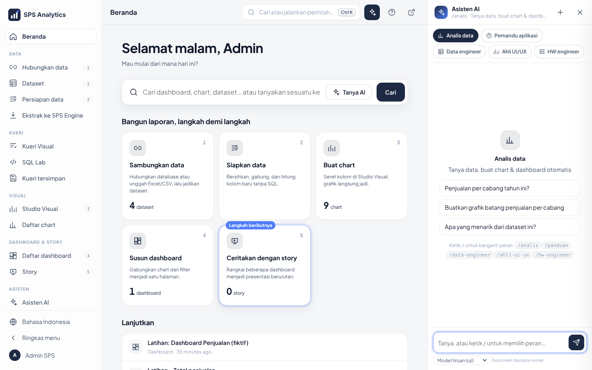
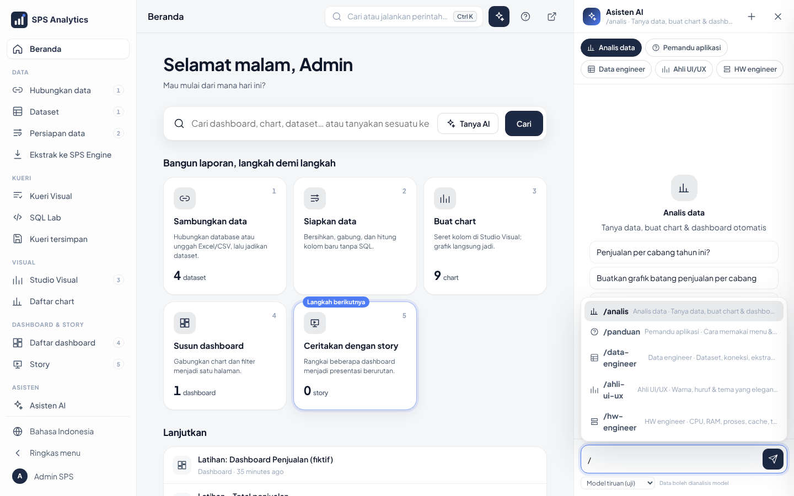
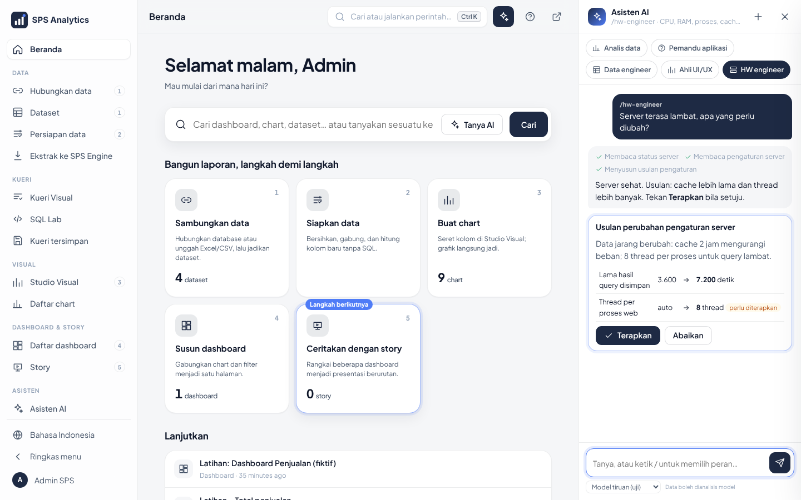
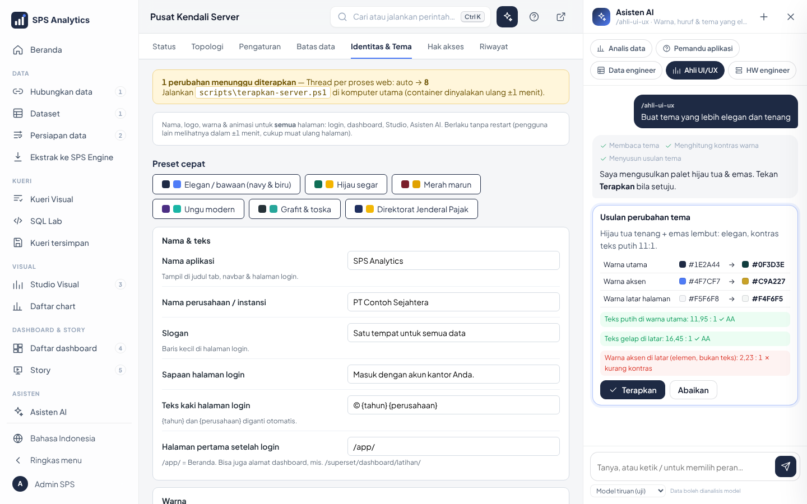

# 23 · Asisten AI di Setiap Halaman (Peran Ahli)

Asisten AI kini ada di **semua halaman**: panel di sisi kanan. Pilih **peran ahli**
sesuai pekerjaan: analis data, pemandu aplikasi, data engineer, ahli UI/UX, atau HW engineer.

## 1. Membuka panel

| Cara | Keterangan |
|---|---|
| Tombol **✦** di bilah atas | muncul bila Anda boleh memakai Asisten AI. Belum ada model aktif? Panel menampilkan layar **Sambungkan AI** ([28](28-sambungkan-asisten-ai.md)) |
| Ikon **sambung** (🔗) di kepala panel | buka layar Sambungkan AI: status model lokal, key cloud (Admin) |
| `Ctrl + I` | buka / tutup panel (juga saat kursor ada di dalam halaman) |
| Beranda › **Tanya AI** | pertanyaan dari kotak Cari langsung dikirim ke panel |

Di layar lebar (≥ 1280 px) panel menempel di kanan dan halaman menyempit. Di laptop kecil panel melayang,
di ponsel panel memenuhi layar.

## 1b. Asisten paham isi aplikasi & halaman yang dibuka

Asisten tidak perlu diberi tahu nama tabel atau id. Setiap pertanyaan otomatis disertai:

| Yang diketahui | Isinya | Contoh pertanyaan |
|---|---|---|
| **Peta isi aplikasi** | dataset (kolom & metrik utama), dashboard (chart di dalamnya), chart lain; **hanya yang boleh Anda akses** | dari Beranda: *"Cabang mana yang penjualannya paling tinggi?"* |
| **Halaman yang sedang dibuka** | dashboard: semua chart, metrik, pengelompokan, filter, **beserta angkanya**; chart: rinciannya & angkanya; dataset: kolomnya | di dashboard: *"Jelaskan dashboard ini dan temuan utamanya"* |
| **Teks di layar** | potongan tulisan yang tampil di halaman (maks. ±2.000 huruf) | *"Apa arti angka di kartu kanan atas?"* |

Alat tambahan peran `/analis`: **info_dashboard**, **info_chart**, dan **data_chart** (menjalankan ulang query
chart dengan hak akses Anda).

**Privasi.** Angka chart dan teks layar hanya dikirim ke model yang boleh menerima data (`kirim_data: true`,
bawaan untuk model lokal). Model cloud (`kirim_data: false`) hanya menerima nama dataset, kolom, dan judul chart,
lalu angkanya ditampilkan langsung ke Anda tanpa lewat model.

**Kecepatan.** Model lokal kecil (4B) tanpa GPU butuh ±1–3 menit untuk pertanyaan yang memakai beberapa alat. Di halaman
dashboard, angka sudah disertakan sehingga biasanya cukup satu langkah. Untuk jawaban cepat, pakai model 8B+ dengan GPU atau
layanan cloud ([28](28-sambungkan-asisten-ai.md)). Bila sering melewati batas waktu, naikkan `batas_detik_lokal` (model lokal, bawaan 240 dtk)
atau `batas_detik_model` (cloud, 120 dtk) di `config\ai.yaml`.

## 2. Peran ahli

Pilih dengan **chip** di atas obrolan, atau ketik **`/`** lalu nama peran (panah ↑ ↓, `Enter`).

| Perintah | Peran | Bisa apa | Siapa |
|---|---|---|---|
| `/analis` | Analis data | tanya data, ambil angka, buat chart & dashboard | semua pengguna Asisten AI |
| `/panduan` | Pemandu aplikasi | menjelaskan cara memakai menu & pintasan (dari isi panel **?**) | semua pengguna Asisten AI |
| `/data-engineer` | Data engineer | dataset, koneksi, ekstrak, batas data, menulis SQL sesuai dialek, cek kualitas data | Analis (SQL Lab) atau Admin |
| `/ahli-ui-ux` | Ahli UI/UX | menilai & mengusulkan warna, huruf, tema; cek kontras WCAG | Admin |
| `/hw-engineer` | HW engineer | membaca status CPU/RAM/proses/cache, mengusulkan pengaturan server | Superadmin |

Peran yang tidak boleh untuk akun Anda tidak tampil. Bila panel dibuka di halaman tertentu, peran awalnya
menyesuaikan: Pusat Kendali › Status/Pengaturan/Batas data → `/hw-engineer`; Identitas & Tema → `/ahli-ui-ux`;
Dataset, Hubungkan data, Ekstrak, Kueri Visual, SQL Lab, Persiapan data → `/data-engineer`; selain itu `/analis`.

Contoh: `/hw-engineer server terasa lambat, apa yang perlu diubah?`

## 3. Usulan & tombol Terapkan

Peran yang bisa mengubah sesuatu (`/ahli-ui-ux`, `/hw-engineer`) **tidak pernah mengubah sendiri**. Peran itu
membuat **kartu usulan**: nilai lama → nilai baru, alasan, dan (untuk tema) hasil cek kontras.

| Usulan pengaturan server | Usulan tema |
|---|---|
|  |  |

- **Terapkan** mengirim perubahan lewat API yang sama dengan Pusat Kendali, jadi hak akses Anda diperiksa lagi.
- **Abaikan** = tidak ada yang berubah.
- Pengaturan berlabel *perlu diterapkan* baru aktif setelah `scripts\terapkan-server.ps1` (restart container).
- Cek kontras: teks ≥ 4,5 : 1 (WCAG AA); elemen non-teks seperti sorotan & garis fokus ≥ 3 : 1.
- Setiap perubahan tercatat di Pusat Kendali › **Riwayat** atas nama Anda.

## 4. Keamanan & privasi

| Aturan | Cara |
|---|---|
| Hak akses tetap berlaku | semua alat berjalan sebagai pengguna yang login; data tetap disaring RLS |
| Alat dibatasi per peran | model hanya diberi alat milik peran itu; alat lain ditolak server |
| Model cloud tanpa data | `kirim_data: false` di `config/ai.yaml`: angka hasil kueri tidak dikirim ke model, hanya tampil di layar |
| Konfigurasi bukan data pajak | `/ahli-ui-ux` & `/hw-engineer` hanya membaca tema & pengaturan server, bukan data pegawai/wajib pajak |
| Tanpa rahasia | password, API key, dan `.env` tidak pernah dibaca alat mana pun |
| Audit | setiap pertanyaan tercatat di tabel `sps_ai_log` dengan awalan peran, mis. `[/hw-engineer] ...` |

## 5. Untuk pengembang

| Berkas | Isi |
|---|---|
| `config/sps_ai/peran.py` | daftar `PERAN` (id, nama, syarat, alat, instruksi) + alat ahli & pelaksananya |
| `config/sps_ai/agen.py` | putaran agen; instruksi umum + instruksi peran; alat dipilih per peran |
| `config/sps_ai/tampilan.py` | `GET /asisten/api/peran`, `POST /asisten/api/chat {riwayat, peran, konteks, model}` |
| `config/sps_app/static/ai.js` | panel di cangkang: chip peran, saran `/`, kartu usulan, tabel dengan tombol Ekspor |

Menambah peran: tambah satu `Peran(...)` di `PERAN`, tulis definisi alatnya di `ALAT_AHLI` dan pelaksananya di
`jalankan()`, lalu tambahkan teksnya di `config/sps_app/terjemahan.py` (EN/JA). Uji otomatis
"Peran Asisten AI & alatnya lengkap" memastikan semua alat peran terdaftar.

Halaman **Asisten AI** lama (`/asisten/`, dengan tab Auto Chart & Story) tetap ada untuk pekerjaan panjang.
Lihat juga [10-asisten-ai.md](10-asisten-ai.md) (memasang model, `ai.yaml`) dan [20-model-ai-lokal.md](20-model-ai-lokal.md).
