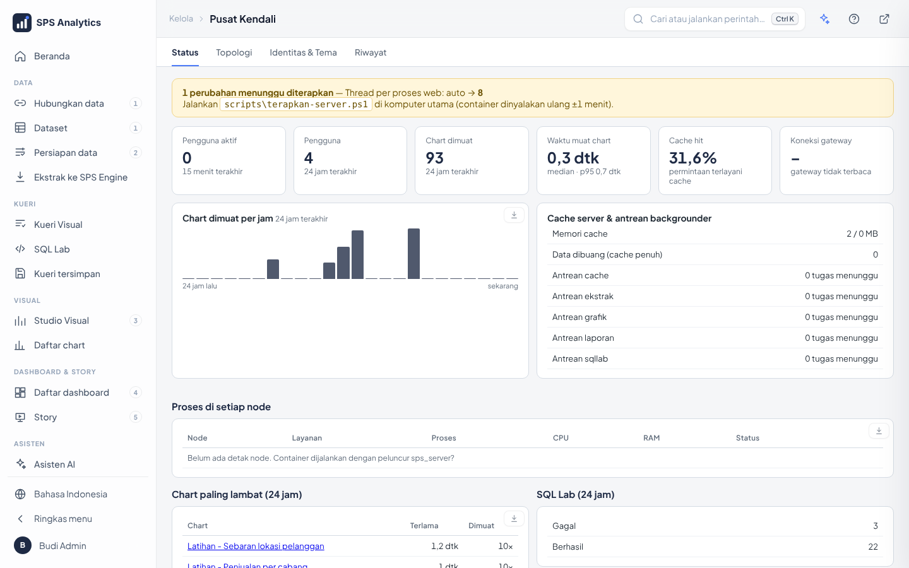
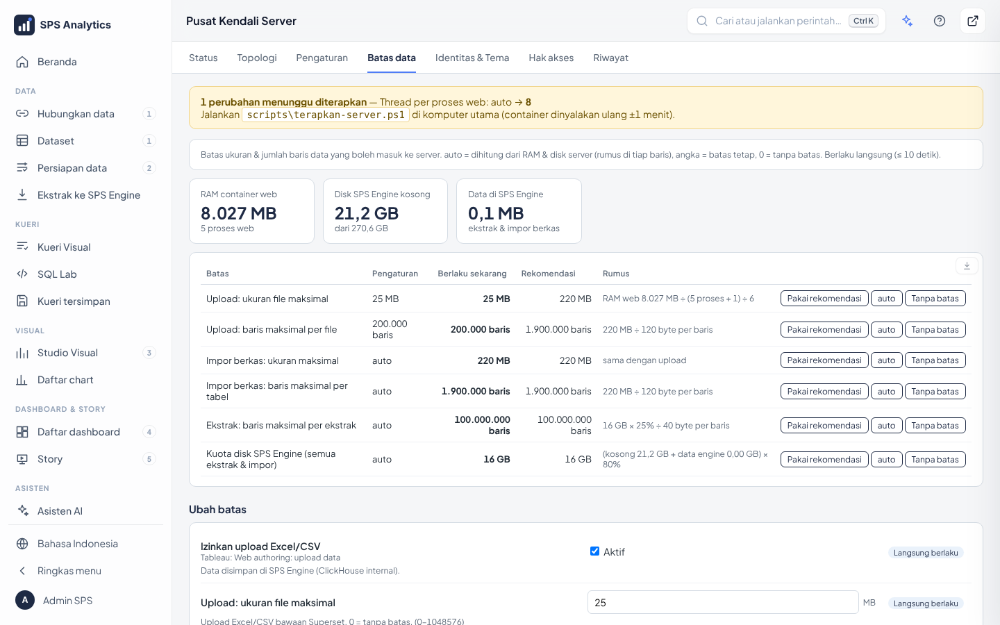

# 24 · Superadmin & Batas Data

## 1. Superadmin: satu tingkat di atas Admin

| Role | Boleh |
|---|---|
| **Superadmin** | semua milik Admin **+ pengaturan vital**: Pusat Kendali › Pengaturan, **Batas data**, Hak akses, hapus node, peran AI `/hw-engineer`, memberi/mencabut role Superadmin, **Moderasi ulasan** (komentar & rating, [25 §3](25-berkas-filter-global-ulasan.md)) |
| Admin | kelola pengguna, koneksi & ekstrak, Identitas & Tema, lihat Status/Topologi/Riwayat |
| Analis / Pengguna | tidak berubah |

Tab vital **tidak tampil** untuk Admin biasa, dan API-nya menolak (403):

**Siapa Superadmin?**

- Akun **Superadmin dari installer** (halaman 3: email & password, `ADMIN_USERNAME` di `.env`) otomatis menjadi Superadmin.
  Akun ini akun lokal: login dengan email, tetap bisa masuk walau LDAP mati. Instalasi lama: akun lokal `admin`.
- **Login LDAP, opsional**: isi `SPS_SUPERADMIN_USERS=` di `.env` dengan username jaringan, pisah koma, mis.
  `SPS_SUPERADMIN_USERS=060110956`. Orang itu otomatis mendapat role **Admin + Superadmin** setiap kali login
  (dan saat `build-dashboards`). Di installer: halaman *Login kantor* → *Username yang jadi Superadmin*.
  Setelah mengubah `.env`: `docker compose up -d` (bukan `restart`, karena `restart` tidak membaca ulang `.env`),
  lalu **keluar & login lagi**.
- Superadmin lain dibuat dari installer (peran **Superadmin**), atau oleh Superadmin di **Kelola › Pengguna**
  (centang role `Admin` + `Superadmin`).
- Admin biasa **tidak bisa** memberi dirinya role Superadmin, mengubah role itu, atau mengubah akun Superadmin.
  Penjaga ada di `config/sps_superadmin.py` (memeriksa semua `POST/PUT/DELETE /api/v1/security/...`).
- **Akun Superadmin terkunci** karena salah password berulang: dibuka Superadmin lain di Pusat Kendali › Riwayat,
  tunggu kuncinya habis (bawaan 15 menit), atau darurat `scripts\buka-kunci.ps1 -Akun <email>` ([14 §4.5](14-akun-dan-akses.md)).
- **Pengaman terkunci**: bila tidak ada satu pun Superadmin aktif (mis. akunnya dinonaktifkan), semua Admin
  sementara diperlakukan sebagai Superadmin, jadi pengaturan vital tidak pernah hilang aksesnya.

## 2. Batas data

Pusat Kendali › **Batas data** (khusus Superadmin) mengatur berapa besar data yang boleh masuk ke server.

| Batas | Berlaku untuk | Bawaan |
|---|---|---|
| Upload: ukuran file maksimal (MB) | upload Excel/CSV bawaan Superset | 25 |
| Upload: baris maksimal per file | idem | 200.000 |
| Impor berkas: ukuran maksimal (MB) | Data › Hubungkan data › Berkas (Excel, CSV, Access, SQLite, ...) | auto |
| Impor berkas: baris maksimal per tabel | idem | auto |
| Ekstrak: baris maksimal per ekstrak | Ekstrak ke ALDx Engine (penuh & inkremental, dihitung total) | auto |
| Kuota disk ALDx Engine (GB) | semua ekstrak & impor berkas | auto |

Setiap batas bisa diisi:

- **angka** = batas tetap
- **`auto`** = dihitung dari perangkat server (lihat rumus)
- **`0`** = **tanpa batas** (dilepas)

Tombol cepat di setiap baris: **Pakai rekomendasi**, **auto**, **Tanpa batas**, lalu **Simpan perubahan**.
Berlaku langsung (≤ 10 detik), tanpa restart.

### Rumus rekomendasi

| Rekomendasi | Rumus | Alasan |
|---|---|---|
| Ukuran berkas (MB) | RAM container web ÷ (proses web + 1) ÷ 6 | membaca Excel/CSV ke memori butuh ±5–6× ukuran berkas |
| Baris berkas | ukuran MB × 1.048.576 ÷ 120 | ±120 byte per baris CSV |
| Kuota ALDx Engine (GB) | (disk kosong + data engine) × 80% | sisakan 20% disk untuk sistem & penggabungan data |
| Baris per ekstrak | kuota × 25% ÷ 40 | satu ekstrak maks. ¼ kuota; ±40 byte/baris setelah kompresi ClickHouse |

Contoh server uji (RAM web 8 GB, 5 proses): berkas **220 MB**, **1,9 juta** baris; kuota **16 GB**,
**100 juta** baris per ekstrak. Angka berubah sendiri bila RAM/disk server berubah (selama `auto`).

### Bila batas terlampaui

| Kejadian | Hasil |
|---|---|
| Berkas lebih besar dari batas | ditolak saat diunggah, pesan menyebut ukuran & batasnya |
| Tabel berkas / ekstrak melebihi baris | dihentikan; tabel sementara dihapus, **data lama tetap utuh** |
| Kuota ALDx Engine penuh | impor & penyegaran ekstrak ditolak sampai ada ruang atau kuota dinaikkan |

`SPS_IMPOR_MAKS_MB` di `.env` (versi lama) masih dihormati sebagai nilai awal; selanjutnya atur di tab ini.

## 3. Untuk pengembang

| Berkas | Isi |
|---|---|
| `config/sps_superadmin.py` | `adalah()`, dekorator `khusus()`, penjaga API keamanan, `siapkan()` |
| `config/sps_server/batas.py` | perangkat, rumus `rekomendasi()`, `berlaku()`, `batasi_baris()`, `periksa_kuota_engine()` |
| `config/sps_server/skema.py` | grup pengaturan `data` (Batas data) |
| `sps_koneksi/impor.py`, `sps_engine/ekstrak.py` | memakai batas saat impor & ekstrak |
