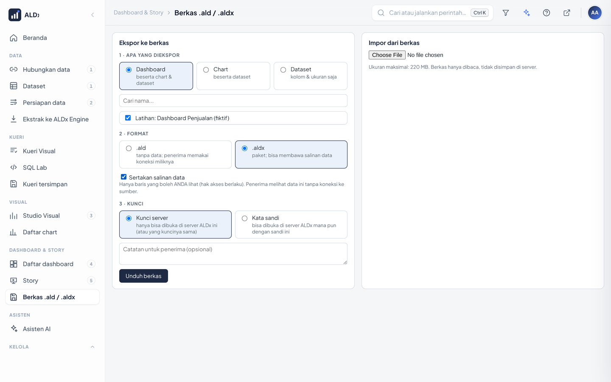
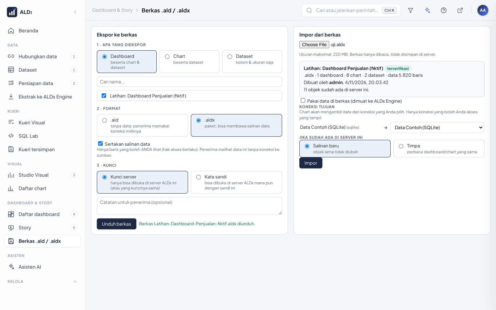
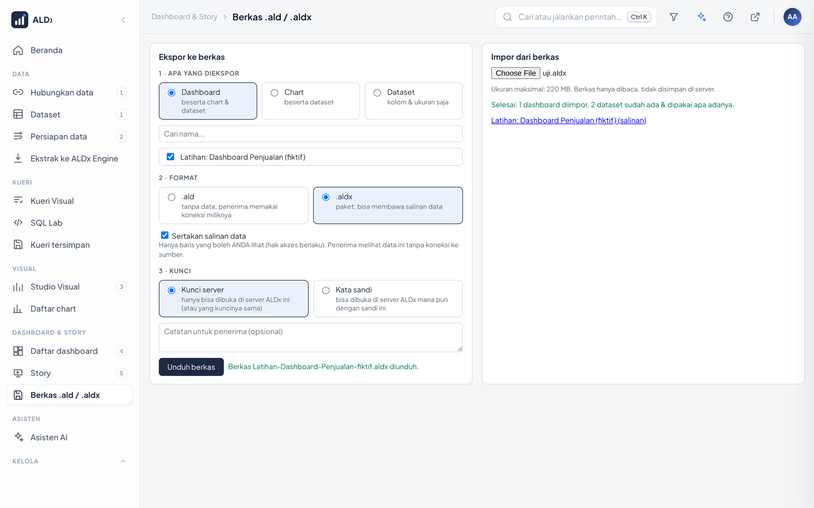
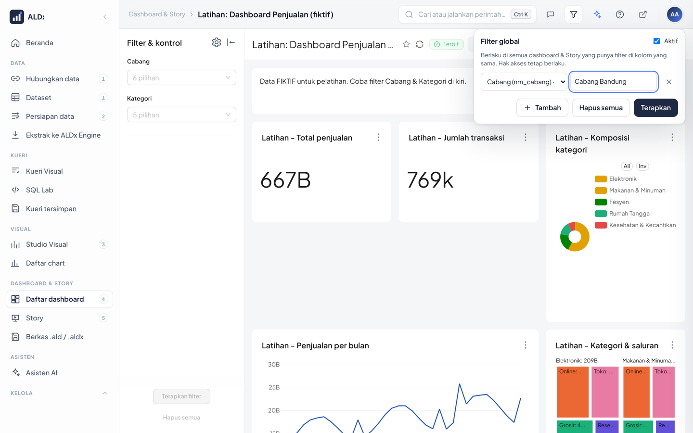
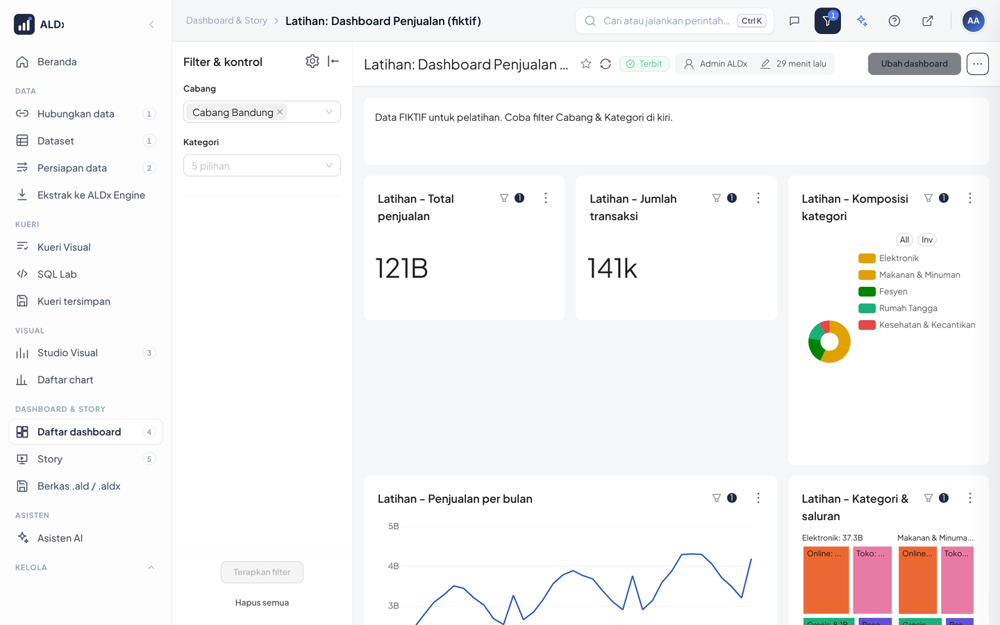
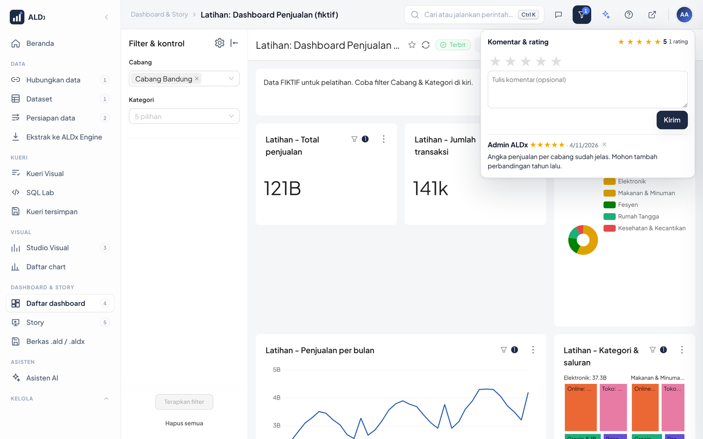
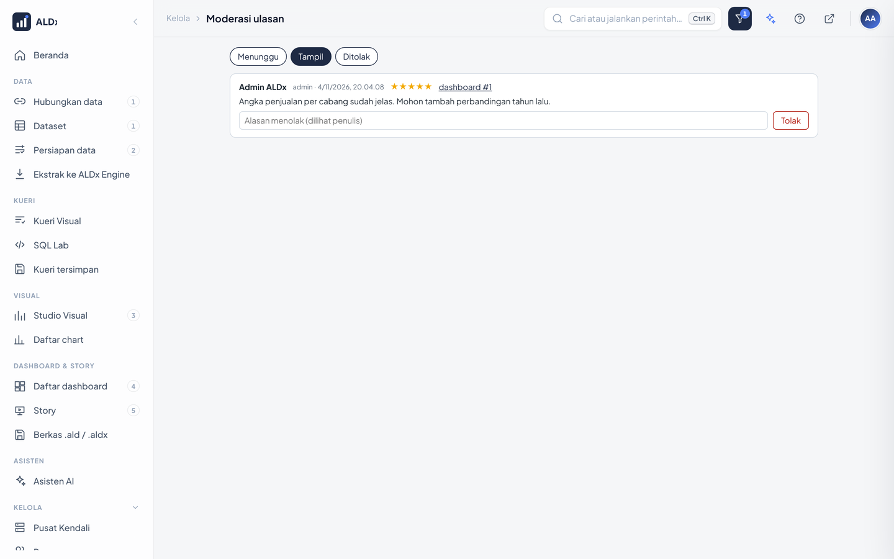

# 25 · Berkas .ald/.aldx, Filter Global, Komentar & Rating

Tiga fitur untuk berbagi dan berkolaborasi:

| Fitur | Untuk |
|---|---|
| Berkas **.ald** | menyimpan & berbagi definisi dashboard/chart/dataset, **tanpa data** |
| Berkas **.aldx** | paket: definisi + (opsional) **salinan data** |
| **Filter global** | satu filter (mis. Cabang) berlaku di semua dashboard & Story |
| **Komentar & rating** | masukan pengguna, dimoderasi Superadmin |

## 1. Berkas .ald / .aldx

Menu: **Dashboard & Story › Berkas .ald / .aldx** (`/berkas/`).



### 1a. Ekspor

1. Pilih **apa** yang diekspor: Dashboard (beserta chart & dataset), Chart (beserta dataset), atau Dataset.
2. Centang satu atau beberapa objek. Hanya objek yang boleh Anda lihat yang tampil.
3. Pilih **format**:
   - `.ald` tanpa data. Penerima memakai koneksi database miliknya sendiri.
   - `.aldx` paket. Centang **Sertakan salinan data** bila dashboard harus jalan tanpa koneksi ke sumber.
4. Pilih **kunci**:
   - **Kunci server**: hanya bisa dibuka di server ALDx ini (atau server lain dengan `SPS_KUNCI_BERKAS` sama).
   - **Kata sandi** (minimal 8 karakter): bisa dibuka di server ALDx mana pun. Sandi tidak disimpan; lupa sandi = berkas tidak bisa dibuka.
5. **Unduh berkas**. Berkas `.aldx` **berisi data** disiapkan oleh backgrounder (bila menyala): pesan *disiapkan di
   latar belakang* muncul dan Anda boleh pindah halaman. Unduh dari bagian **Ekspor terakhir** setelah statusnya
   *siap* (tersedia 24 jam, hanya untuk Anda). Tanpa backgrounder, berkas dibuat langsung.

Hasil AI juga bisa disimpan: kartu dashboard/chart buatan Asisten AI punya tautan **Simpan sebagai berkas .ald / .aldx**.

### 1b. Impor



1. Pilih berkas. Bila dikunci sandi, isi sandinya lalu **Buka**.
2. Periksa ringkasan: judul, isi, pembuat, tanggal, dan lencana:
   - **terverifikasi** = dibuat di server ini / organisasi dengan kunci sama;
   - **dari server lain** = berkas sah (sandi benar) tetapi dibuat di luar.
3. Berkas berisi data: centang **Pakai data di berkas** → data dimuat ke ALDx Engine; tidak perlu koneksi tujuan.
   Hanya peran yang diizinkan (bawaan **Admin**; Superadmin selalu) yang bisa mencentang ini. Peran lain tetap bisa
   mengimpor definisinya dengan koneksi tujuan miliknya.
4. Tanpa data: pilih **koneksi tujuan** untuk setiap koneksi asal. Hanya koneksi yang boleh Anda akses yang tampil.
5. **Jika sudah ada**: *Salinan baru* (bawaan, objek lama tidak diubah) atau *Timpa* (perbarui dashboard/chart dengan UUID sama).
6. **Impor** → klik nama hasil untuk membukanya.



Dataset yang tabelnya **sudah terdaftar** di koneksi tujuan dipakai apa adanya (tidak diubah, tidak diduplikasi).

### 1c. Keamanan berkas

| Aturan | Cara |
|---|---|
| Isi tidak bisa dibaca tanpa kunci | AES-256-GCM; kunci server (HKDF dari `SPS_KUNCI_BERKAS`/`SUPERSET_SECRET_KEY`) atau sandi (scrypt) |
| Berkas yang diubah ditolak | kepala & isi diautentikasi; tanda HMAC-SHA256 kunci server |
| Tanpa rahasia koneksi | alamat server, nama user, dan password koneksi **tidak pernah** ikut |
| Data sesuai hak akses | salinan data diambil **sebagai pembuat**: RLS berlaku, hanya baris yang boleh ia lihat |
| Izin | ekspor butuh izin *export*; impor butuh izin *write* (Dashboard/Chart/Dataset) |
| Batas | Pusat Kendali › Pengaturan: **Berkas .aldx boleh membawa data** (bawaan ya), **baris maksimal per dataset** (bawaan 100.000), **Berkas .ald/.aldx: ukuran maksimal** (bawaan 100 MB; membuka berkas butuh ± 3× ukurannya di RAM) |
| Siapa boleh memuat data | Pusat Kendali › Pengaturan › Batas data: **Peran yang boleh memuat data dari berkas .aldx** (bawaan Admin) |
| Data impor tertutup dulu | dataset hasil data `.aldx` otomatis diberi aturan hak akses data **"ALDx berkas: … (khusus <pengimpor>)"**: hanya pengimpor & Admin yang melihat barisnya |
| Jejak | setiap ekspor/impor tercatat di **jejak audit** (Pusat Kendali › Riwayat) dan log server (`ALDx berkas: ...`) |

> Data di `.aldx` adalah data milik **pembuat**. Setelah impor, datanya hanya terlihat oleh pengimpor & Admin.
> **Membagikan**: Admin membuka Kelola › Hak akses data, cari aturan `ALDx berkas: <tabel> (khusus …)`, lalu
> ubah klausanya sesuai siapa yang boleh melihat (atau hapus aturannya bila datanya boleh dilihat semua yang berhak).

Berbagi antar-server dengan kunci server: isi `SPS_KUNCI_BERKAS` yang **sama** di `.env` kedua server, lalu
`docker compose up -d`. Tanpa itu, pakai kunci kata sandi.

### 1d. Isi berkas (untuk pengembang)

```
"ALDX" 0x01 | panjang kepala (4 byte) | kepala JSON (terbuka) | isi AES-256-GCM | HMAC-SHA256 (32 byte)
isi = ZIP:
  manifest.json                  judul, jenis, pembuat, koneksi (nama & jenis saja), dataset, jumlah baris
  superset/metadata.yaml         ekspor resmi Superset (tanpa folder databases/)
  superset/dashboards|charts|datasets/*.yaml
  data/<uuid dataset>.parquet    hanya .aldx dengan data
```

## 2. Filter global

Tombol **corong** di bilah atas. Angka di tombol = jumlah filter global yang aktif.



1. **Tambah** → pilih kolom (daftar diambil dari filter dashboard yang boleh Anda lihat) → isi nilainya:
   - kolom *pilihan* (mis. Cabang): klik kotak nilai → **pilih dari daftar** (bisa dicari sambil mengetik) atau ketik
     lalu **Enter**. Setiap nilai jadi chip; × mencabutnya, Backspace di kotak kosong mencabut chip terakhir.
     Daftar nilai mengikuti hak akses & RLS Anda;
   - kolom *rentang* (filter angka, mis. Tahun): **dari** – **sampai** (salah satu boleh kosong);
   - **Rentang waktu** (filter waktu dashboard): 30 hari terakhir, 3 bulan terakhir, … atau *Tanggal tertentu*
     `2025-01-01 : 2025-12-31`.
2. **Terapkan**. Dashboard yang sedang dibuka dimuat ulang dengan filter itu.
3. Setiap dashboard lain, termasuk dashboard di halaman **Story**, otomatis memakai nilai yang sama **bila** dashboard
   itu punya filter di kolom bernama sama (filter pilihan, rentang angka, atau rentang waktu).
4. Matikan dengan centang **Aktif**, atau **Hapus semua**.
5. **Kecualikan dashboard ini**: saat sebuah dashboard terbuka, centang ini → dashboard itu selalu tampil tanpa filter
   global (mis. dashboard ringkasan nasional). Hapus centang untuk memakainya lagi.

**Chip di bilah atas** (layar ≥ 1280 px): filter yang aktif tampil di sebelah tombol corong, mis. `Elektronik ×`.
Arahkan kursor untuk melihat nama kolomnya; klik chip untuk membuka panel; × mencabut filter itu dan memuat ulang
dashboard. Di dashboard yang dikecualikan, chip tampak redup dengan catatan *dikecualikan*.



Catatan:
- Filter global disimpan **di akun Anda**: ikut ke komputer & ponsel lain.
- Kolom angka (mis. `tahun`) otomatis dicocokkan sebagai angka.
- Filter global hanya mempersempit data. Hak akses & RLS tetap berlaku.
- Filter yang Anda ubah sendiri di dashboard tidak ditimpa sampai dashboard dibuka ulang.

## 3. Komentar & rating

Tombol **komentar** muncul di bilah atas saat dashboard atau chart dibuka.



- Beri **1–5 bintang** dan/atau komentar, lalu **Kirim**.
- Rata-rata memakai rating **terakhir** tiap pengguna.
- Bila moderasi aktif (bawaan), komentar Anda berstatus *menunggu persetujuan* dan hanya terlihat oleh Anda
  & Superadmin. Komentar yang ditolak menampilkan alasannya kepada penulis.
- Penulis bisa menghapus komentarnya sendiri. Superadmin bisa menghapus komentar siapa pun.
- **Balas** di bawah komentar untuk menjawabnya (satu tingkat). Ketik **@** lalu nama untuk menyebut seseorang
  (muncul saran nama).
- Orang yang disebut, dan penulis komentar yang dibalas, mendapat **pemberitahuan** di menu akun (titik di avatar)
  saat komentar itu tampil.

### Moderasi (Superadmin)

Menu **Kelola › Moderasi ulasan** (`/ulasan/moderasi/`), tab *Menunggu / Tampil / Ditolak*.



- Setiap kartu menampilkan **judul** dashboard/chart. Centang beberapa (atau **Pilih semua**) lalu **Tampilkan
  terpilih** / **Tolak terpilih** untuk memproses sekaligus.
- Jumlah yang menunggu tampil sebagai lencana di menu Moderasi ulasan dan titik di avatar Superadmin.
- **Tampilkan**: terlihat semua yang boleh membuka dashboard/chart itu.
- **Tolak**: isi alasan (dilihat penulis).
- Matikan moderasi: Pusat Kendali › Pengaturan › **Komentar perlu disetujui Superadmin**.
- Komentar Superadmin langsung tampil.

## 4. Untuk pengembang

| Berkas | Isi |
|---|---|
| `config/sps_berkas/sandi.py` | format biner, enkripsi, tanda tangan |
| `config/sps_berkas/paket.py` | ekspor / periksa / impor (perintah ekspor-impor resmi Superset) |
| `config/sps_berkas/tampilan.py`, `halaman.html`, `static/berkas.js` | halaman & API `/berkas/` |
| `config/sps_berkas/tugas.py` | ekspor `.aldx` berisi data di backgrounder (antrean *ekstrak*), hasil di tabel `sps_berkas_tugas` 24 jam |
| `config/sps_filter_global.py` | `GET /filter-global/api/kolom`, `GET /filter-global/api/nilai?kolom=&cari=` (daftar nilai, RLS berlaku), `GET /filter-global/api/terapkan` (`kecuali=[id/slug]`), `GET/POST /filter-global/api/milik` (`{aktif, filter, kecuali}`) |
| `config/sps_app/static/filter.js` | panel filter global, pemilih nilai, chip aktif di bilah atas |
| `config/sps_app/static/bingkai.js` | menerapkan filter global saat dashboard dibuka (juga di Story) |
| `config/sps_ulasan/` | tabel `sps_ulasan`, API `/ulasan/api/...`, halaman moderasi |
| `config/sps_app/static/ulasan.js` | panel komentar & rating di cangkang |

Uji otomatis: "Berkas .ald/.aldx: enkripsi, sandi, tanda tangan" dan "Filter global & tabel komentar/rating".
