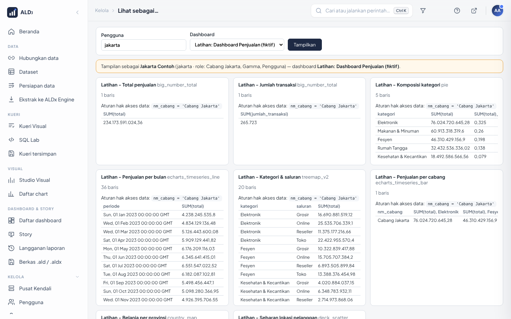

# 26 · Langganan Laporan, Riwayat Versi, Tata Letak Ponsel, Lihat Sebagai, Lencana Resmi

Fitur untuk mengelola dashboard yang sudah dipakai banyak orang.

| Fitur | Siapa | Di mana |
|---|---|---|
| [Langganan laporan](#1-langganan-laporan) | Admin, Alpha | Dashboard & Story › **Langganan laporan** |
| [Riwayat versi dashboard](#2-riwayat-versi-dashboard) | semua melihat; pemilik/Admin memulihkan | tombol **Riwayat versi** di kepala dashboard |
| [Tata letak ponsel](#3-tata-letak-ponsel) | pemilik dashboard, Admin | tombol **Tata ponsel** di kepala dashboard |
| [Lihat sebagai…](#4-lihat-sebagai) | Admin | Kelola › **Lihat sebagai…** |
| [Lencana Resmi](#5-lencana-resmi-sertifikasi) | pemilik objek | Ubah properti › Sertifikasi |
| [Kueri tersimpan](#6-kueri-visual-tersimpan) | pengguna Kueri Visual | Kueri Visual › **Simpan kueri** |

## 1. Langganan laporan

Kirim chart/dashboard lewat email secara terjadwal (harian, mingguan, …), atau **peringatan** bila angka melewati
batas (mis. penjualan harian < target).

**Menyiapkan (admin server, sekali):** isi server email kantor di `.env`, lalu `docker compose up -d`:

```ini
SMTP_HOST=mail.perusahaan.co.id
SMTP_PORT=587
SMTP_STARTTLS=1
SMTP_USER=aldx@perusahaan.co.id
SMTP_PASSWORD=...            # rahasia
SMTP_MAIL_FROM=aldx@perusahaan.co.id
```

Tanpa `SMTP_HOST`, laporan tetap terjadwal tetapi hanya dicatat di log (mode uji), tidak dikirim.

**Membuat langganan:** Dashboard & Story › Langganan laporan › **+ Laporan** → pilih chart/dashboard, jadwal, penerima
email, format.

| Format | Butuh | Catatan |
|---|---|---|
| CSV / teks (chart) | – | langsung jalan |
| PNG / PDF (gambar dashboard/chart) | peramban di image | image standar ALDx belum memuatnya (instalasi tanpa internet). Pakai CSV/teks, atau minta pengembang menambahkan peramban ke `docker/Dockerfile` |

### 1b. Peringatan data

Menu **Dashboard & Story › Peringatan data** → **+ Peringatan**: ALDx menjalankan sebuah kueri sesuai jadwal dan
mengirim email **hanya bila syaratnya terpenuhi**.

| Isian | Contoh |
|---|---|
| Database & SQL (harus menghasilkan satu angka) | `SELECT SUM(total) FROM latihan_penjualan WHERE periode = '2025-12-01'` |
| Syarat | `<` `20000000000` (penjualan bulan ini di bawah 20 M) |
| Jadwal | tiap hari 07.00 |
| Masa tenang (*grace period*) | 1 hari, agar tidak dikirimi email berulang untuk kejadian yang sama |
| Isi pesan | chart atau dashboard terkait + penerima email |

Butuh pengaturan email yang sama dengan Langganan laporan; tanpa `SMTP_HOST` peringatan hanya dicatat di log.

Data di laporan diambil **sebagai pemilik laporan** (hak aksesnya berlaku). Jangan kirim ke penerima yang tidak berhak
atas data itu. Tugas dijalankan backgrounder (antrean *laporan*).

## 2. Riwayat versi dashboard

Setiap kali dashboard disimpan (tata letak, properti, filter, warna), **versi sebelumnya** dicatat otomatis.

1. Buka dashboard → tombol **Riwayat versi** (kanan atas).
2. Daftar versi: waktu, oleh siapa, judul saat itu, jumlah chart.
3. **Pulihkan** (pemilik dashboard / Admin): judul, tata letak, filter, warna, CSS & daftar chart kembali seperti versi itu.
   Keadaan sebelum pemulihan ikut dicatat, jadi pemulihan bisa dibatalkan.

Isi chart & dataset tidak ikut (punya riwayat sendiri). Disimpan 50 versi terakhir per dashboard. Pemulihan tercatat
di jejak audit.

## 3. Tata letak ponsel

Di layar ≤ 760 px dashboard tampil satu kolom. Pemilik dashboard bisa mengatur **urutan** chart dan
**menyembunyikan** chart yang tidak cocok di ponsel (mis. tabel lebar). Layar lebar tidak berubah.

1. Buka dashboard di komputer → tombol **Tata ponsel**.
2. Atur urutan dengan ↑ ↓, hilangkan centang untuk menyembunyikan → **Simpan**.
3. **Kembali ke urutan layar lebar** menghapus pengaturan.

## 4. Lihat sebagai…

Menguji hak akses data tanpa meminjam password atau login dua akun.

1. Kelola › **Lihat sebagai…**
2. Ketik pengguna (nama/username) dan pilih dashboard → **Tampilkan**.
3. Setiap chart dijalankan **sebagai pengguna itu**: jumlah baris, isi data (50 baris pertama), dan **aturan hak akses
   data** yang berlaku padanya. Bila ia tidak berhak membuka dashboard/chart, tertulis jelas.

Hanya baca; Admin tidak masuk ke sesi pengguna itu. Setiap pemakaian tercatat di jejak audit.



## 5. Lencana Resmi (sertifikasi)

Tandai dashboard/chart/dataset yang angkanya sudah diverifikasi: buka **Ubah properti** → bagian **Sertifikasi** →
isi *Disertifikasi oleh* (mis. "Tim Data") dan keterangan. Objek itu mendapat lencana **Resmi** di Beranda dan
didahulukan di hasil Cari (`Ctrl + K`).

## 6. Kueri Visual tersimpan

Di Kueri Visual, isi nama lalu **Simpan kueri**: susunan kueri (tabel, gabung, kolom, filter, urutan) tersimpan untuk
akun Anda. Buka lagi dari daftar **Kueri tersimpan…** di kiri atas, ubah, lalu simpan dengan nama yang sama untuk
menimpa. Data selalu diambil sesuai hak akses orang yang membuka.

## 7. Jejak data (lineage)

Menu **Data › Jejak data**: pilih dataset → empat kolom **Sumber → Dataset → Chart → Dashboard**.
Pakai sebelum mengubah atau menghapus dataset/kolom, untuk tahu chart dan dashboard mana yang terdampak.

| Yang tampil | Penjelasan |
|---|---|
| Sumber | database, skema, dan tabel. Untuk dataset virtual (SQL): tabel-tabel yang dibaca SQL itu |
| Dataset | fisik/virtual, jumlah kolom & metrik, pemilik, terakhir diubah |
| Chart | semua chart dari dataset itu dan berapa dashboard yang memakainya |
| Dashboard | dashboard yang memuat chart tersebut (terbit/draf) |
| Sorot | arahkan kursor ke chart → dashboard pemakainya tersorot, dan sebaliknya |
| Hak akses | hanya objek yang boleh Anda buka; chart orang lain dihitung "tersembunyi" tanpa nama |

Hanya membaca; tidak mengubah apa pun. Kode: `config/sps_jejak.py`, `config/sps_jejak.html`.

### 7b. Label kesegaran data

Saat sebuah dashboard dibuka, bilah atas menampilkan seberapa baru datanya:

| Label | Arti |
|---|---|
| **Data: 2 jam lalu** | data di ALDx Engine (ekstrak, impor berkas) yang **paling lama** diperbarui 2 jam lalu |
| **Data langsung** | semua chart membaca database sumber langsung, jadi selalu terbaru |
| bingkai jingga | lebih dari 2 hari, atau penyegaran ekstrak terakhir gagal |

Arahkan kursor ke label untuk rincian per dataset (waktu diperbarui & jadwal berikutnya); klik membuka Jejak data.
Label tidak tampil di layar sempit. Kode: `kesegaran()` di `config/sps_jejak.py`, `config/sps_app/static/segar.js`.

## 8. Untuk pengembang

| Berkas | Isi |
|---|---|
| `config/sps_versi.py`, `sps_versi.html` | potret sebelum `PUT /api/v1/dashboard/<id>[/filters|/colors]`, tabel `sps_versi_dashboard` |
| `config/sps_ponsel.py`, `sps_ponsel.html` | tabel `sps_tata_ponsel`; diterapkan `bingkai.js` (`tataPonsel`) |
| `config/sps_lihat_sebagai.py`, `.html` | `override_user` + `ChartDataCommand` per chart |
| `config/sps_kueri/tampilan.py` | `/kueri/api/simpanan`, tabel `sps_kueri_simpan` |
| `config/superset_config.py` §7b | `ALERT_REPORTS`, `SMTP_*` |
