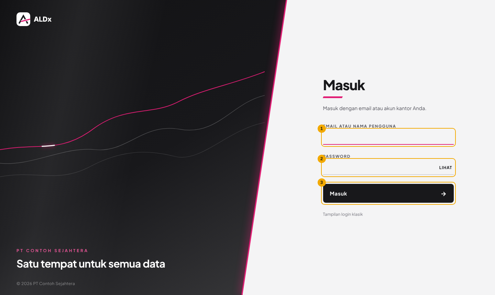
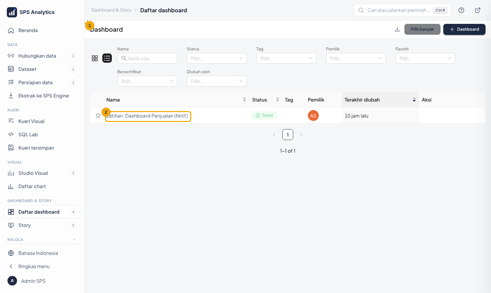
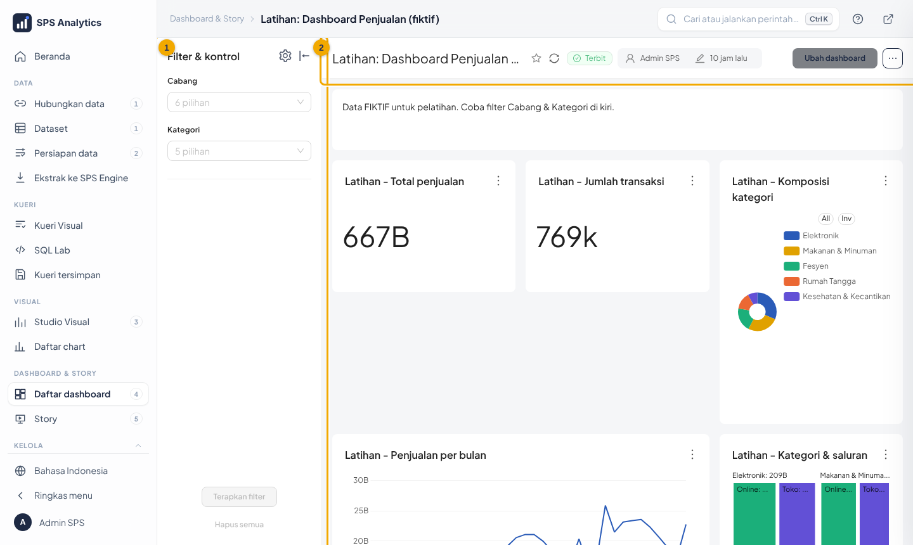
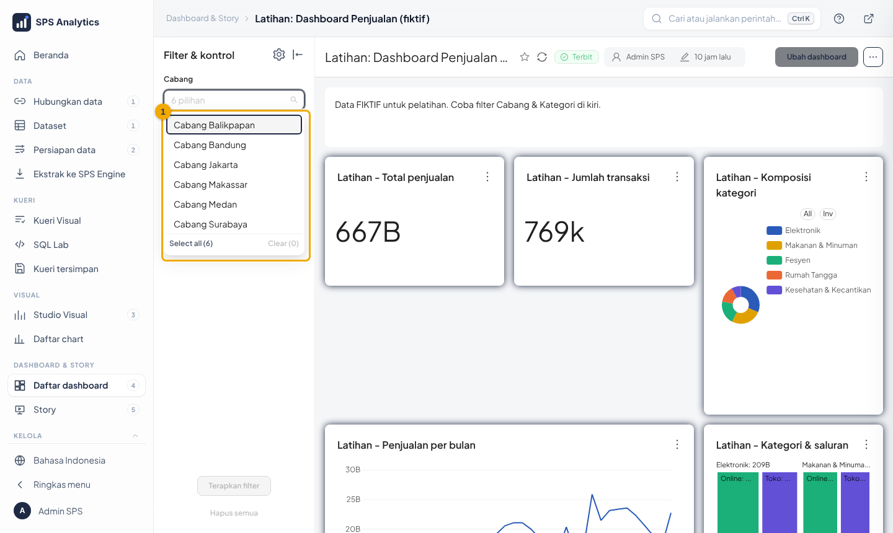
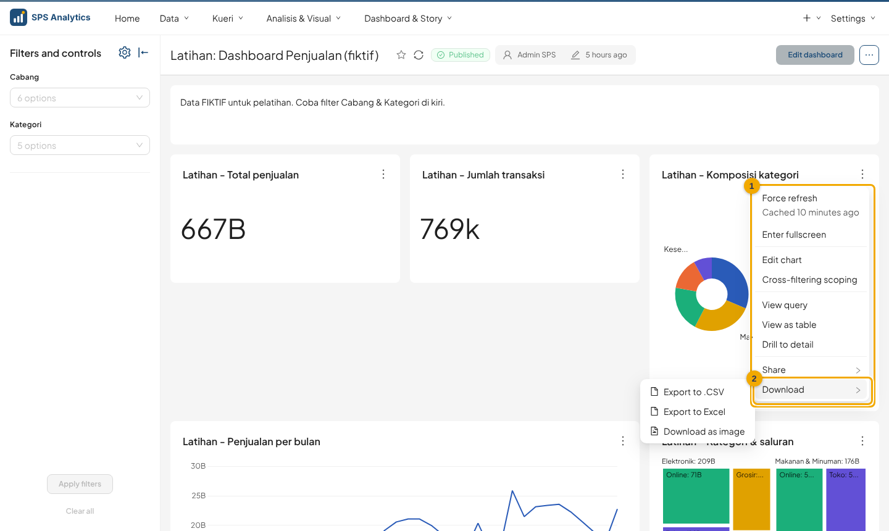
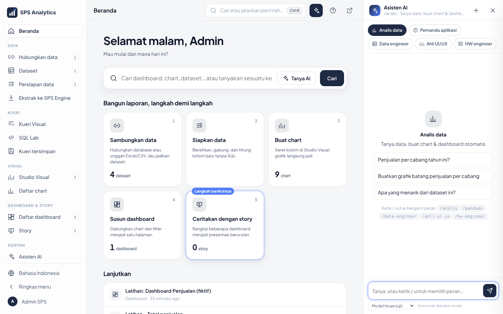

# Modul Level 1 · Pengguna: Membaca Dashboard

| Identitas | |
|---|---|
| Peserta | semua pengguna |
| Durasi | 90 menit |
| Prasyarat | bisa memakai browser |
| Bahan peserta | [tutorial Level 1](../tutorial/level-1-pengguna.md) |
| Akun | akun peserta (akun lokal atau LDAP; role Gamma) |

## Tujuan pembelajaran

Setelah sesi, peserta mampu:
1. login dengan akunnya;
2. menemukan dan membuka dashboard;
3. menyaring dashboard dengan panel filter dan klik-filter;
4. membaca angka singkat (k, M, B) dan melihat nilai lengkap;
5. mengunduh data/gambar chart;
6. menjelaskan mengapa angka pengguna berbeda cabang bisa berbeda (hak akses data);
7. bertanya ke Asisten AI lewat panel ✦ (`Ctrl + I`) dan mengekspor tabel jawabannya;
8. memakai Cari (`Ctrl + K`) dan Cara pakai (`?`) untuk menemukan halaman & panduan sendiri;
9. memasang **filter global** (tombol corong) dan memberi **komentar & rating** pada dashboard.

## Rencana sesi

| Menit | Kegiatan | Metode | Gambar |
|---|---|---|---|
| 0–10 | Pembukaan: apa itu ALDx, manfaatnya | paparan (deck slide 1–4) | – |
| 10–20 | Login, Beranda, sidebar, Cari `Ctrl + K`, tombol `?`, ganti bahasa | demo → peserta ikut |  |
| 20–30 | Mencari dashboard, favorit | demo → peserta ikut |  |
| 30–45 | Membaca dashboard, singkatan angka, tooltip | demo + tanya jawab |  |
| 45–60 | Filter & klik-filter | peserta praktik |  |
| 60–70 | Menu chart: unduh, layar penuh, lihat tabel | peserta praktik |  |
| 70–75 | Hak akses data: "angka saya beda dengan teman" | diskusi | – |
| 75–80 | Panel Asisten AI (`Ctrl + I`), `/panduan`, tombol Ekspor | demo |  |
| 80–90 | Latihan & kuis | individu | – |

## Poin penyampaian

- **Satu sumber angka**: dashboard mengambil data dari sistem perusahaan, bukan hasil olahan manual.
- **Angka otomatis sesuai hak akses.** Tunjukkan dashboard yang sama dari akun cabang berbeda
  (atau jelaskan dengan gambar). Ini bukan kesalahan.
- **Singkatan**: `B` = miliar, `M` = juta, `k` = ribu. Arahkan kursor untuk angka lengkap.
- **Filter tidak mengubah data**, hanya tampilan Anda. Aman dicoba.
- **Kerahasiaan**: file unduhan tetap data rahasia perusahaan; jangan dibagikan ke luar.
- Asisten AI **membantu**, bukan sumber resmi. Cocokkan angka penting.

## Demo pengajar (naskah singkat)

1. "Saya login dengan akun saya." (tunjukkan tombol **Masuk** dan latar login yang bergerak)
2. "Menu **Dashboards**, ketik *latihan*, klik judulnya."
3. "Angka **667B** artinya 667 miliar. Arahkan kursor ke batang Cabang Jakarta: nilainya lengkap."
4. "Saya saring **Kategori = Kesehatan & Kecantikan** di kiri, lalu **Apply filters**. Semua chart berubah."
5. "Klik potongan **Elektronik** di pie: chart lain ikut tersaring. Klik lagi untuk membatalkan."
6. "Titik tiga **⋮** → **Download → Export to .CSV**."
7. "`Ctrl + I` → *penjualan per cabang* → tabel jawaban → **Ekspor → Excel**."

## Latihan

Di dashboard **Latihan: Dashboard Penjualan (fiktif)**:

1. Berapa total penjualan seluruh data latihan?
2. Cabang mana yang penjualannya paling besar, dan berapa?
3. Kategori apa yang porsinya paling besar?
4. Saring **Kategori = Kesehatan & Kecantikan**. Berapa total penjualannya?
5. Unduh data chart *Penjualan per cabang* sebagai CSV dan buka di Excel. Ada berapa baris data?
6. Di peta *Belanja per provinsi*, provinsi mana yang warnanya paling gelap?
7. Pasang **filter global** Cabang = `Cabang Bandung`. Berapa total penjualan di dashboard latihan sekarang?
8. Ganti **Tampilan** ke *Gelap*, lalu tulis komentar yang menyebut rekan dengan `@`. Di mana rekan melihat pemberitahuannya?

### Kunci jawaban

| No | Jawaban |
|---|---|
| 1 | `667B` → Rp667,4 miliar |
| 2 | Cabang Jakarta, ± Rp234,2 miliar |
| 3 | Elektronik (± Rp208,8 miliar, ± 31%) |
| 4 | ± Rp53,8 miliar (`53.8B`), sekitar 8,1% dari total |
| 5 | data 6 cabang × 5 kategori (berisi 30 nilai; susunan kolom mengikuti chart) |
| 6 | DKI Jakarta (ID-JK) |
| 7 | ± Rp121 miliar (`121B`); lencana corong menunjukkan 1 |
| 8 | Dashboard ikut gelap. Setelah komentar tampil, rekan melihat **titik biru di avatar**; isinya di menu akun bagian pemberitahuan |

## Kuis (pilihan ganda)

1. Angka `25B` di dashboard berarti… a) 25 juta **b) 25 miliar** c) 25 triliun
2. Agar semua chart hanya menampilkan cabang tertentu, Anda… **a) memilih di panel filter lalu Apply filters** b) mengedit chart c) mengunduh CSV
3. Rekan di cabang lain melihat angka berbeda di dashboard yang sama karena… a) dashboard rusak **b) hak akses data per cabang** c) cache
4. Menu untuk mengunduh data chart ada di… a) Settings **b) titik tiga ⋮ → Download** c) Dashboards
5. Klik satu potongan pie akan… **a) menyaring chart lain (cross filter)** b) menghapus data c) membuka SQL Lab
6. Jawaban Asisten AI sebaiknya… a) langsung dipakai sebagai angka resmi **b) dicocokkan dengan dashboard resmi untuk angka penting** c) diabaikan

7. Cara tercepat membuka dashboard yang judulnya Anda ingat… a) menelusuri semua menu **b) Ctrl + K lalu ketik judulnya** c) minta admin
8. Untuk bertanya "bagaimana cara membuat story" ke AI, ketik… a) /hw-engineer **b) /panduan** c) /ahli-ui-ux

9. Filter global berlaku di… a) satu chart saja **b) semua dashboard & Story yang punya filter di kolom sama** c) semua pengguna
10. Komentar Anda belum terlihat rekan karena… a) rusak **b) menunggu persetujuan Superadmin** c) rating kurang

**Kunci:** 1b · 2a · 3b · 4b · 5a · 6b · 7b · 8b · 9b · 10b

## Modul tambahan (15 menit): dashboard lebih dalam

| Menit | Kegiatan | Metode |
|---|---|---|
| 0–5 | telusuri ke dashboard lain (klik kanan chart), chip ← pulang | demo → peserta ikut |
| 5–10 | tampilan tersimpan; label kesegaran data | peserta praktik |
| 10–15 | ekspor PowerPoint; **Ringkasan AI** di bilah atas dashboard; tanya jawab | demo |

Tutorial: [Level 1 §6e](../tutorial/level-1-pengguna.md). Poin penyampaian: *tampilan tersimpan milik akun sendiri; PowerPoint hanya tab
yang tampil; "Data langsung" = selalu terbaru, "Data: N jam lalu" = ada penyegaran terjadwal*.

### Latihan tambahan

Di dashboard **Latihan: Dashboard Penjualan (fiktif)** dan **Latihan: Wilayah & Prediksi (fiktif)**:

- **T1.** Klik irisan **Elektronik** pada pie → klik kanan → *Telusuri ke dashboard lain…* → pilih tujuan. Dashboard apa dan berapa totalnya?
- **T2.** Simpan sebagai tampilan tersimpan `Elektronik`, hapus semua filter, buka lagi tampilan itu.
- **T3.** Apa arti label kesegaran di dashboard *Wilayah & Prediksi*?
- **T4.** Ekspor dashboard *Wilayah & Prediksi* ke PowerPoint. Berapa slide?
- **T5.** Klik chip **✦ Ringkasan AI** di dashboard *Wilayah & Prediksi*: berapa poin, apa baris *Perlu perhatian*, dan cocokkah satu angkanya dengan chart?

### Kunci jawaban tambahan

| No | Jawaban |
|---|---|
| T1 | *Latihan: Wilayah & Prediksi* terbuka tersaring Elektronik, total ± Rp5,45 T (`5.45T`); chip **← nama dashboard asal** mengantar pulang |
| T2 | filter Kategori = Elektronik kembali terpasang; tombol **×** menghapus tampilan |
| T3 | *Data: N jam/hari lalu* = data di ALDx Engine terakhir diperbarui N jam/hari lalu (data latihan dimuat sekali); *Data langsung* bila membaca sumber langsung |
| T4 | **8 slide**: sampul + 7 chart |
| T5 | **3–5 poin** berangka + baris *Perlu perhatian* (isi tergantung model AI); angka harus cocok dengan chart **tanpa filter** (mis. total penjualan ± 20,3 T). Bila tidak cocok: laporkan, AI bisa salah. Tanpa model lokal / `kirim_data` kartu menjelaskan cara menyambungkan |

### Kuis tambahan

11. Tampilan tersimpan berguna untuk… a) menyimpan data **b) membuka dashboard dengan kombinasi filter tertentu satu klik** c) mengirim email
12. *Data: 5 jam lalu* berarti… **a) data di ALDx Engine paling lama diperbarui 5 jam lalu** b) Anda membuka dashboard 5 jam lalu c) server menyala 5 jam
13. PowerPoint dari dashboard berisi… a) hanya sampul **b) sampul + satu chart per slide (tab yang tampil)** c) seluruh data
14. *Telusuri ke dashboard lain…* membawa… a) judul chart **b) filter yang sedang aktif** c) akun Anda

15. Ringkasan AI di dashboard memakai angka… a) semua cabang walau saya dibatasi **b) sesuai hak akses saya, tanpa filter dashboard** c) dari internet

**Kunci:** 11b · 12a · 13b · 14b · 15b

## Daftar periksa kompetensi

- [ ] Login berhasil dengan akunnya
- [ ] Membuka halaman lewat Cari (`Ctrl + K`) dan membaca Cara pakai (`?`)
- [ ] Membuka dashboard lewat pencarian
- [ ] Menerapkan & menghapus filter
- [ ] Memakai klik-filter
- [ ] Mengunduh CSV
- [ ] Membuka panel Asisten AI (`Ctrl + I`) dan mengekspor tabel jawaban ke Excel
- [ ] Menjelaskan perbedaan angka antar-cabang (hak akses)
- [ ] Memasang & menghapus filter global
- [ ] Memberi komentar & rating pada dashboard
- [ ] Menelusuri ke dashboard lain (klik kanan chart) dan kembali lewat chip
- [ ] Menyimpan, membuka, dan menghapus tampilan tersimpan
- [ ] Membaca label kesegaran data
- [ ] Mengekspor dashboard ke PowerPoint
- [ ] Membaca Ringkasan AI dashboard dan mencocokkan angkanya dengan chart
