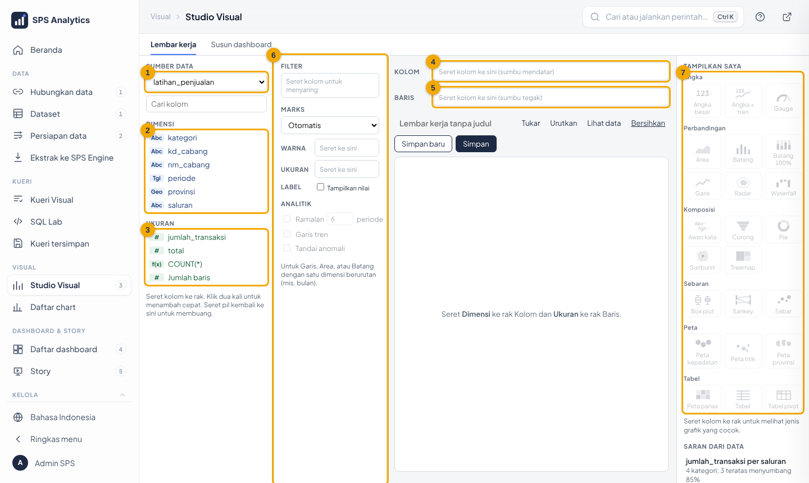
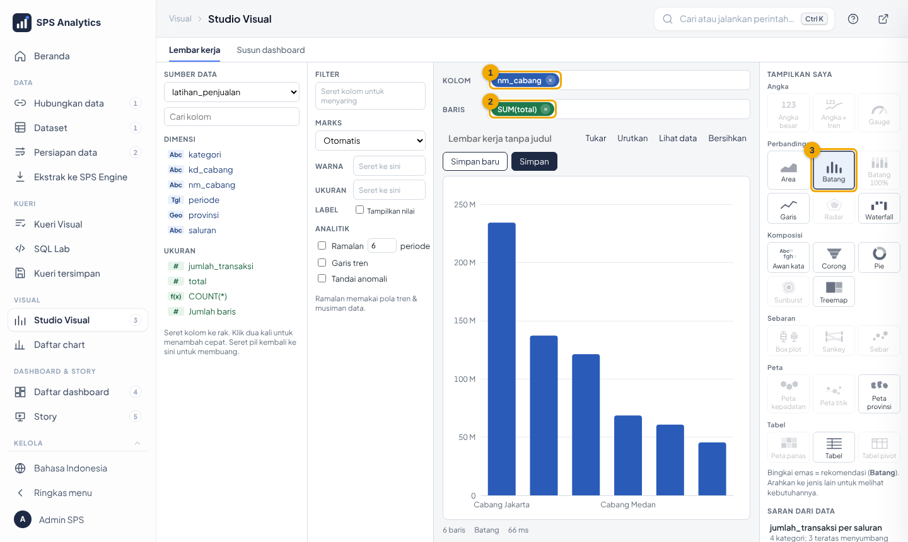
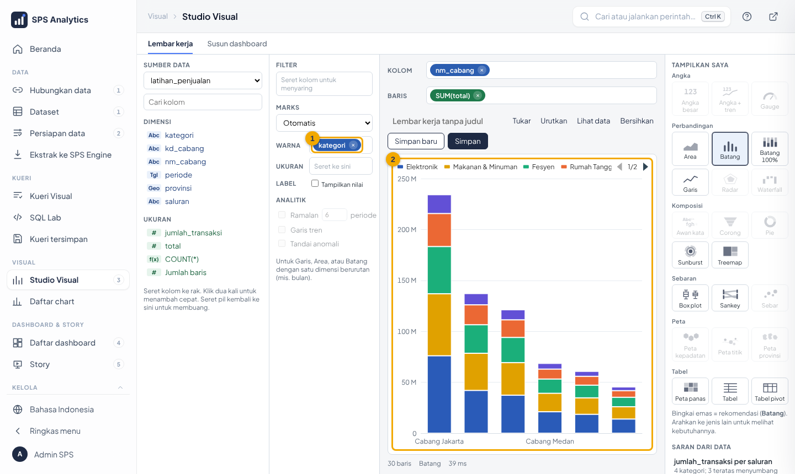
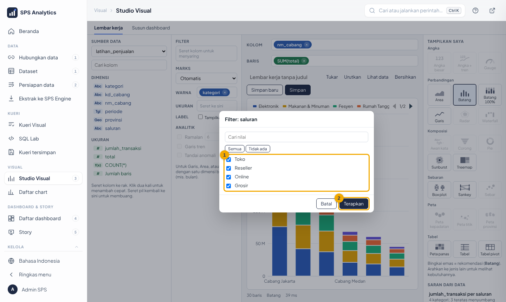
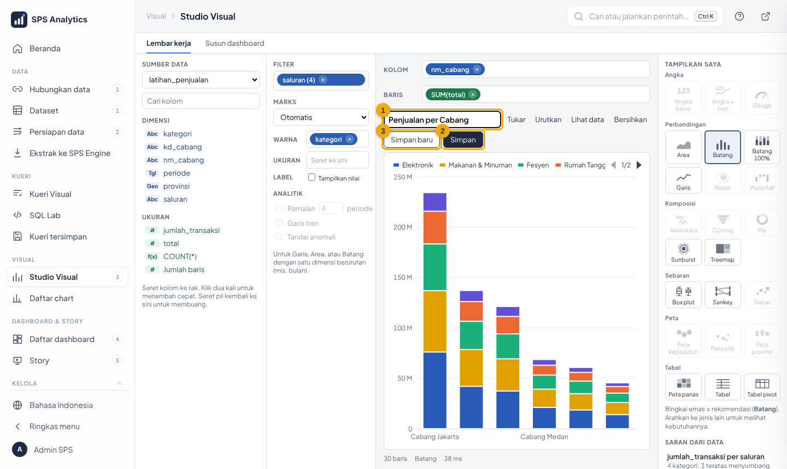
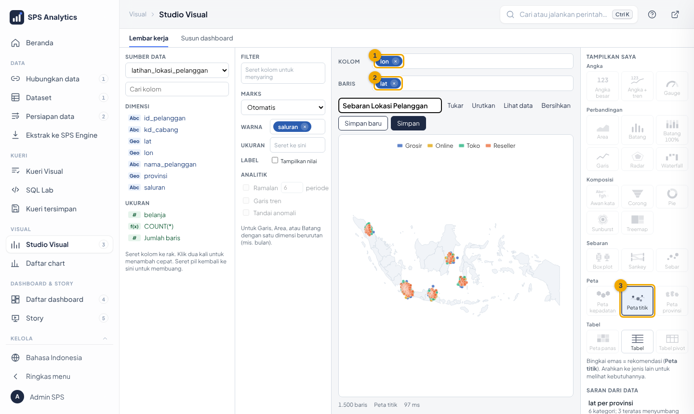
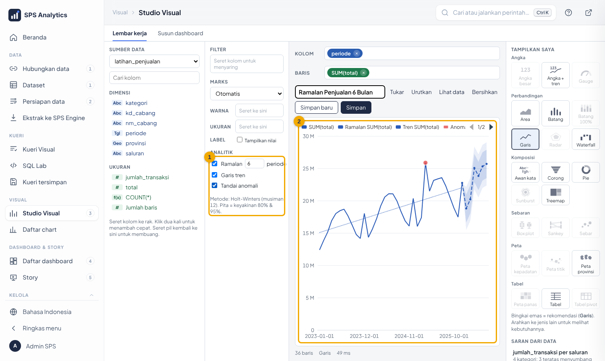
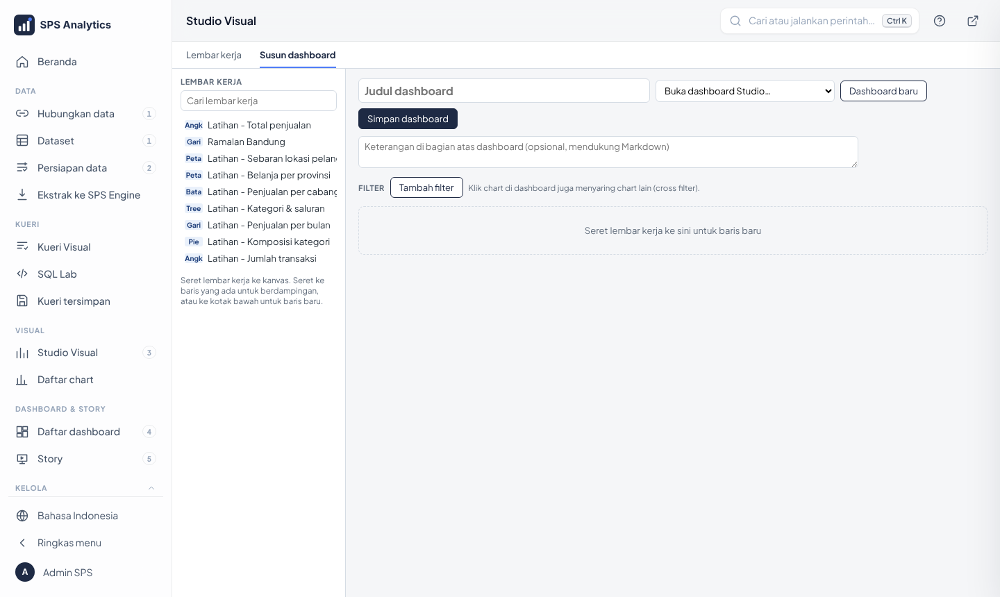
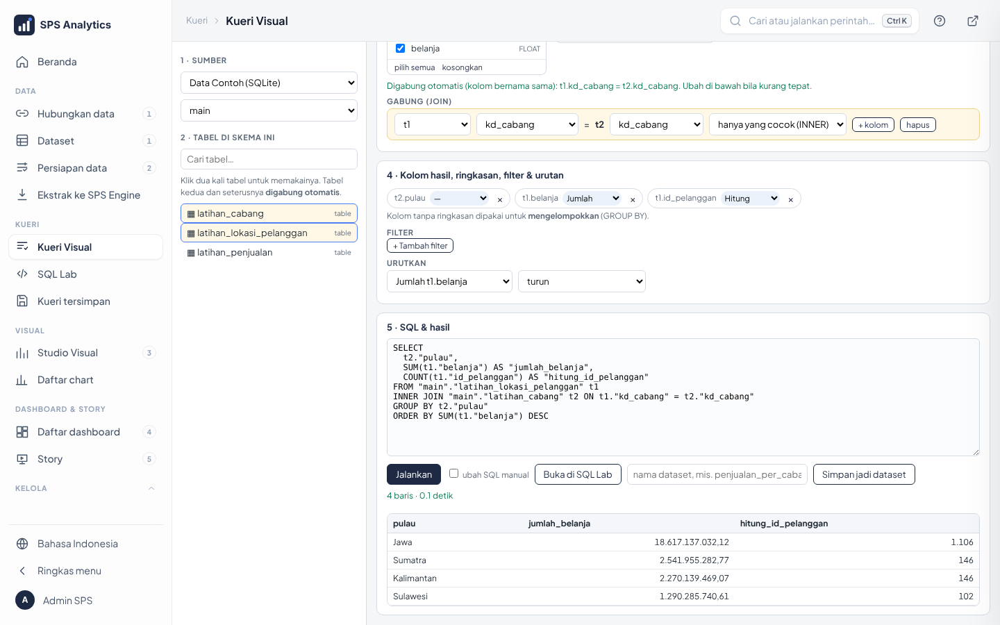

# Modul Level 2 · Analis: Studio Visual

| Identitas | |
|---|---|
| Peserta | pembuat laporan di unit kerja |
| Durasi | 2 sesi × 120 menit |
| Prasyarat | Level 1 |
| Bahan peserta | [tutorial Level 2](../tutorial/level-2-analis.md), [katalog chart](../17-katalog-chart-peta-prediksi.md) |
| Akun | role dengan *Buat & simpan chart* dan *Buat & ubah dashboard*; peran **Analis** (SQL Lab) untuk Kueri Visual |

## Tujuan pembelajaran

1. Membedakan **dimensi** dan **ukuran**;
2. membuat chart dengan seret-lepas dan memilih jenis lewat *Tampilkan saya*;
3. memakai filter, agregasi, warna, label, urutan;
4. membuat **peta** titik & provinsi;
5. membuat **ramalan**, tren, dan membaca pita keyakinan;
6. menyusun dashboard dengan filter;
7. memilih jenis grafik yang tepat untuk pertanyaannya;
8. menggabung dua tabel dengan **Kueri Visual** lalu menyimpannya sebagai dataset;
9. mengekspor hasil (Excel, CSV, gambar, PDF) dan meminta SQL ke peran AI `/data-engineer`;
10. menyimpan & membagikan dashboard sebagai berkas **.ald / .aldx** terenkripsi dan mengimpornya kembali.

## Rencana sesi

**Sesi 1 (120 menit): chart**

| Menit | Kegiatan | Gambar |
|---|---|---|
| 0–15 | Dimensi vs ukuran: "per apa?" vs "berapa?" (latihan kartu di papan) |  |
| 15–35 | Chart pertama: batang per cabang (demo → ikut) |  |
| 35–50 | Warna bertumpuk, label, urutkan, tukar |  |
| 50–65 | Filter & agregasi |  |
| 65–85 | Tampilkan saya: 23 jenis, kapan pakai apa ([tabel pilihan](../tutorial/level-2-analis.md#7-memilih-jenis-grafik-lain)) | galeri katalog |
| 85–100 | Menyimpan chart, membuka lagi, membuka di Explore |  |
| 100–120 | Latihan 1–2 | – |

**Sesi 2 (120 menit): peta, ramalan, dashboard**

| Menit | Kegiatan | Gambar |
|---|---|---|
| 0–25 | Peta titik & peta provinsi; kolom Geo; kode ISO provinsi |  |
| 25–55 | Ramalan, tren, anomali; membaca pita 80/95%; batas ramalan |  |
| 55–80 | Menyusun dashboard + filter; klik-filter |  |
| 80–95 | Alur menu (Data › Kueri › Visual › Dashboard) + **Kueri Visual**: klik dua kali, gabung otomatis, ringkas, simpan dataset |  |
| 95–110 | Latihan 3–6 | – |
| 110–120 | Kuis | – |

## Poin penyampaian

- **Mulai dari pertanyaan**, bukan dari jenis grafik: "Cabang mana paling besar?" → batang terurut.
- Pie hanya untuk ≤ 7 bagian. Lebih dari itu pakai batang/treemap.
- Warna sudah diatur palet ALDx: jangan diganti manual. Warna yang sama berarti nilai yang sama di seluruh dashboard.
- **Ramalan = pola masa lalu diteruskan.** Pita lebar = tidak pasti. Kebijakan baru tidak terbaca model.
- Bulan berjalan yang belum lengkap menarik ramalan ke bawah: saring dulu.
- **Gabung tabel**: periksa jumlah baris sebelum & sesudah. Baris berlipat = kolom penghubung salah.
- Chart tersimpan = chart Superset biasa: bisa dipakai di dashboard mana pun, dan hak akses tetap berlaku.

## Latihan

1. Grafik **Garis** penjualan (`latihan_penjualan`) per **periode**, warna **kategori**.
   Bulan apa yang selalu tinggi, dan bulan apa yang selalu paling rendah?
2. **Tabel pivot**: Baris = nm_cabang, Kolom = kategori, ukuran = total.
   Berapa Elektronik di Cabang Jakarta? Berapa Kesehatan & Kecantikan di Cabang Makassar?
3. **Peta provinsi** belanja (`latihan_lokasi_pelanggan`). Provinsi mana tertinggi, dan berapa jumlah
   pelanggannya (ganti ukuran ke *Jumlah baris*)?
4. **Ramalan 6 bulan** penjualan total per periode, dengan tren & anomali.
   Metode apa yang dipakai? Bulan mana yang ditandai anomali paling mencolok?
5. Susun dashboard *Latihan – [nama]* berisi chart 1, 3, 4 dan filter **Cabang** (`nm_cabang`). Tambahkan objek **Teks** sebagai judul
   (huruf *Montserrat*, 28 px, tebal) dan **Garis** pemisah di bawahnya.
6. **Kueri Visual**: gabungkan `latihan_lokasi_pelanggan` dengan `latihan_cabang`. Ringkas `belanja` (Jumlah) dan
   `id_pelanggan` (Hitung) per **pulau**. Pulau mana terbesar? Lalu filter `saluran` = Online, kelompokkan per
   `kepala_cabang`: siapa yang pelanggan Online-nya paling sedikit?
7. Ekspor hasil no. 6 (per pulau) ke **Excel**. Di Excel, jumlahkan kolom belanja. Berapa totalnya?
8. Ekspor dashboard no. 5 sebagai **.aldx** + salinan data + **kata sandi**. Impor kembali sebagai **Salinan baru**
   dengan **Pakai data di berkas**. Apa yang terjadi bila sandinya salah?
9. Ubah judul dashboard no. 5, simpan, lalu pulihkan judul lama lewat **Riwayat versi**. Simpan juga susunan Kueri
   Visual no. 6 dengan **Simpan kueri**, muat ulang halaman, dan buka lagi dari *Kueri tersimpan…*.
10. **Hierarki seret-tumpuk** (`latihan_penjualan_harian`): seret `kecamatan` ke atas `kab_kota`, beri nama
    *Kota & Kecamatan*. Lalu pakai hierarki bawaan **Wilayah** di Kolom + `penjualan` di Baris, klik batang terbesar
    sampai level kab/kota. Kab/kota mana terbesar di pulau itu?
11. **Analitik lengkap**: hierarki **Kalender** turun ke level `bulan`, `penjualan` di Baris, Garis. Centang Ramalan 6,
    Rata bergerak 3, Garis rata-rata, Tertinggi & terendah. Bulan apa tertinggi, dan kenapa tiap tahun ada puncak
    di bulan berbeda?

### Kunci jawaban

| No | Jawaban |
|---|---|
| 1 | Tinggi: **Juni–Juli** (puncak musiman) dan **Desember** (lonjakan akhir tahun). Terendah: **Januari** |
| 2 | Jakarta Elektronik ± **Rp76,0 miliar**; Makassar Kesehatan & Kecantikan ± **Rp3,7 miliar** |
| 3 | **ID-JK** (DKI Jakarta), ± Rp8,8 miliar, **514** pelanggan |
| 4 | **Holt-Winters (musiman 12)**. Anomali yang ditandai: **Maret 2025** (lonjakan Elektronik Cabang Jakarta). Ramalan bulan pertama ± Rp18,8 miliar (Jan 2026) |
| 5 | dinilai dengan daftar periksa: 3 chart tampil, filter Cabang bekerja di semua chart |
| 6 | Digabung otomatis lewat `kd_cabang`. **Jawa** ± **Rp18,6 miliar**, **1.106** pelanggan (Sumatra & Kalimantan masing-masing 146, Sulawesi 102). Online paling sedikit: **Eko Contoh** (Makassar), **19** pelanggan |
| 7 | ± **Rp24,7 miliar** (18,6 + 2,5 + 2,3 + 1,3); angka tersimpan sebagai angka sehingga bisa dijumlah langsung |
| 9 | Minimal 1 versi (judul lama). **Pulihkan** mengembalikan judul; keadaan sebelum pemulihan juga tercatat. Kueri tersimpan muncul lengkap (tabel, gabung, kolom) |
| 10 | Pulau **Jawa** (12,77 T) → provinsi **DKI Jakarta** (4,49 T) → kab/kota **Jakarta Selatan** (1,99 T) |
| 11 | Tertinggi **Maret 2025** (Rp579,6 miliar). Puncak mengikuti **Lebaran** yang maju ± 11 hari tiap tahun (Mei 2021, Mei 2022, April 2023, April 2024, Maret 2025); juga naik tiap Desember |
| 8 | Sandi salah: *"Kata sandi salah, atau berkas telah diubah."* Sandi benar: ringkasan tampil, dashboard hasil berjudul **"... (salinan)"**, datanya dari ALDx Engine |

## Kuis

1. Kolom `nm_cabang` termasuk… **a) dimensi** b) ukuran
2. Membandingkan penjualan 6 cabang paling tepat dengan… **a) batang terurut** b) pie c) sebar
3. Lat & lon diseret ke Kolom/Baris, Studio merekomendasikan… a) tabel **b) peta titik** c) garis
4. Pita 95% lebih lebar dari 80% karena… **a) makin yakin, rentang makin lebar** b) data salah c) musim
5. Ramalan tidak tersedia untuk Batang bila… a) satu dimensi **b) ada dimensi di Warna** c) data bulanan
6. Peta provinsi di Superset membutuhkan nilai… a) nama kota **b) kode ISO provinsi (ID-JK)** c) koordinat
7. Rata-rata belanja per pelanggan memakai agregasi… a) SUM **b) AVG** c) COUNT

8. Di Kueri Visual, tabel kedua yang diklik dua kali akan… a) menggantikan tabel pertama **b) digabung otomatis lewat kolom penghubung** c) dibuka di tab baru

9. Agar angka hasil ekspor bisa langsung dijumlah di Excel, pilih format… a) TXT **b) Excel** c) Gambar

10. Berkas yang bisa dibuka di server ALDx lain tanpa menyamakan kunci server dikunci dengan… a) kunci server **b) kata sandi** c) tanpa kunci
11. Salinan data di `.aldx` berisi… a) semua baris tabel **b) hanya baris yang boleh dilihat pembuat berkas** c) 10 baris contoh

**Kunci:** 1a · 2a · 3b · 4a · 5b · 6b · 7b · 8b · 9b · 10b · 11b

## Sesi tambahan (60 menit): alat bantu, template, laporan

| Menit | Kegiatan | Tutorial |
|---|---|---|
| 0–20 | kalkulasi cepat (% total, kumulatif, YoY), skala warna, kelompokkan nilai, simulasi | [§10c](../tutorial/level-2-analis.md) |
| 20–30 | jelaskan perubahan, tooltip kaya, analitik per Warna | [§10c](../tutorial/level-2-analis.md) |
| 30–40 | ambang (target berwarna); dashboard dari template (umum & per bidang), tab, tinggi kotak | [§10c, §11a](../tutorial/level-2-analis.md) |
| 40–50 | Auto chart & dashboard; Asisten AI membuat dashboard | [§12c](../tutorial/level-2-analis.md) |
| 50–60 | Langganan laporan & Peringatan data; Daftar chart & Jejak data | [§12d–e](../tutorial/level-2-analis.md) |

### Latihan tambahan

- **T1.** Garis **periode × total**, **Hitung** = % dari total: berapa persen titik pertama dan terakhir, dan jumlah semuanya?
- **T2.** **Kumulatif**: nilai titik terakhir? **% vs tahun lalu (YoY)**: 12 bulan pertama dan Januari 2024?
- **T3.** Kelompokkan `nm_cabang`: *Jawa* = Jakarta + Bandung + Surabaya, sisanya *Lainnya*: total tiap kelompok?
- **T4.** **Simulasi** +10% pada total: nilai baru, dan ikut tersimpan?
- **T5.** Klik kanan Maret 2024 › *Jelaskan perubahan*: naik berapa, dimensi apa yang paling menjelaskan?
- **T6.** Template *Ringkasan eksekutif* untuk `latihan_penjualan`: berapa lembar kerja? Tambah tab **Rincian**.
- **T7.** Auto chart `latihan_penjualan`: berapa saran tercentang bawaan?
- **T8.** Peringatan data `SUM(total)` `latihan_penjualan` `>` 600 miliar: terpenuhi?
- **T9.** **Ambang**: Angka total dengan *Hijau ≥* 600 miliar; Tabel `nm_cabang × total` dengan *Hijau ≥* 120 miliar & *Merah ≤* 60 miliar.
- **T10.** Template **Penjualan** (per bidang), ukuran utama *Otomatis*: berapa lembar kerja, ukuran & kategori apa yang dipilih?
- **T11.** Mini-chart tooltip **Cabang Jakarta** (Batang `nm_cabang × total`); lalu skenario +10% disimpan: nilai Jakarta di chart tersimpan?

### Kunci jawaban tambahan

| No | Jawaban |
|---|---|
| T1 | Jan 2023 **1,85%**, Des 2025 **3,41%**; jumlah semua **100%** |
| T2 | kumulatif akhir **667B** (Rp667,4 miliar); YoY: 12 bulan pertama **kosong**, Jan 2024 **+15,8%** (Feb 2024 +13,1%) |
| T3 | Jawa ± **Rp493 M**, Lainnya ± **Rp175 M** |
| T4 | ± **Rp734 M** (667B × 1,1); **tidak** tersimpan (status menulis "hanya pratinjau") |
| T5 | naik ± **Rp1,6 M (+10%)**; dimensi **saluran** (66%): Online +578,6 jt, Grosir +455,2 jt |
| T6 | **7 lembar kerja** + judul; filter Saluran, Kategori, Cabang, Rentang waktu; tab Rincian: satu lembar hanya di satu tab |
| T7 | **4** saran teratas |
| T8 | **ya** (667,4 miliar > 600 miliar) |
| T9 | Angka **hijau ▲ 667B**. Tabel: **hijau** Jakarta (234,2 M), Surabaya (137,1 M), Bandung (121,2 M); **merah** Makassar (45,5 M); Medan & Balikpapan biasa. Chart tersimpan menampilkan warna yang sama |
| T10 | **9 lembar kerja** + judul; ukuran utama **total**, kategori pertama **kategori**; ada % vs tahun lalu dan peta provinsi |
| T11 | mini-chart **2025-01 – 2025-12**, hijau ▲ (± 38,6%); chart tersimpan berlabel `SUM(total) (+10%)`, Jakarta **± 257,6 M** (234,2 M × 1,1), sama dengan pratinjau Studio |

### Kuis tambahan

12. Pada % dari total, jumlah semua titik… a) 1 **b) 100%** c) sama dengan total
13. Titik terakhir kumulatif sama dengan… **a) total seluruh periode** b) rata-rata c) titik pertama
14. YoY hanya aktif bila dimensi… **a) kolom tanggal** b) teks c) angka
15. Simulasi what-if… a) mengubah data sumber **b) hanya pratinjau, tidak tersimpan** c) menghapus chart
16. Peringatan data berbeda dari Langganan laporan karena… **a) email hanya dikirim bila syarat angka terpenuhi** b) selalu tiap jam c) tanpa email

17. Ambang *Hijau ≥ 100* dan *Merah ≤ 50*; nilai 75 tampil… a) hijau b) merah **c) warna biasa**
18. Template per bidang memilih kolom berdasarkan… a) urutan abjad **b) kecocokan nama kolom dengan bidangnya** c) acak
19. Simulasi yang **disimpan sebagai skenario**… a) mengubah data sumber **b) dihitung di database sebagai (agregat) × faktor pada chart itu** c) hanya tampil di Studio

**Kunci:** 12b · 13a · 14a · 15b · 16a · 17c · 18b · 19b

## Daftar periksa kompetensi

- [ ] Membuat batang dengan warna & urutan
- [ ] Menerapkan filter & mengganti agregasi
- [ ] Memilih jenis grafik yang sesuai pertanyaan dan menjelaskan alasannya
- [ ] Membuat peta titik & peta provinsi
- [ ] Membuat ramalan dan menjelaskan arti pita 80/95%
- [ ] Menyusun dashboard dengan filter
- [ ] Menggabung 2 tabel di Kueri Visual, memeriksa hasil gabung, dan menyimpannya sebagai dataset
- [ ] Mengekspor dashboard ke .ald/.aldx berkata sandi dan mengimpornya sebagai salinan baru
- [ ] Mengekspor hasil ke Excel/CSV/gambar dan memakai `/data-engineer` untuk SQL
- [ ] Memakai kalkulasi cepat (% total, kumulatif, YoY), skala warna, kelompokkan nilai, simulasi (pratinjau & skenario tersimpan)
- [ ] Membaca mini-chart tren di tooltip Batang/Pie
- [ ] Memakai *Jelaskan perubahan* dan membaca tooltip kaya
- [ ] Memberi **ambang** (hijau/merah) pada Angka atau Tabel dan menjelaskan artinya
- [ ] Membuat dashboard dari template (umum & per bidang), menambah tab, mengatur tinggi kotak
- [ ] Memakai Auto chart & dashboard
- [ ] Membuat Langganan laporan dan Peringatan data
- [ ] Memeriksa dampak lewat Jejak data sebelum mengubah dataset
