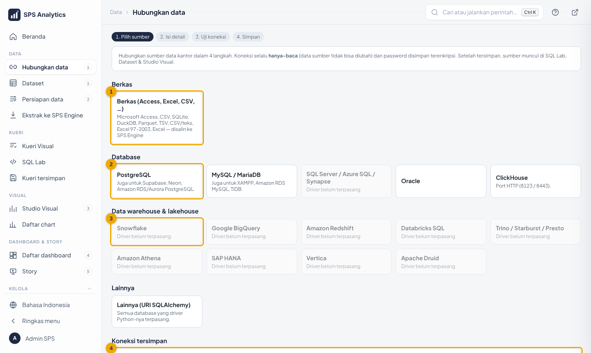
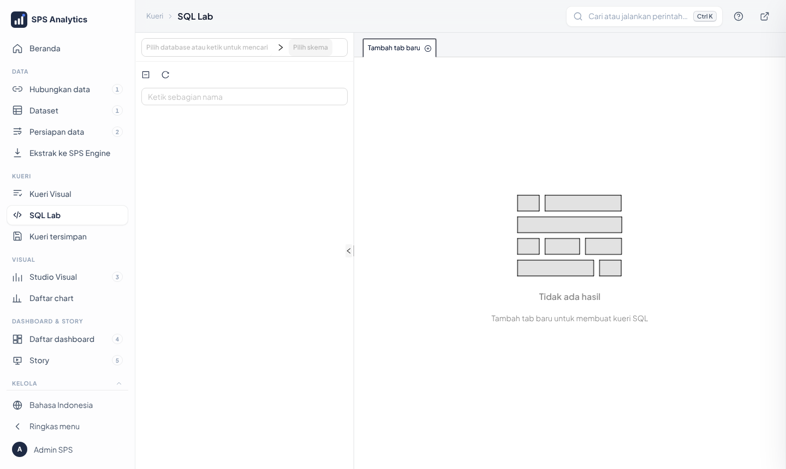
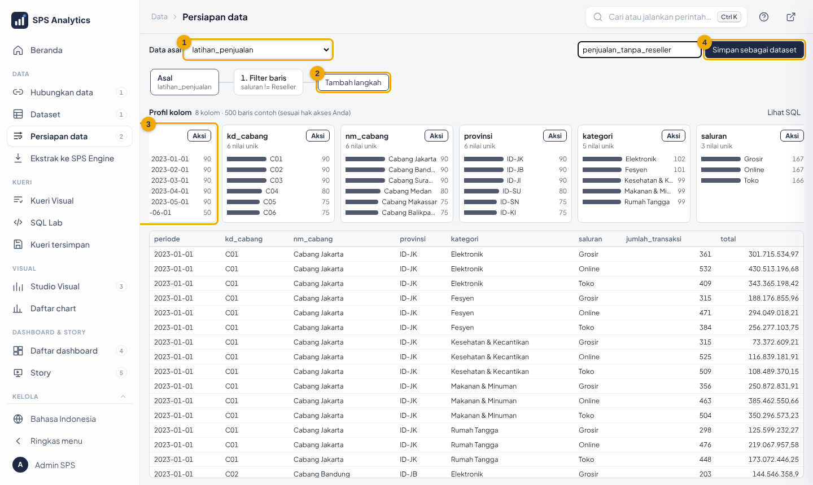
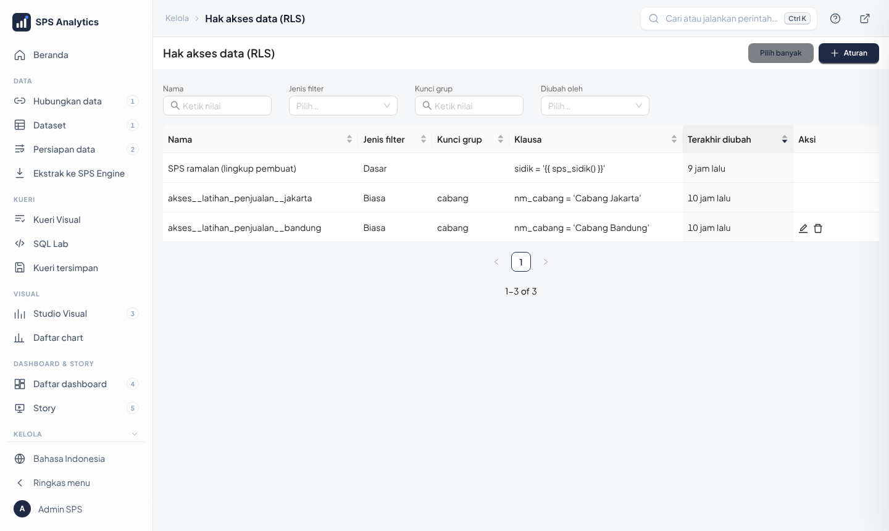
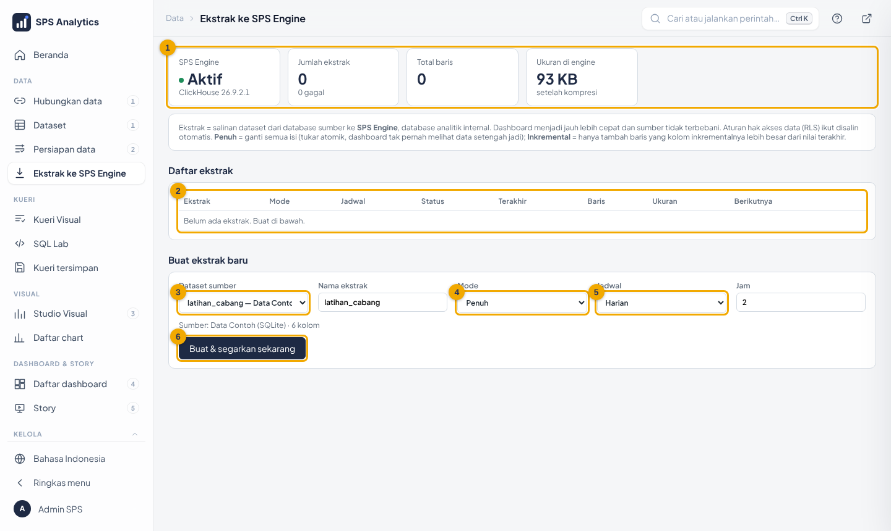

# Modul Level 3 · Admin Data: Sumber Data, Dataset, Hak Akses, Ekstrak

| Identitas | |
|---|---|
| Peserta | pengelola data unit/divisi |
| Durasi | 2 sesi × 120 menit |
| Prasyarat | Level 1–2, paham dasar tabel & SQL `SELECT` |
| Bahan peserta | [tutorial Level 3](../tutorial/level-3-admin-data.md), [08-hak-akses-data](../08-hak-akses-data.md), [13-sps-engine-ekstrak](../13-sps-engine-ekstrak.md) |
| Akun | role Admin di **server uji**, plus satu akun uji di role `Cabang Bandung` |
| Berkas | [`berkas/contoh-target-toko.xlsx`](berkas/contoh-target-toko.xlsx) dibagikan ke peserta; satu database uji (mis. PostgreSQL) dengan akun hanya-baca |

## Tujuan pembelajaran

1. **menghubungkan** database/data warehouse dan **mengimpor** berkas Access/Excel lewat wizard *Hubungkan data*;
2. menjelaskan koneksi, dataset fisik & virtual; membuat dataset dari SQL Lab dan Persiapan data;
3. **membuat dan menguji aturan RLS** per role (dan mengenali cara otomatis dari profil);
4. membuat ekstrak penuh/inkremental terjadwal dan memindahkan chart ke ekstrak;
5. mengunggah Excel/CSV ke ALDx Engine;
6. menerapkan daftar periksa keamanan dataset.

## Rencana sesi

**Sesi 1: dataset & hak akses**

| Menit | Kegiatan | Gambar |
|---|---|---|
| 0–15 | Peta komponen data: koneksi → dataset → chart → dashboard | – |
| 15–35 | **Hubungkan data**: database (uji → simpan), impor Access/Excel |  |
| 35–50 | SQL Lab → simpan dataset; kolom temporal; metrik tersimpan |  |
| 50–65 | Persiapan data: langkah, gabung, simpan |  |
| 65–100 | **RLS** per role: buat role, aturan Regular/Base, uji dengan akun cabang; sekilas cara profil otomatis |  |
| 100–120 | Latihan 1–3 | – |

**Sesi 2: ekstrak & upload**

| Menit | Kegiatan | Gambar |
|---|---|---|
| 0–20 | Live vs ekstrak: kecepatan, beban sumber, kesegaran | – |
| 20–55 | Buat ekstrak, jadwal, Pakai di chart, riwayat, gagal & penyebabnya |  |
| 55–75 | Upload CSV/Excel ke ALDx Engine; dataset upload tanpa RLS | – |
| 75–105 | Latihan 4–5 + daftar periksa keamanan | – |
| 105–120 | Kuis | – |

## Poin penyampaian

- **Dataset tanpa RLS = semua baris terlihat** bagi siapa pun yang diberi akses. Selalu buat RLS sebelum memberi akses.
- RLS ditulis sekali, berlaku di chart, filter, dashboard, SQL Lab, Asisten AI, ekstrak, dan ramalan.
- Ekstrak & Persiapan data **menyalin RLS otomatis**, tetapi kolom hak akses harus tetap ada di hasilnya.
- Ekstrak membaca sumber **utuh** (oleh sistem), lalu membatasi per pengguna saat dibaca.
- Koneksi dari wizard selalu **hanya-baca**; minta akun hanya-baca ke DBA. Upload/impor hanya ke ALDx Engine.
- Berkas impor tidak punya RLS: buat aturan bila datanya per cabang.

## Demo pengajar: menguji RLS per role

1. **Settings → List Roles → +** `Cabang Bandung` (salin izin `Gamma`); masukkan akun uji ke role itu.
2. **Settings → Row Level Security → + Rule**: Regular, dataset `latihan_penjualan`, role `Cabang Bandung`,
   clause `nm_cabang = 'Cabang Bandung'`.
3. Login sebagai akun uji di jendela *Incognito* → buka dashboard latihan → hanya Cabang Bandung (± Rp121,2 miliar).
4. Tunjukkan bahwa filter, Asisten AI, dan unduh CSV juga hanya berisi Bandung.
5. Hapus aturan setelah demo (atau biarkan untuk latihan 3).

## Latihan

1. Impor `contoh-target-toko.xlsx` lewat **Hubungkan data → Berkas**. Berapa dataset terbentuk, apa namanya, dan berapa total target 2025?
2. Persiapan data: `latihan_elektronik` hanya kategori Elektronik, kolom periode, kd_cabang, nm_cabang, saluran, total. Berapa baris & totalnya?
3. Buat role `Cabang Bandung` + RLS Regular untuk `latihan_elektronik` (`nm_cabang = 'Cabang Bandung'`). Berapa total yang dilihat akun uji?
4. Upload CSV 3 kolom × 10 baris ke **ALDx Engine**, buat chart batang dari hasilnya.
5. Jelaskan kapan ekstrak **penuh** dan kapan **inkremental**; beri satu contoh dataset perusahaan untuk masing-masing.
6. Dengan **Lihat sebagai…**, bandingkan dashboard latihan untuk akun Cabang Bandung dan Cabang Jakarta.
7. Impor [`contoh-penerbangan-sedang.xlsx`](berkas/contoh-penerbangan-sedang.xlsx) lewat **Hubungkan data → Berkas** dengan awalan `terbang`.
   Berapa dataset terbentuk? Di Kueri Visual gabungkan tiket + jadwal + penerbangan + maskapai: maskapai mana yang
   pendapatannya terbesar (tanpa tiket Refund)? Berapa jadwal dari/ke DPS yang batal pada 12–13 November 2024?

### Kunci jawaban

| No | Jawaban |
|---|---|
| 1 | **2 dataset**: `contoh_target_toko_target` dan `contoh_target_toko_toko`; total target 2025 **Rp731 miliar** |
| 2 | **864 baris** (36 bulan × 6 cabang × 4 saluran), total ± **Rp208,8 miliar** |
| 3 | ± **Rp37,3 miliar** (hanya Cabang Bandung). Akun Admin tetap melihat Rp208,8 miliar |
| 4 | dinilai: tabel tampil di Datasets dengan database *ALDx Engine (ClickHouse)*, chart tampil |
| 6 | Setiap chart menampilkan aturan `nm_cabang = 'Cabang Bandung'` / `'Cabang Jakarta'` dan angka cabang masing-masing; chart yang dataset-nya tanpa RLS menampilkan semua baris (perlu diperiksa) |
| 7 | **6 dataset** `terbang_maskapai`, `terbang_bandara`, `terbang_penerbangan`, `terbang_jadwal`, `terbang_penumpang`, `terbang_tiket`; **Nusa Air, Rp151,25 miliar** (total semua maskapai Rp323,94 miliar); **56 jadwal** (insiden abu vulkanik). Rincian: [berkas/README.md](berkas/README.md#angka-kunci-untuk-memeriksa-hasil) |
| 5 | Penuh: data bisa dikoreksi mundur / tabel referensi (mis. master produk, target). Inkremental: data hanya bertambah dengan kolom naik (mis. transaksi penjualan per tanggal) |

## Kuis

1. Dataset baru tanpa aturan RLS akan… a) kosong **b) terlihat utuh oleh semua yang punya akses** c) ditolak sistem
2. Aturan RLS jenis **Regular** dengan role `Cabang Jakarta` berlaku untuk… a) semua pengguna **b) hanya anggota role Cabang Jakarta** c) semua kecuali Cabang Jakarta
3. Ekstrak inkremental membutuhkan… **a) kolom yang selalu naik (tanggal/ID)** b) kolom teks c) metrik
4. Setelah membuat ekstrak, agar dashboard memakainya klik… a) Segarkan **b) Pakai di chart** c) Riwayat
5. Koneksi yang dibuat lewat wizard *Hubungkan data* bersifat… a) baca-tulis **b) hanya-baca** c) tergantung role
6. Persiapan data menyimpan dataset baru; aturan RLS sumber… **a) ikut otomatis** b) harus dibuat ulang semua c) hilang

**Kunci:** 1b · 2b · 3a · 4b · 5b · 6a

## Daftar periksa kompetensi

- [ ] Menghubungkan satu database lewat wizard (uji → simpan) dan mengimpor berkas Excel/Access
- [ ] Membuat dataset dari SQL Lab dengan kolom temporal & metrik
- [ ] Membuat dataset lewat Persiapan data
- [ ] Membuat aturan RLS **dan membuktikan** dengan akun berlingkup terbatas
- [ ] Membuat ekstrak terjadwal dan memindahkan chart
- [ ] Mengunggah CSV ke ALDx Engine
