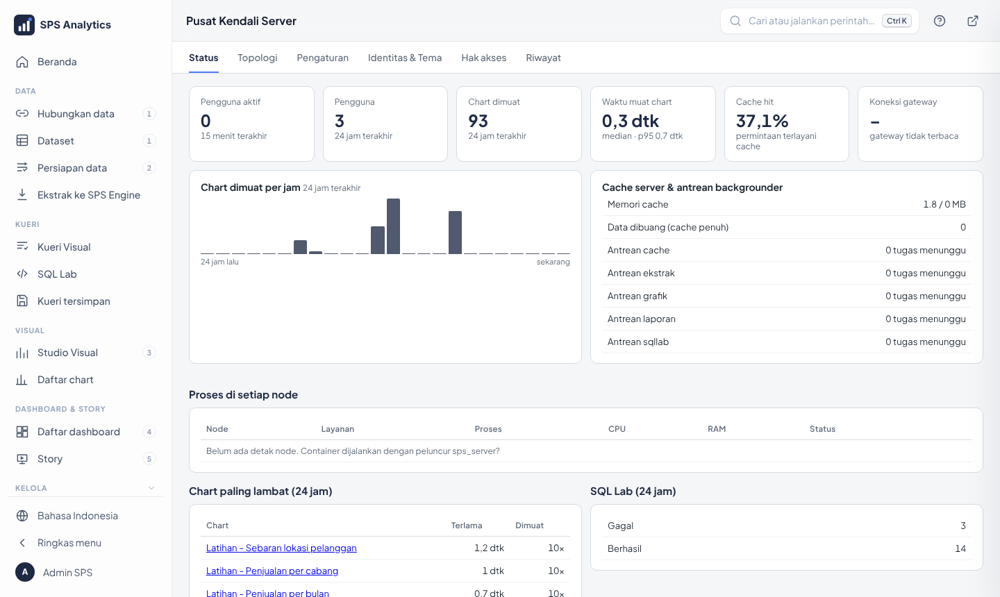

# Modul Level 4 · Admin Server

| Identitas | |
|---|---|
| Peserta | tim TI pengelola server |
| Durasi | 2 sesi × 150 menit |
| Prasyarat | Level 1–3; Windows, PowerShell, konsep Docker dasar |
| Bahan peserta | [tutorial Level 4](../tutorial/level-4-admin-server.md), dokumen 09, 11, 14, 15, 16, 18, **19 (runbook)** |
| Lingkungan | **server/VM uji** per kelompok (4 CPU / 8 GB, Docker Desktop terpasang) |

## Tujuan pembelajaran

1. Memasang dengan `ALDx-Setup.exe` (atau `PASANG.cmd`) dan memverifikasi dengan `scripts\uji.ps1`;
2. menjelaskan peran 7 container dan cara masuk ke masing-masing;
3. memantau dan mengatur kapasitas di Pusat Kendali; menerapkan auto-tuning;
4. mencadangkan & memulihkan (metadb, engine), menjadwalkan cadangan;
5. melakukan upgrade/downgrade aman;
6. mengatur identitas & tema (nama, logo, warna) tanpa restart: tema bawaan *Tinta & Sakura*, preset `navy` (tampilan lama), dan logo ALDx "Tebasan";
7. membedakan Superadmin & Admin, mengatur **Batas data**, dan memakai saran AI `/hw-engineer` dengan aman;
8. menangani gangguan dengan prosedur 7 langkah (pendalaman: [modul runbook admin](modul-runbook-admin.md)).

## Rencana sesi

**Sesi 1: pasang & pantau (150 menit)**

| Menit | Kegiatan | Rujukan |
|---|---|---|
| 0–20 | Arsitektur: gateway, web, worker, beat, metadb, engine, redis | [14 bagian 1](../14-akun-dan-akses.md) |
| 20–70 | Praktik **ALDx-Setup.exe** (wizard ringkas, lalu ulangi dengan *pengaturan lanjutan*) di VM uji (sambil menunggu build: penjelasan `.env`, akun) | [18](../18-installer.md) |
| 70–85 | `scripts\uji.ps1`, `versi.ps1`, `docker compose ps` | – |
| 85–125 | Pusat Kendali: Status, Topologi, Pengaturan, Hak akses, Riwayat |  |
| 125–150 | Latihan 1–3 | – |

**Sesi 2: rawat & pulihkan (150 menit)**

| Menit | Kegiatan | Rujukan |
|---|---|---|
| 0–30 | Sizing & auto-tuning: membaca tabel, kapan menambah node | [15](../15-sizing.md) |
| 30–60 | Cadangan, pemulihan, Task Scheduler | [tutorial §8](../tutorial/level-4-admin-server.md#8-cadangan--pemulihan) |
| 60–90 | Upgrade/downgrade: simulasi naik patch Redis & ClickHouse | [16](../16-upgrade-downgrade.md) |
| 90–120 | Simulasi gangguan: engine mati, disk penuh, password sumber berubah; Identitas & Tema | [19 §4](../19-runbook-faq-admin.md#4-mencari-penyebab-gangguan-pohon-keputusan) |
| 120–140 | Latihan 4–6 | – |
| 140–150 | Kuis | – |

## Poin penyampaian

- **`.env` adalah kunci rumah**: cadangkan di tempat aman; jangan dikirim lewat chat.
- **Jangan pernah mengganti `SUPERSET_SECRET_KEY`** setelah instalasi.
- Semua perubahan kapasitas lewat Pusat Kendali → `terapkan-server.ps1`; jangan edit `docker-compose.yml` untuk angka.
- **Cadangkan sebelum apa pun.** Downgrade database hanya lewat cadangan.
- `uji.ps1` setelah setiap perubahan.
- **Asisten AI**: demo panel AI (`Ctrl + I`) › **Sambungkan AI**: Ollama terdeteksi otomatis setelah
  `ollama pull qwen3:4b`, lalu isi key cloud gratis (mis. Groq) dan tunjukkan key salah ditolak
  ([28-sambungkan-asisten-ai.md](../28-sambungkan-asisten-ai.md)). Model lokal dipasang di Windows, bukan di Docker.
- Urutan memeriksa gangguan selalu dari lapis bawah: Docker → metadb/engine/redis → web → worker/beat → gateway.
- Port metadb/engine/redis hanya untuk localhost kecuali mode multi-node.

## Latihan

1. Jalankan `scripts\uji.ps1`. Berapa uji yang dijalankan dan berapa yang lulus?
2. Ubah **Baris maksimal per chart** menjadi 10.000. Di mana terlihat siapa yang mengubah?
3. Ubah **Backgrounder: penyegaran ekstrak** menjadi 2 → `terapkan-server.ps1`. Di mana perubahannya terlihat?
4. Cadangkan metadata, hapus chart *Latihan - Jumlah transaksi*, pulihkan cadangan. Apakah chart kembali? Apa yang hilang bila ada chart dibuat **setelah** cadangan?
5. `docker compose stop engine`, lalu `scripts\uji.ps1`. Uji apa saja yang GAGAL? Nyalakan kembali.
6. Server 16 CPU / 32 GB untuk Docker: berapa jatah RAM ALDx Engine dan berapa proses web?
7. Pusat Kendali → **Batas data**: tulis rekomendasi ukuran impor berkas di server Anda dan rumusnya. Set baris impor = 3, impor CSV 10 baris, catat pesannya, kembalikan ke **auto**.
8. Minta `/hw-engineer` mengusulkan pengaturan; **Abaikan**. Adakah perubahan di Riwayat?
9. Kunci akun uji dengan 5 kali salah password. Buka kuncinya sebagai Admin dan temukan kejadiannya di jejak audit.

### Kunci jawaban

| No | Jawaban |
|---|---|
| 1 | **68 uji**, semua LULUS pada instalasi sehat (4 komponen, 1 data, 23 chart Studio, 2 analitik, 2 engine, 8 halaman termasuk Kueri Visual & cangkang, 3 keamanan termasuk Superadmin, 5 Tahap 2: batas data, ekspor Excel, peran AI, Oracle ROWNUM, skema terpilih, 2 Tahap 3: berkas .ald/.aldx & filter global/ulasan, 1 Hubungkan data (driver opsional seperti SAP HANA yang belum dipasang tetap LULUS, dengan catatan), 1 HTTPS gateway, 2 keamanan: penguncian & audit, hak minimum, 1 ketahanan: ekspor latar & cadangan, 1 hierarki dimensi Studio, 1 objek dashboard, 1 tipe angka ClickHouse & tanggal ISO (syarat ramalan), 5 tambahan: Tampilkan saya banyak kolom, analitik lengkap, data latihan harian, kolom ID, preset tema, impor banyak tabel) |
| 2 | Pusat Kendali → **Riwayat**: waktu, oleh siapa, sebelum **5.000** (bawaan) → sesudah **10.000**. Berlaku ±10 detik tanpa restart |
| 3 | **Topologi** (kolom backgrounder ekstrak = 2) dan Status → antrean |
| 4 | Ya, chart kembali. Chart/dashboard yang dibuat setelah cadangan **hilang** (dicatat & dibuat ulang) |
| 5 | *ALDx Engine terhubung*, *Isi penuh (tukar atomik)…*, ke-23 *chart Studio* dan *Ramalan* (data latihan berada di engine). *metadb*, *Redis*, *halaman* tetap LULUS. Setelah `docker compose start engine`: semua LULUS lagi |
| 6 | Engine ± **6,8 GB** (25% dari RAM tersedia), web **15 proses × 4 thread** |
| 7 | Rumus: RAM web ÷ (proses web + 1) ÷ 6 (server uji: 220 MB). Pesan: *"Tabel '...' melebihi batas 3 baris..."*; tidak ada dataset terbuat, data lama utuh |
| 8 | Tidak ada. Usulan AI tidak mengubah apa pun sampai **Terapkan** ditekan; yang diterapkan tercatat atas nama Anda |
| 9 | Pesan *"Akun dikunci sementara… Coba lagi pukul HH:MM"*. Pusat Kendali › Riwayat › Akun terkunci › **Buka kunci**. Jejak audit (kelompok Login): 5× *Login gagal*, *Akun dikunci*, *Kunci akun dibuka* oleh Anda |

## Kuis

1. Data ekstrak disimpan di container… a) metadb **b) engine** c) redis
2. Container yang aman dihapus tanpa kehilangan data permanen… a) metadb **b) redis** c) engine
3. Setelah mengubah *Sumber daya → RAM web* di Pusat Kendali, perlu… a) restart Windows **b) `scripts\terapkan-server.ps1`** c) tidak perlu apa-apa
4. Pindah versi utama PostgreSQL (mis. 17 → 18) dilakukan dengan… a) mengganti versi saja **b) volume baru + pulihkan cadangan** c) `db downgrade`
5. Password admin aplikasi setelah instalasi disimpan di… a) `.env` **b) tidak disimpan (dipegang admin)** c) `docker-compose.yml`
6. `CLUSTER_BIND=0.0.0.0` dipakai saat… a) instalasi biasa **b) mode multi-node** c) upgrade

7. Admin biasa ingin melepas batas ukuran impor berkas. Yang benar… a) ubah `.env` sendiri **b) minta Superadmin: Batas data → Tanpa batas** c) tidak mungkin

**Kunci:** 1b · 2b · 3b · 4b · 5b · 6b · 7b

## Daftar periksa kompetensi

- [ ] Memasang dari nol dengan ALDx-Setup.exe dan `uji.ps1` LULUS
- [ ] Masuk ke metadb, engine, redis dengan perintah yang benar
- [ ] Mengubah pengaturan & menerapkannya
- [ ] Mengatur Batas data (rekomendasi, auto, tanpa batas) sebagai Superadmin
- [ ] Menilai & menerapkan/mengabaikan usulan `/hw-engineer`
- [ ] Mencadangkan, memulihkan, dan menjadwalkan cadangan
- [ ] Menjelaskan langkah upgrade & downgrade tiap komponen
- [ ] Menangani gangguan sesuai prosedur
- [ ] Membuka akun terkunci dan membaca/mengunduh jejak audit
