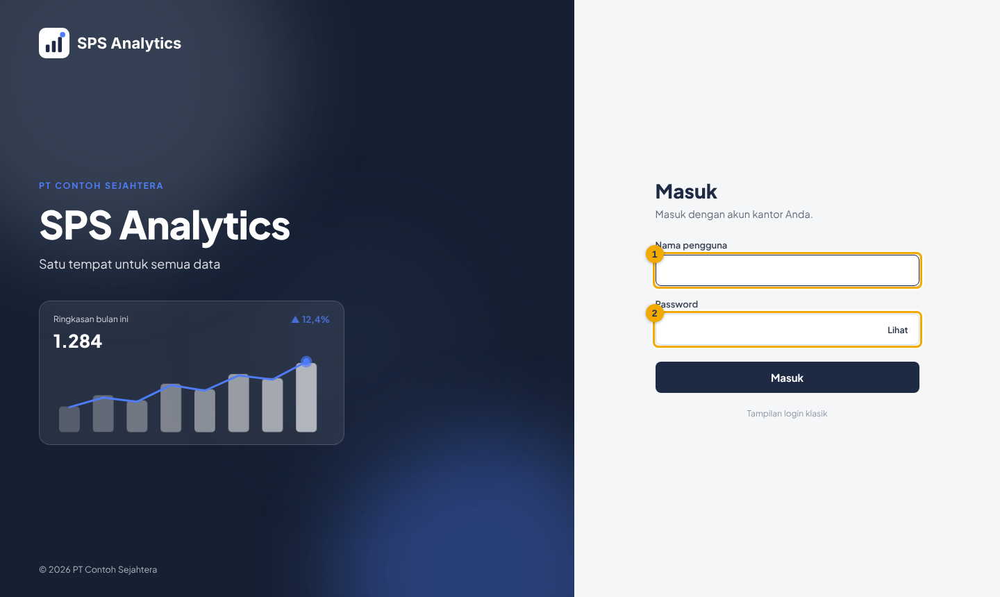
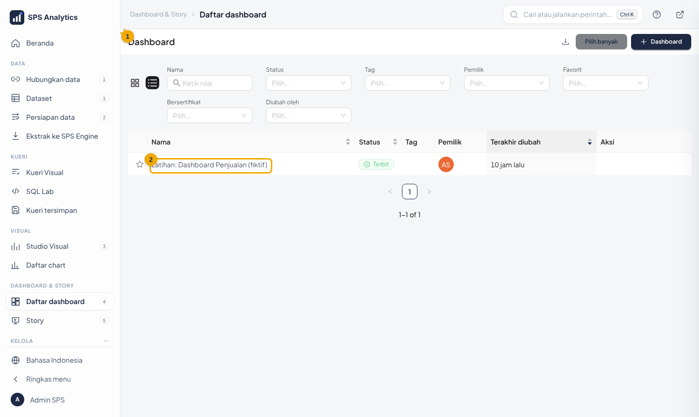
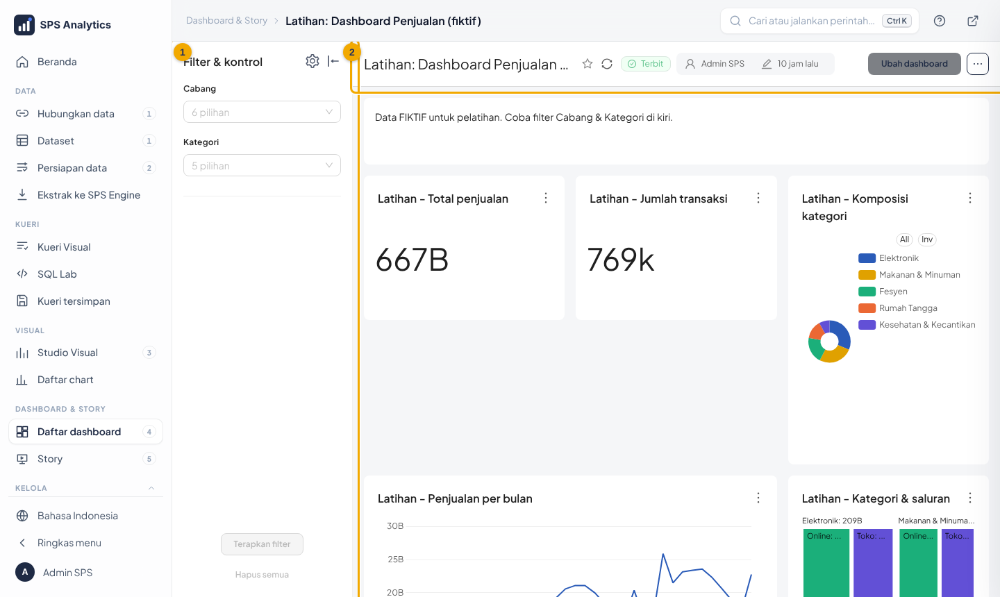
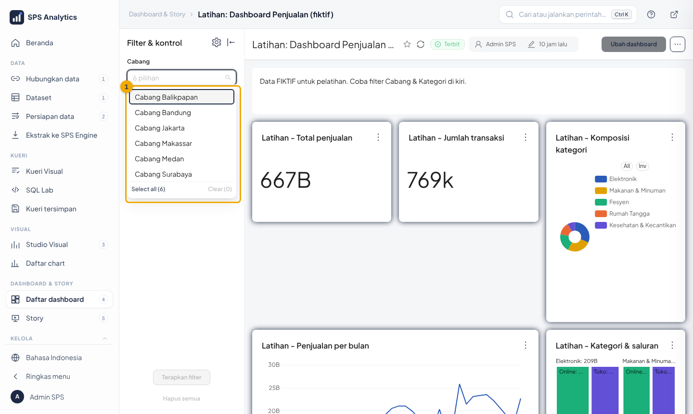
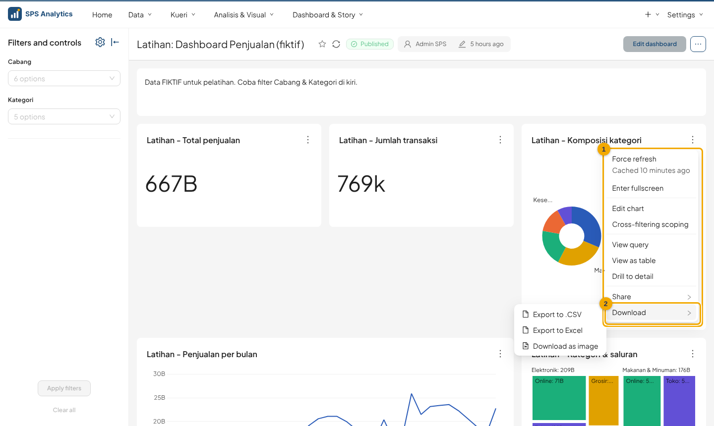
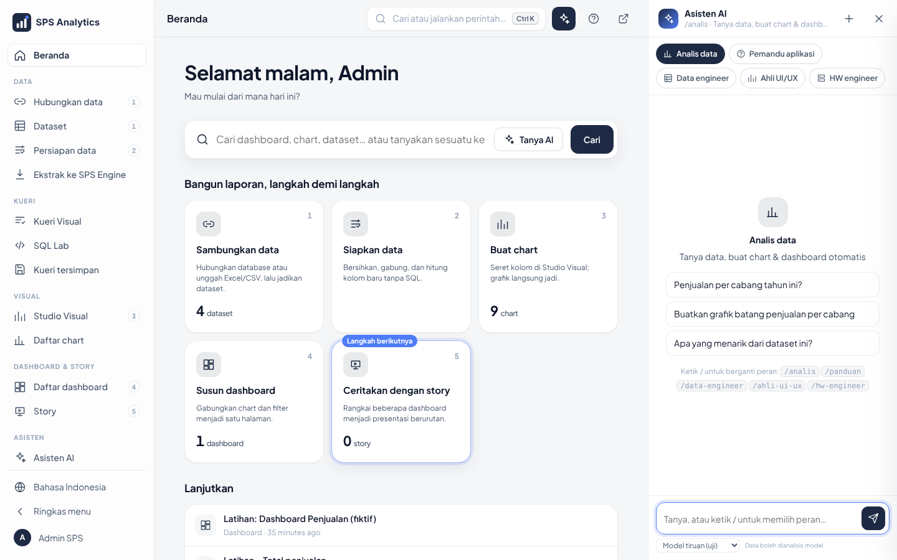
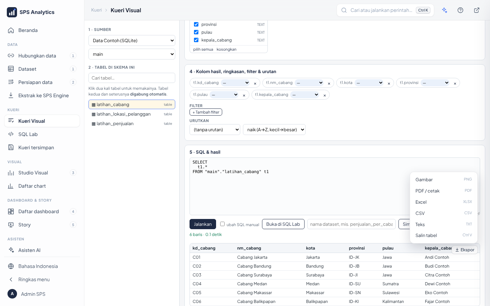
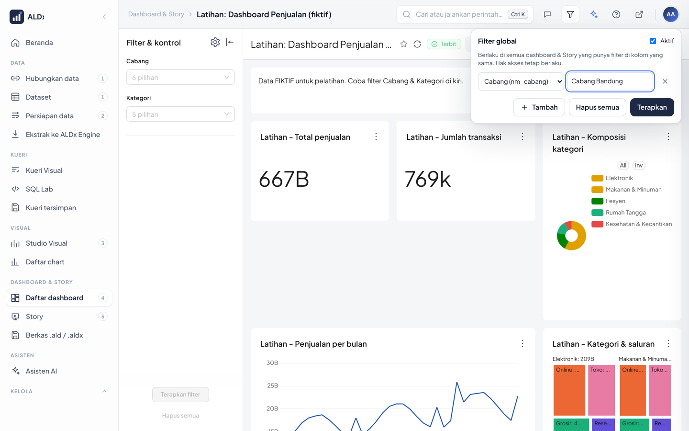

# Level 1 · Pengguna: Membaca Dashboard

**Untuk:** semua pengguna · **Waktu:** ± 1 jam · **Hasil:** bisa login, membuka dashboard,
menyaring data, mengunduh, dan bertanya ke Asisten AI.

> Beberapa tombol bawaan Superset berbahasa Inggris. Terjemahannya ditulis dalam kurung.

---

## 1. Masuk (login)

1. Buka browser (Chrome/Edge), ketik alamat yang diberikan admin, misalnya `http://analytics.perusahaan.local:8088`.
2. **(1) Nama pengguna**: akun yang diberikan admin. Bila kantor memakai login jaringan (LDAP/Active
   Directory), pakai username yang sama dengan login komputer kantor.
3. **(2) Password**: password akun tersebut.
4. Klik **Masuk**.

Halaman login menampilkan nama, logo, dan warna perusahaan Anda; latarnya bergerak perlahan.
Bila komputer Anda diatur untuk mengurangi animasi, latar tampil diam. Tampilan bawaan Superset
tetap tersedia di alamat `/login/?klasik=1`.

| Masalah | Penyebab | Yang dilakukan |
|---|---|---|
| "Nama pengguna atau password salah" | salah ketik, atau password baru saja diganti | ulangi; pastikan Caps Lock mati |
| Halaman tidak terbuka | di luar jaringan kantor | sambungkan VPN kantor / tanyakan alamat ke admin |
| Setelah login, dashboard kosong | hak akses belum diatur | hubungi admin data unit Anda |

Setelah login, Anda melihat **Beranda** (atau halaman depan yang ditentukan admin).

**Mengenal layar** ([22](../22-cangkang-aplikasi.md)): menu di **kiri** tersusun sesuai urutan kerja; kotak
**Cari** di atas (`Ctrl + K`) menemukan halaman, dashboard, atau chart; tombol **?** menjelaskan cara pakai
halaman yang sedang dibuka; bahasa (Indonesia, English, 日本語) dan tombol **Keluar** ada di menu **avatar** kanan atas. Di ponsel, menu ada di
bilah bawah dan tombol ☰.

---

## 2. Mencari dashboard

1. Klik **Daftar dashboard** di menu kiri (grup *Dashboard & Story*). Cara cepat: tekan `Ctrl + K`, ketik nama
   dashboard, lalu `Enter`. Anda hanya melihat menu yang boleh dipakai.
2. Ketik sebagian judul di kotak pencarian, misalnya `latihan`.
3. **(2)** Klik judul **Latihan: Dashboard Penjualan (fiktif)**.

Tips: klik **bintang ☆** di sebelah judul dashboard untuk menjadikannya favorit; dashboard favorit
muncul di Beranda.

---

## 3. Membaca dashboard

| No | Bagian | Fungsi |
|---|---|---|
| 1 | **Filters and controls** (Filter) | menyaring seluruh dashboard |
| 2 | Judul & tombol | nama dashboard, ↻ muat ulang, ⋯ menu lain |

- Setiap kotak adalah satu chart. Arahkan kursor ke batang/titik untuk melihat angka lengkapnya.
- Angka **667B** artinya Rp667 miliar (lihat [kamus singkatan](README.md#membaca-singkatan-angka)).
- Gulir ke bawah untuk chart berikutnya, termasuk peta.

> **Data yang Anda lihat sesuai hak akses Anda.** Bila admin mengatur hak akses data, pengguna
> cabang hanya melihat data cabangnya. Dua orang bisa membuka dashboard yang sama dengan angka berbeda; itu normal.

---

## 4. Menyaring data (filter)

1. Di panel kiri, klik kotak **Cabang**.
2. Centang satu atau beberapa nilai, misalnya `Cabang Jakarta`.
3. Klik **Apply filters** (Terapkan filter) di bawah panel.
4. Semua chart berubah. Untuk mengembalikan: **Clear all** (Hapus semua) → **Apply filters**.

**Klik-filter (cross filter):** klik satu batang/potongan pie, misalnya `Elektronik`. Chart lain ikut
tersaring ke Elektronik. Klik lagi bagian yang sama untuk membatalkan.

Panel filter bisa disembunyikan dengan ikon **|←** agar chart lebih lebar.

---

## 5. Menu setiap chart: unduh, layar penuh, lihat tabel

Arahkan kursor ke chart, klik **⋮** di pojok kanan atas.

| Menu | Arti |
|---|---|
| Force refresh | ambil data terbaru (abaikan cache) |
| Enter fullscreen | perbesar chart ke layar penuh |
| View as table | lihat angka chart sebagai tabel |
| Drill to detail | lihat baris data rinci di balik chart |
| **(2) Download → Export to .CSV / Excel** | unduh data chart |
| **Download → Download as image** | unduh gambar chart (untuk bahan paparan) |

Menu **Download** hanya muncul bila Anda diberi izin unduh. Data yang terunduh tetap mengikuti hak
akses Anda. Simpan file unduhan sesuai ketentuan kerahasiaan data perusahaan.

---

## 6. Bertanya ke Asisten AI

1. Klik **✦** di bilah atas, atau tekan `Ctrl + I`. Panel muncul di kanan, di halaman mana pun.
   (Tombol ini muncul bila admin mengizinkan role Anda. Bila panel menampilkan **Sambungkan Asisten AI**,
   artinya AI belum disambungkan: minta admin mengikuti [28-sambungkan-asisten-ai.md](../28-sambungkan-asisten-ai.md).)
2. Peran awal **Analis data**. Klik salah satu contoh, atau ketik pertanyaan sehari-hari, misalnya:
   *"Berapa total penjualan tiap cabang tahun 2025?"*
3. Asisten mencari dataset, menjalankan query **dengan hak akses Anda**, lalu menjawab beserta tabel.
   Tabel jawaban punya tombol **Ekspor** (Excel, CSV, gambar, ...).
4. Bingung cara memakai menu? Ketik `/panduan` lalu pertanyaannya, mis. *"/panduan cara membuat dashboard"*.

Tips bertanya:
- Asisten sudah tahu dataset, chart, dan dashboard yang boleh Anda buka, serta halaman yang sedang terbuka.
  Buka dashboard lalu tanya *"jelaskan dashboard ini"* atau *"kategori mana yang paling turun?"*.
- Sebut ukuran, pengelompokan, dan periode: *"penjualan Elektronik per bulan 2025"*.
- Bila jawaban kurang tepat, perjelas: *"hanya Cabang Jakarta"*.
- Asisten bisa salah. Cocokkan angka penting dengan dashboard resmi.
- Di Beranda, ketik pertanyaan di kotak Cari lalu klik **Tanya AI**.

Penjelasan lengkap peran: [23-asisten-ai-peran-ahli.md](../23-asisten-ai-peran-ahli.md).

---

## 6a. Ekspor tabel & grafik halaman ALDx

Di halaman ALDx (Kueri Visual, Studio Visual, Asisten AI, ...) arahkan kursor ke tabel atau grafik, klik
**Ekspor** di pojok kanan atas: **Gambar** (PNG), **PDF / cetak**, **Excel**, **CSV**, **Teks**, atau **Salin tabel**.
Isi berkas = data yang tampil di layar Anda (hak akses tetap berlaku).

## 6b. Filter global: satu filter untuk semua dashboard

1. Klik tombol **corong** di bilah atas → **Tambah**.
2. Pilih kolom, mis. **Cabang (nm_cabang)**, ketik nilainya: `Cabang Bandung`.
3. **Terapkan**. Dashboard yang terbuka langsung tersaring; dashboard & Story lain yang punya filter Cabang ikut tersaring.
4. Angka di tombol corong = jumlah filter global aktif. **Hapus semua** untuk kembali normal.
5. Kolom angka (mis. Tahun) diisi **dari – sampai**; **Rentang waktu** dipilih dari daftar (mis. 30 hari terakhir).
   Filter global tersimpan di akun Anda, jadi ikut saat Anda membuka ALDx dari ponsel.

## 6c. Komentar & rating

Saat dashboard terbuka, klik tombol **komentar** di bilah atas → pilih bintang → tulis komentar → **Kirim**.
Komentar tampil untuk orang lain setelah disetujui Superadmin. Detail: [docs/25](../25-berkas-filter-global-ulasan.md).

- **Balas** komentar orang lain; ketik **@** lalu nama untuk menyebut rekan (pilih dari saran).
- Titik biru di avatar = ada pemberitahuan (Anda disebut / komentar Anda dibalas). Klik avatar untuk membacanya.

## 6d. Mode gelap & ponsel

- Avatar › **Tampilan** › *Gelap* (atau *Ikuti sistem*). Dashboard ikut gelap; nyaman untuk layar pantau.
- Di ponsel, tombol komentar, filter, Asisten & bantuan ada di tombol **…** kanan atas.

---

## 7. Latihan mandiri

Kerjakan di dashboard **Latihan: Dashboard Penjualan (fiktif)**. Jawaban di
[bahan ajar Level 1](../bahan-ajar/level-1-pengguna.md#kunci-jawaban).

1. Berapa total penjualan seluruh data latihan?
2. Cabang mana penjualannya paling besar?
3. Kategori apa yang paling besar porsinya?
4. Saring **Kategori = Kesehatan & Kecantikan**. Berapa kira-kira total penjualannya?
5. Unduh data chart "Penjualan per cabang" sebagai CSV, lalu buka di Excel.
6. Buka panel Asisten AI (`Ctrl + I`), tanyakan *"penjualan per cabang"*, lalu ekspor tabel jawabannya ke Excel.
7. Tulis komentar di dashboard latihan yang menyebut rekan Anda dengan `@`. Apa yang terlihat di avatar rekan itu
   setelah komentar disetujui?

## 8. Ringkasan

- Login dengan akun Anda → **Dashboards** → pilih dashboard.
- Saring dengan panel kiri (**Apply filters**) atau klik bagian chart.
- **⋮** di tiap chart: unduh, layar penuh, lihat tabel.
- **✦ / `Ctrl + I`**: Asisten AI di halaman mana pun; **Ekspor** di tabel & grafik halaman ALDx.
- Angka mengikuti hak akses Anda secara otomatis.

Lanjut ke [Level 2 · Analis](level-2-analis.md) untuk membuat chart sendiri.
