# Level 2 · Analis: Membuat Chart & Dashboard dengan Studio Visual

**Untuk:** pembuat laporan · **Waktu:** ± 3 jam · **Prasyarat:** Level 1 · **Izin:** role dengan
kemampuan *Buat & simpan chart* (minta ke admin)

Studio Visual bekerja dengan **seret kolom, grafik langsung jadi**. Tidak perlu menulis SQL.
Buka lewat menu **Visual → Studio Visual** atau alamat `/studio/`.

> **Menu** dibaca dari kiri ke kanan sesuai urutan kerja: **Data** (dataset) › **Kueri** (ambil & gabung tabel) ›
> **Visual** (chart) › **Dashboard & Story**. Semua halaman memakai menu yang sama
> ([21](../21-kueri-visual-dan-alur-menu.md)).

---

## 1. Mengenal layar Lembar kerja

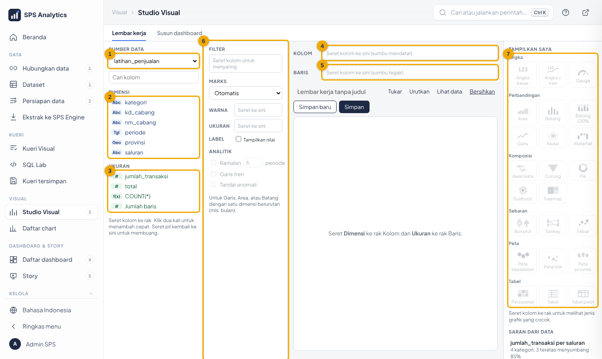

| No | Bagian | Fungsi |
|---|---|---|
| 1 | **Sumber data** | pilih dataset (mis. `latihan_penjualan`) |
| 2 | **Dimensi** | kolom pengelompok: teks, tanggal (`Tgl`), geografis (`Geo`) |
| 3 | **Ukuran** | kolom angka (`#`), metrik tersimpan (`f(x)`), *Jumlah baris* |
| 4 | Rak **Kolom** | isi sumbu mendatar |
| 5 | Rak **Baris** | isi sumbu tegak |
| 6 | **Filter · Marks · Analitik** | penyaring, warna/ukuran/label, ramalan |
| 7 | **Tampilkan saya** | 23 jenis grafik; bingkai emas = rekomendasi |

Prinsip: **dimensi** menjawab "per apa?", **ukuran** menjawab "berapa?".

---

## 2. Chart pertama: penjualan per cabang

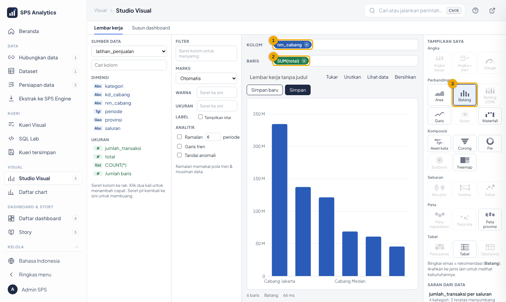

1. Pilih sumber data **latihan_penjualan**.
2. Seret **nm_cabang** (Dimensi) ke rak **Kolom** **(1)**.
3. Seret **total** (Ukuran) ke rak **Baris** **(2)**. Pil berubah menjadi `SUM(total)`.
4. Grafik batang langsung muncul. **(3)** Tombol *Batang* berbingkai emas = rekomendasi.

Cara cepat: **klik dua kali** kolom di panel kiri. Dimensi masuk ke Kolom, ukuran masuk ke Baris.

## 3. Memberi warna (bertumpuk)

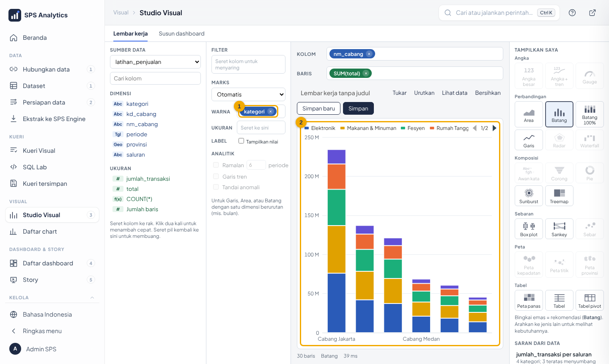

Seret **kategori** ke kotak **Warna** **(1)**. Batang menjadi bertumpuk per kategori **(2)**.
Warna mengikuti palet ALDx yang aman bagi penyandang buta warna, dan sama dengan warna di dashboard.

## 4. Menyaring

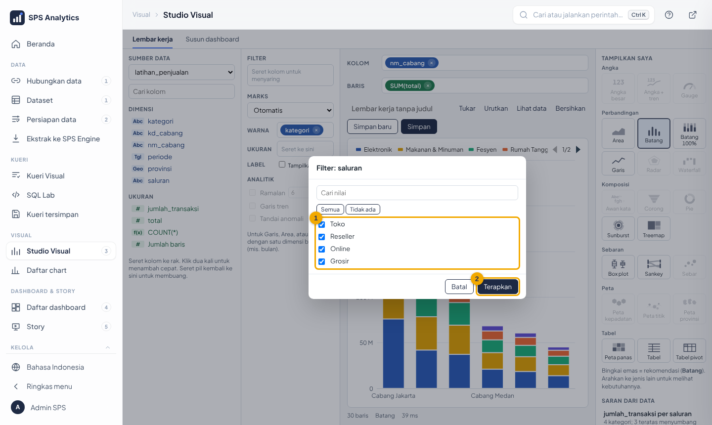

1. Seret **saluran** ke rak **Filter**.
2. **(1)** Centang nilai yang ingin ditampilkan (tombol *Semua* / *Tidak ada* untuk centang cepat).
3. **(2)** Klik **Terapkan**.

Untuk ukuran (angka), dialog filter meminta nilai **minimum/maksimum**.
Klik pil filter untuk mengubah, atau seret pil kembali ke panel kiri untuk membuang.

## 5. Mengganti cara meringkas (agregasi)

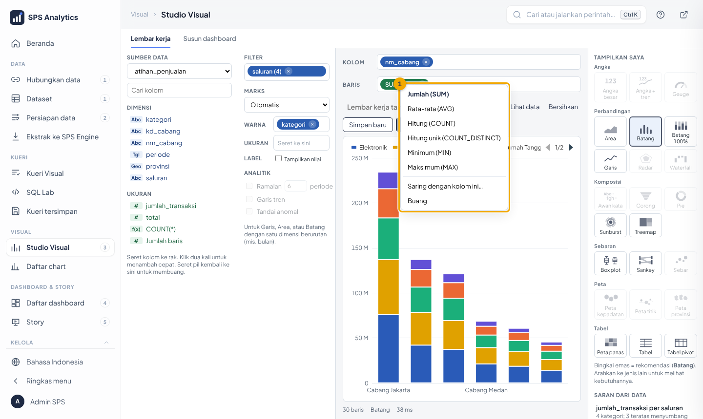

Klik pil ukuran, misalnya `SUM(total)` → **(1)** pilih Jumlah, Rata-rata, Hitung, Hitung unik, Minimum, atau Maksimum.

| Pertanyaan | Agregasi |
|---|---|
| Berapa total penjualan? | Jumlah (SUM) |
| Berapa rata-rata belanja per pelanggan? | Rata-rata (AVG) |
| Ada berapa pelanggan? | Hitung unik (COUNT_DISTINCT) pada id_pelanggan |

## 6. Tombol alat

| Tombol | Fungsi |
|---|---|
| **Tukar** | tukar isi Kolom ⇄ Baris (batang mendatar ⇄ tegak) |
| **Urutkan** | terbesar dulu → terkecil dulu → asli |
| **Lihat data** | tabel angka di bawah grafik |
| **Bersihkan** | kosongkan lembar |
| Kotak **Label → Tampilkan nilai** | angka tertulis di grafik |

## 7. Memilih jenis grafik lain

Di panel **Tampilkan saya**, klik jenis lain. Tombol pudar berarti kolom belum cukup; arahkan
kursor untuk melihat kebutuhannya (mis. *Sankey: 2 dimensi, 1 ukuran*).
Galeri seluruh 23 jenis: [17-katalog-chart-peta-prediksi.md](../17-katalog-chart-peta-prediksi.md).

| Ingin menunjukkan | Pilih |
|---|---|
| perbandingan antar-cabang | Batang |
| perkembangan per bulan | Garis / Area |
| komposisi (porsi) | Pie (≤ 7 bagian), Treemap (banyak bagian), Batang 100% |
| silang dua kategori | Tabel pivot / Peta panas |
| aliran (dari → ke) | Sankey |
| satu angka penting | Angka besar / Angka + tren |
| lokasi | Peta titik / Peta provinsi / Peta kepadatan |

## 8. Menyimpan

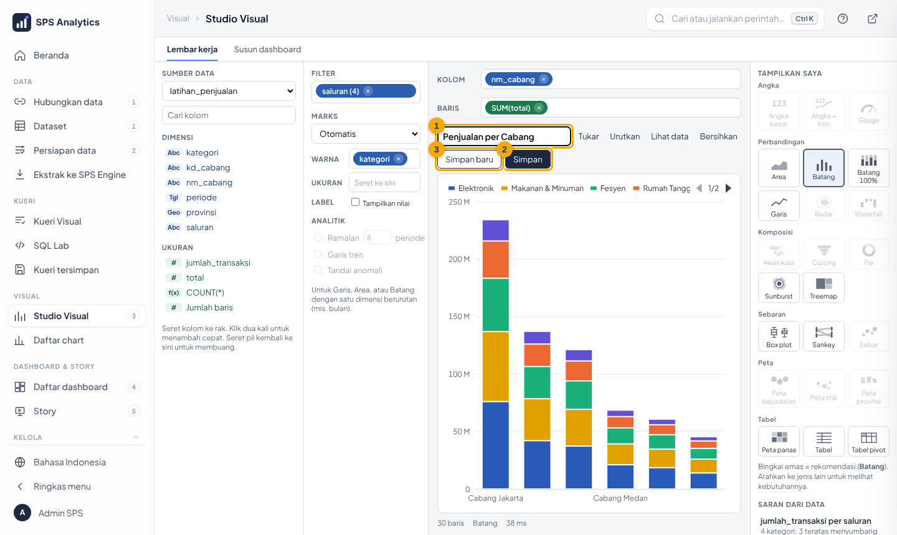

1. **(1)** Ketik judul yang jelas, mis. *Penjualan per Cabang 2025*.
2. **(2) Simpan** memperbarui chart yang sedang dibuka, **(3) Simpan baru** membuat salinan.
3. Chart tersimpan muncul di **Lembar kerja tersimpan** (panel kanan) dan di menu **Charts** Superset.

---

## 9. Peta

### Peta titik (lokasi pelanggan)

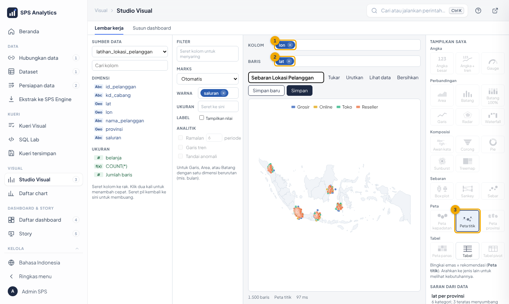

1. Sumber data **latihan_lokasi_pelanggan**.
2. Seret **lon** (bujur) ke **Kolom** **(1)**, **lat** (lintang) ke **Baris** **(2)**.
3. Rekomendasi otomatis **Peta titik** **(3)**. Seret **saluran** ke **Warna**, **belanja** ke **Ukuran**.
4. Gulir roda mouse untuk memperbesar, seret untuk menggeser.

### Peta provinsi

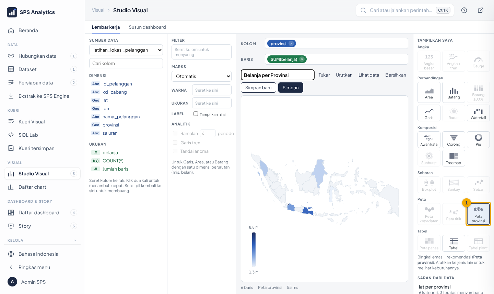

Seret **provinsi** ke Kolom dan **belanja** ke Baris → **(1) Peta provinsi**. Warna makin gelap = nilai makin besar.

---

## 10. Ramalan, tren & anomali

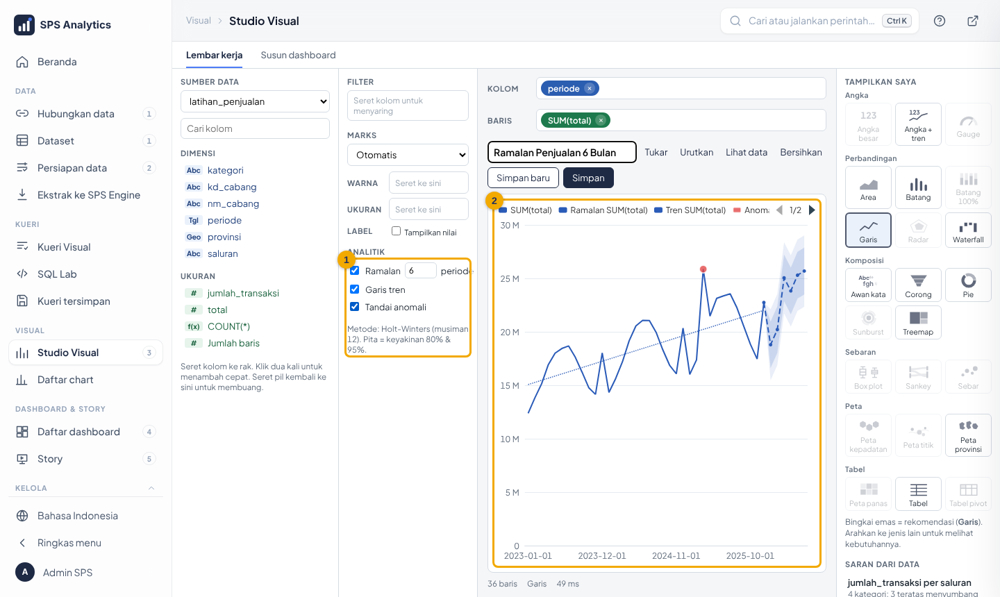

1. Sumber data **latihan_penjualan**: **periode** ke Kolom, **total** ke Baris (grafik Garis).
2. **(1)** Di panel **Analitik**, centang:
   - **Ramalan 6 periode**: garis putus-putus + pita keyakinan 80% & 95%;
   - **Garis tren**: arah umum naik/turun;
   - **Tandai anomali**: titik merah pada bulan yang tidak wajar.
3. Arahkan kursor ke bulan ramalan untuk melihat rentang 80%/95%.

Cara membaca: lihat [17-katalog-chart-peta-prediksi.md bagian 4](../17-katalog-chart-peta-prediksi.md#4-analitik-prediktif).
Ramalan meneruskan pola lama; kebijakan baru tidak diketahui model.

---

## 11. Menyusun dashboard

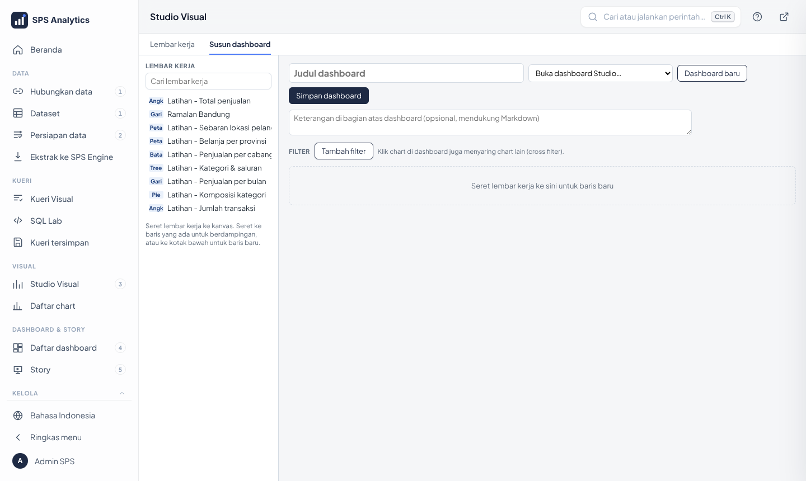

1. Tab **Susun dashboard** di Studio.
2. Seret lembar kerja tersimpan dari panel kiri ke kanvas. Lepas di samping kotak lain agar sebaris.
3. Atur lebar setiap kotak: ¼ · ⅓ · ½ · ⅔ · penuh.
4. **Tambah filter**: pilih kolom (mis. `nm_cabang`), jenis *pilihan* atau *rentang*.
5. Isi judul & keterangan → **Simpan**. Dashboard bisa dibuka di menu **Dashboards**.

Klik-filter antar-chart otomatis aktif.

---

## 12. Menggabung tabel dengan Kueri Visual (tanpa SQL)

Butuh izin SQL Lab (peran **Analis**). Menu **Kueri → Kueri Visual**.

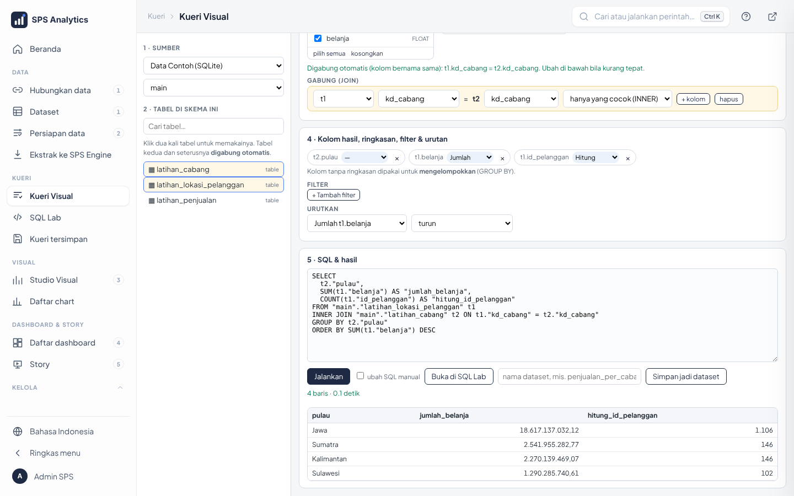

1. Pilih database tempat data latihan (mis. **ALDx Engine**) dan skemanya. Hanya tabel skema itu yang tampil.
2. **Klik dua kali** `latihan_lokasi_pelanggan` → kueri langsung dijalankan.
3. **Klik dua kali** `latihan_cabang` → otomatis digabung lewat `kd_cabang` (lihat pesan hijau).
4. Klik **kosongkan** di kedua kotak, lalu centang `pulau`, `belanja`, `id_pelanggan`.
5. Pada kotak kolom hasil: `belanja` → **Jumlah**, `id_pelanggan` → **Hitung**. Urutkan *Jumlah belanja* turun.
6. **Jalankan**. Bila benar, isi nama `belanja_per_pulau` → **Simpan jadi dataset** → **Buat chart di Studio Visual**.

Tips: angka yang tiba-tiba berlipat setelah gabung = kolom penghubung salah. Periksa kotak **Gabung**.

**Ekspor hasil**: arahkan kursor ke tabel hasil (atau grafik di Studio Visual), klik **Ekspor** → Excel, CSV,
TXT, gambar, atau PDF. Rincian: [22 § 7](../22-cangkang-aplikasi.md).

**Minta bantuan data engineer AI**: tekan `Ctrl + I`, peran **/data-engineer** (otomatis di halaman Kueri/SQL Lab),
mis. *"tuliskan SQL total penjualan per bulan"*. Jawaban SQL punya tombol **Salin**.

## 12a. Menyimpan & berbagi sebagai berkas .ald / .aldx

Menu **Dashboard & Story › Berkas .ald / .aldx**.

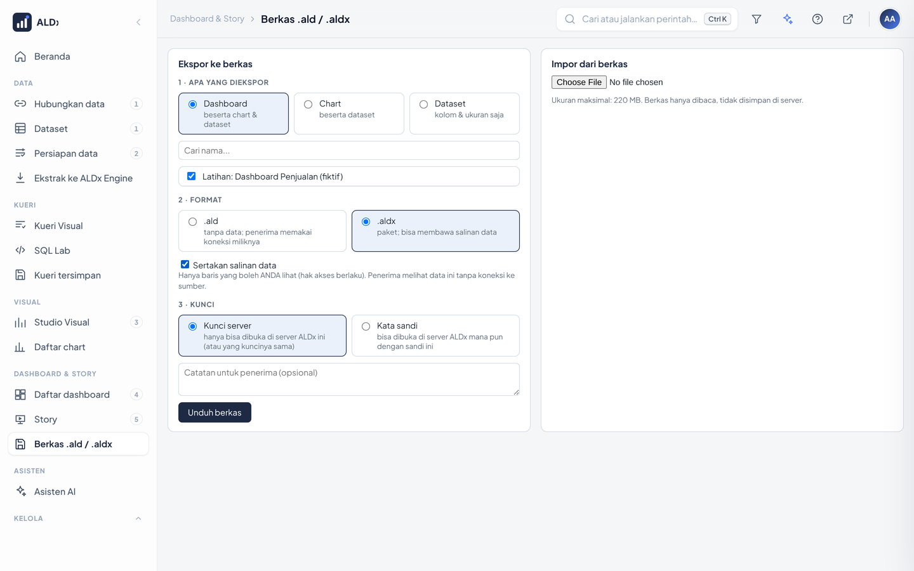

1. **Ekspor**: pilih Dashboard → centang dashboard Anda → pilih `.ald` (tanpa data) atau `.aldx` (+ **Sertakan salinan data**).
2. Kunci: **Kunci server** (dibuka di server ini) atau **Kata sandi** (dibuka di server ALDx mana pun). **Unduh berkas**.
3. **Impor**: pilih berkas → periksa ringkasan → pilih koneksi tujuan (atau **Pakai data di berkas**) → **Salinan baru** → **Impor**.

Isi berkas selalu terenkripsi dan tidak pernah membawa password koneksi. Data di `.aldx` hanya baris yang boleh **Anda** lihat.
Detail: [docs/25](../25-berkas-filter-global-ulasan.md).

---

## 12b. Kueri tersimpan, versi dashboard, tampilan ponsel

| Ingin | Cara |
|---|---|
| Memakai lagi susunan Kueri Visual | isi nama → **Simpan kueri**; buka dari **Kueri tersimpan…** |
| Membatalkan perubahan dashboard | tombol **Riwayat versi** di kepala dashboard → **Pulihkan** |
| Mengatur dashboard di ponsel | tombol **Tata ponsel**: urutkan ↑ ↓, sembunyikan tabel lebar |
| Menandai dashboard yang angkanya sudah diperiksa | Ubah properti › **Sertifikasi** → lencana **Resmi** di Beranda |

Detail: [docs/26](../26-langganan-versi-ponsel-lihat-sebagai.md).

## 13. Latihan mandiri

1. Buat grafik **Garis** penjualan per bulan, warna per **kategori**. Bulan apa yang selalu tinggi?
2. Buat **Tabel pivot**: baris = nm_cabang, kolom = kategori, ukuran = total.
3. Buat **Peta provinsi** belanja pelanggan. Provinsi mana tertinggi?
4. Buat **Ramalan 6 bulan** penjualan total. Metode apa yang dipakai sistem?
5. Gabungkan 3 chart di atas menjadi dashboard *Latihan – [nama Anda]* dengan filter Cabang.
6. Dengan **Kueri Visual**, gabungkan pelanggan dengan cabang. Pulau mana belanjanya terbesar, dan berapa pelanggannya?
7. Ekspor hasil nomor 6 ke **Excel**, lalu jumlahkan kolom belanja di Excel. Apakah sama dengan Studio Visual?
8. Ekspor dashboard nomor 5 sebagai **.aldx** berkata sandi, lalu impor kembali sebagai **Salinan baru**. Apa akhiran judul dashboard hasil impor?
9. Ubah judul dashboard nomor 5, simpan, lalu kembalikan judul lama lewat **Riwayat versi**. Berapa versi yang tercatat?

Kunci jawaban: [bahan ajar Level 2](../bahan-ajar/level-2-analis.md#kunci-jawaban).

Lanjut ke [Level 3 · Admin data](level-3-admin-data.md).
