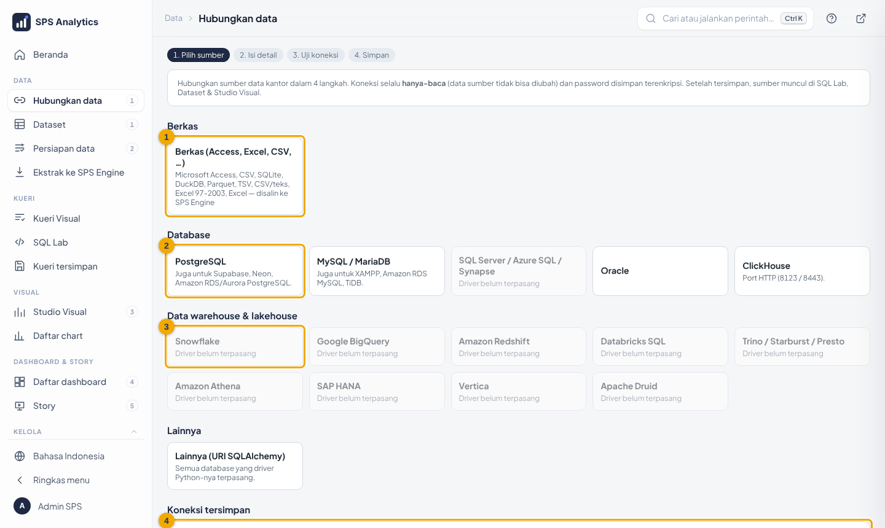
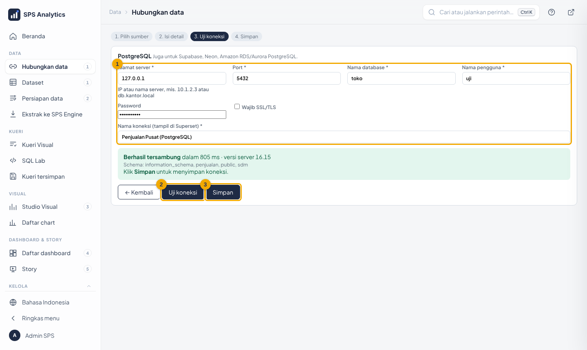
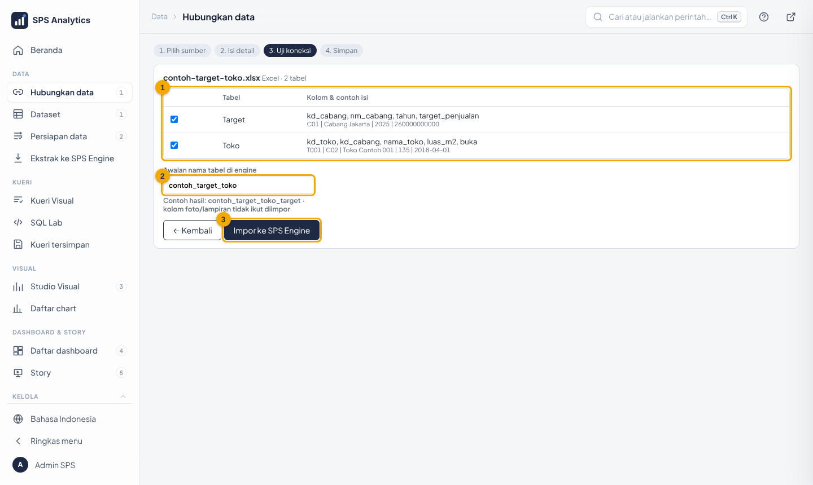
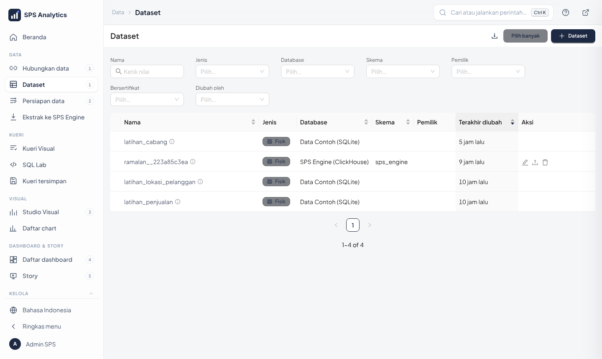
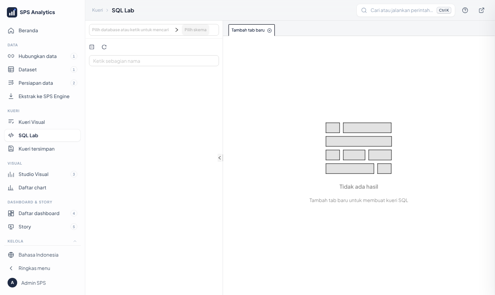
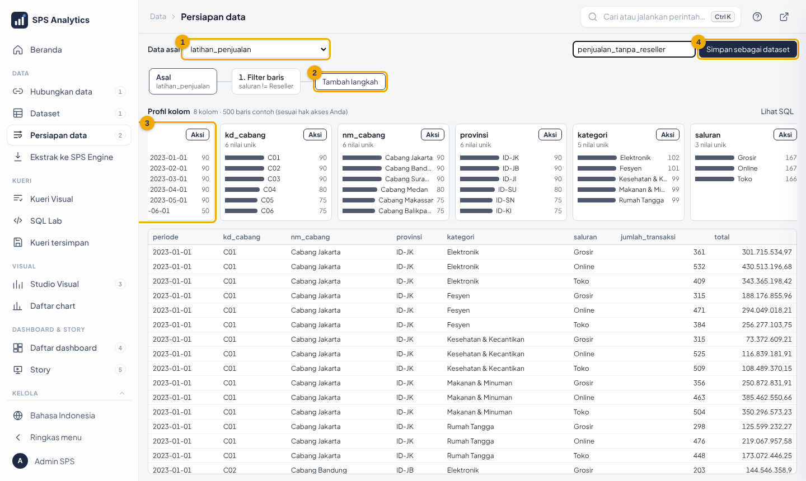
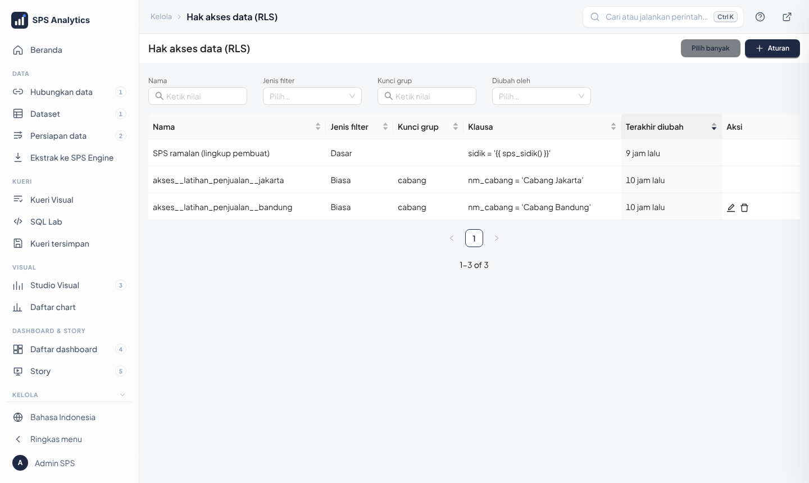
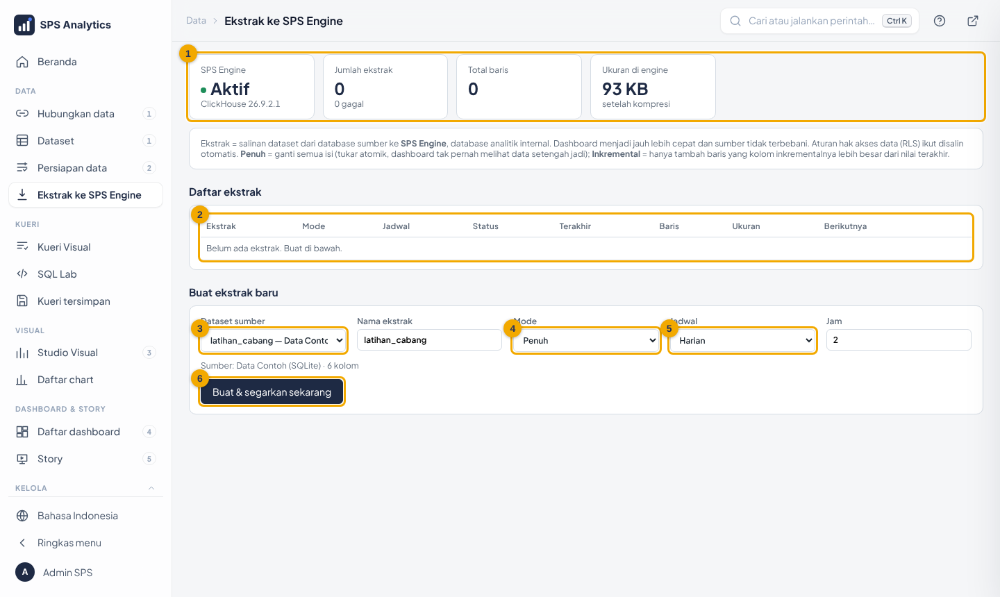

# Level 3 · Admin Data: Dataset, Hak Akses, Ekstrak & Upload

**Untuk:** pengelola data unit · **Waktu:** ± 3 jam · **Prasyarat:** Level 1–2 ·
**Izin:** role Admin, atau role dengan kemampuan *Kelola dataset* + *SQL Lab*

Tugas admin data: menyediakan **bahan (dataset) yang benar dan aman**, sehingga analis bisa membuat
chart tanpa melanggar kerahasiaan data.

> **Aturan keamanan nomor satu:** setiap dataset yang berisi data per cabang/wilayah/orang **wajib**
> punya aturan hak akses (RLS). Dataset tanpa RLS terlihat utuh oleh semua yang diberi akses.

---

## 1. Menghubungkan sumber data (wizard *Hubungkan data*)

Pusat Kendali → tab **Hubungkan data** (role Admin). Empat langkah: **Pilih sumber → Isi detail → Uji → Simpan**.

| No | Bagian | Fungsi |
|---|---|---|
| 1 | **Berkas** | Microsoft Access (`.mdb`/`.accdb`), Excel, CSV, SQLite, DuckDB, Parquet: isinya **disalin** ke ALDx Engine |
| 2 | **Database** | PostgreSQL, MySQL/MariaDB, SQL Server/Azure SQL, Oracle, ClickHouse |
| 3 | **Data warehouse** | Snowflake, BigQuery, Redshift, Databricks, Trino/Presto, Athena, SAP HANA (driver diunduh sendiri), Vertica, Druid |
| 4 | **Koneksi tersimpan** | semua koneksi yang sudah ada |

### Menghubungkan database / data warehouse

1. Klik kartu jenis database, mis. **PostgreSQL**.
2. Isi **(1)** alamat server, port, nama database, nama pengguna, password (minta ke DBA:
   **akun hanya-baca**). Isian bertanda `*` wajib.
3. **(2) Uji koneksi**. Hijau = tersambung (tampil versi server).
   Merah = baca pesannya (alamat salah, password salah, atau firewall).
4. **Skema yang ditampilkan**: cari & centang skema tempat data Anda (mis. `genapp`). Hanya skema ini yang muncul
   di Dataset, SQL Lab, Kueri Visual & Studio. Tidak dicentang = semua skema.
5. Beri **nama koneksi** yang jelas, lalu **(3) Simpan**.

Koneksi lama yang skemanya terlalu banyak: **Koneksi tersimpan → Atur skema**.

Koneksi dari wizard selalu **hanya-baca** (data sumber tidak bisa diubah dari aplikasi) dan password
disimpan terenkripsi. Setelah tersimpan, koneksi muncul di SQL Lab, menu *Datasets*, dan Studio.

### Mengimpor berkas (Access, Excel, CSV, …)

1. Klik **Berkas (Access, Excel, CSV, …)** → pilih berkas.
2. Sistem membaca semua tabel/lembar dan menampilkan **(1)** kolom & contoh isi.
3. Centang tabel yang diperlukan, isi **(2) awalan** nama tabel (mis. nama berkas).
4. **(3) Impor ke ALDx Engine**. Setiap tabel menjadi dataset; klik **Buat chart** untuk langsung memakai.

Kolom foto/lampiran (OLE) di Access dilewati karena tidak bisa dianalisis. Mengimpor ulang dengan
nama sama **mengganti** isi tabel. Data impor **tanpa RLS**: buat aturan bila datanya per cabang.

| Ingin | Pilih |
|---|---|
| Data selalu terbaru langsung dari sistem sumber | hubungkan **database** |
| Data dari berkas kiriman (Access/Excel) | **Berkas** (impor) |
| Database sumber lambat / jauh | hubungkan database, lalu buat **ekstrak** (bagian 5) |

---

## 2. Dataset

Menu **Datasets**. Ada dua jenis:

| Jenis | Dibuat dari | Contoh |
|---|---|---|
| **Fisik** | satu tabel/view | `latihan_penjualan` |
| **Virtual** | query SQL (SQL Lab → *Save dataset*) | gabungan beberapa tabel sumber |

### Membuat dataset dari tabel
1. **Datasets → + Dataset**.
2. Pilih *Database*, *Schema*, *Table* → **Create dataset and create chart**.
3. **Langsung** buat aturan RLS (bagian 4) sebelum memberi akses ke pengguna.

### Membuat dataset dari SQL

1. Menu **SQL → SQL Lab**, pilih database & schema.
2. Tulis query, **Run**. Sertakan kolom hak akses, mis. `kd_cabang` atau `wilayah` (sesuai kebutuhan).
3. **Save → Save dataset**, beri nama jelas, misalnya `penjualan_per_cabang_2025`.

Tips:
- Beri nama kolom yang mudah dibaca (`AS total_penjualan`).
- Kolom tanggal: tandai **Is temporal** di *Edit dataset → Columns* agar bisa diramal & difilter rentang.
- Tambah **metrik** tersimpan (*Edit dataset → Metrics*), mis. `SUM(total)` bernama *Penjualan*,
  agar analis cukup memilih metrik.

---

## 3. Persiapan data (tanpa SQL)

menu **Data → Persiapan data**.

| No | Bagian | Fungsi |
|---|---|---|
| 1 | Data asal | dataset sumber |
| 2 | **Tambah langkah** | Pilih kolom · Ganti nama · Ubah tipe · Bersihkan · Filter · Hitung · Agregasi · **Gabung** |
| 3 | Profil kolom | sebaran nilai tiap kolom; klik nilai → *Hanya nilai ini* / *Kecualikan nilai ini* |
| 4 | **Simpan sebagai dataset** | hasilnya jadi dataset baru (virtual) |

Yang otomatis dilakukan saat menyimpan:
- **aturan RLS sumber ikut** ke dataset baru (termasuk gabungan: syarat kedua sisi digabung);
- akses diberikan hanya ke role yang boleh membaca **semua** dataset sumber.

Contoh: buang saluran Reseller (klik nilai `Reseller` di profil *saluran* → **Kecualikan nilai ini**),
simpan sebagai `penjualan_tanpa_reseller`.

---

## 4. Hak akses data (RLS)

RLS (*Row Level Security*) menambahkan syarat `WHERE` otomatis ke setiap query, sesuai role pengguna.
Contoh: role **Cabang Jakarta** hanya melihat baris `nm_cabang = 'Cabang Jakarta'`.

### Cara 1 — aturan per role (cocok untuk semua perusahaan)
1. Buat role per kelompok pengguna: **Settings → List Roles → +**, mis. `Cabang Jakarta`
   (salin izin dari role `Gamma`). Masukkan pengguna ke role itu di **Settings → List Users**.
2. **Settings → Row Level Security → + Rule**, isi:

| Isian | Nilai |
|---|---|
| Rule name | `akses__latihan_penjualan__jakarta` |
| Filter type | **Regular** (berlaku hanya untuk role yang dipilih) |
| Datasets | dataset yang dibatasi |
| Roles | `Cabang Jakarta` |
| Clause | `nm_cabang = 'Cabang Jakarta'` |

3. **Save**, lalu **uji**: login dengan akun anggota role itu, buka chart; hanya data Jakarta yang tampil.

Pengguna yang tidak terkena aturan Regular melihat **semua** baris. Bila ingin "tanpa aturan = tidak
melihat apa pun", pakai jenis **Base** dengan clause `1 = 0` dan kecualikan role yang boleh melihat semua.

### Cara 2 — otomatis dari profil pengguna (lanjutan)
Bila login memakai LDAP dan profil pengguna (wilayah, unit, jabatan) tersedia di database kantor,
satu aturan bisa melayani semua orang. Contoh pada profil DJP: `{{ sps_akses(kd_kanwil='KD_KANWIL') }}`
menjadi `KD_KANWIL IN ('090')` sesuai profil masing-masing pegawai. Cara kerja, atribut profil, dan
cara menyesuaikan untuk organisasi lain: [08-hak-akses-data.md](../08-hak-akses-data.md).

### Memberi akses dataset ke role
Pusat Kendali → **Hak akses** mengatur *kemampuan* (boleh membuat chart, mengunduh, dsb.).
Akses ke dataset tertentu: **Settings → List Roles → edit role → Permissions**, tambah
`datasource access on [database].[dataset]`.

---

### Menguji aturan dengan "Lihat sebagai…"

Kelola › **Lihat sebagai…** → pilih pengguna & dashboard → **Tampilkan**. Setiap chart dijalankan sebagai pengguna itu
dan menampilkan aturan hak akses data yang berlaku. Lebih cepat & aman daripada login dengan akun pengguna.

### Data dari berkas .aldx

Hanya Admin (bawaan) yang boleh memuat data dari berkas `.aldx`. Dataset hasilnya otomatis diberi aturan
**"ALDx berkas: … (khusus <pengimpor>)"**: ubah klausanya (atau hapus) untuk membagikan datanya.

## 5. Ekstrak (supaya dashboard cepat)

Pusat Kendali → tab **Ekstrak** (role Admin).

1. **(3)** Pilih dataset sumber (dari koneksi database mana pun).
2. Nama ekstrak, **(4)** Mode:
   - **Penuh**: salin semua setiap kali;
   - **Inkremental**: hanya baris baru (pilih kolom tanggal/periode yang selalu naik).
3. **(5)** Jadwal: Harian jam 02:00 (disarankan, di luar jam kerja).
4. **(6) Buat & segarkan sekarang**.
5. Setelah status **siap**, klik **Pakai di chart** agar semua chart dataset itu memakai ekstrak.

RLS & akses role sumber **otomatis ikut**. Rincian: [13-sps-engine-ekstrak.md](../13-sps-engine-ekstrak.md).

---

## 6. Upload Excel/CSV

1. Menu **+ → Data → Upload CSV to database** (atau Excel).
2. Database: **ALDx Engine (ClickHouse)**, schema `sps_engine`.
3. Nama tabel (huruf kecil, tanpa spasi), pilih file → **Upload**.
4. Dataset baru muncul di **Datasets**. **Tanpa RLS**: buat aturan bila datanya per cabang/wilayah.

Untuk berkas Access atau Excel berisi banyak lembar, lebih mudah lewat **Hubungkan data → Berkas** (bagian 1).

Batas ukuran/baris (upload, impor berkas, ekstrak) diatur **Superadmin** di Pusat Kendali → **Batas data**;
jenis file & siapa yang boleh upload di bagian yang sama. Pesan *"melebihi batas"* = saring/pecah datanya atau
minta Superadmin menaikkan batas ([24](../24-superadmin-dan-batas-data.md)).

---

## 7. Daftar periksa sebelum dataset dipakai pengguna

- [ ] Nama dataset & kolom jelas, kolom tanggal ditandai *temporal*
- [ ] Ada kolom hak akses (mis. kd_cabang / wilayah / unit)
- [ ] **Aturan RLS dibuat dan diuji** dengan akun berlingkup terbatas
- [ ] Metrik utama tersimpan (mis. *Penjualan*)
- [ ] Bila sering dipakai/lambat → ekstrak harian
- [ ] Akses diberikan hanya ke role yang perlu

## 8. Latihan mandiri

1. Lewat **Hubungkan data → Berkas**, impor berkas contoh
   [`bahan-ajar/berkas/contoh-target-toko.xlsx`](../bahan-ajar/berkas/contoh-target-toko.xlsx) (2 lembar).
   Berapa dataset yang terbentuk dan apa namanya? Berapa total target penjualan 2025?
2. Di Persiapan data, dari `latihan_penjualan` buat dataset `latihan_elektronik` yang hanya berisi
   kategori Elektronik, kolom: periode, kd_cabang, nm_cabang, saluran, total (kolom cabang wajib ikut: kolom hak akses).
3. Buat role `Cabang Bandung` dan aturan RLS **Regular** untuk `latihan_elektronik` dengan clause
   `nm_cabang = 'Cabang Bandung'`. Login dengan akun uji di role itu: berapa total penjualan yang terlihat?
4. Upload CSV kecil (3 kolom, 10 baris) ke ALDx Engine, lalu buat chart batang dari hasilnya.
5. Jelaskan dengan kata-kata sendiri kapan memakai ekstrak **penuh** dan **inkremental**.
6. Dengan **Lihat sebagai…**, bandingkan dashboard latihan untuk akun Cabang Bandung dan Cabang Jakarta. Aturan apa
   yang berlaku pada masing-masing?
7. Impor berkas besar-kompleks [`contoh-penerbangan-sedang.xlsx`](../bahan-ajar/berkas/contoh-penerbangan-sedang.xlsx)
   (6 lembar, 150.000 tiket) dengan awalan `terbang`. Di Kueri Visual gabungkan tiket + jadwal + penerbangan + maskapai:
   maskapai mana yang pendapatannya terbesar (tanpa tiket Refund)? Berapa jadwal dari/ke DPS yang batal pada
   12–13 November 2024? Kamus data: [bahan-ajar/berkas/README.md](../bahan-ajar/berkas/README.md).

Kunci jawaban: [bahan ajar Level 3](../bahan-ajar/level-3-admin-data.md#kunci-jawaban).

Lanjut ke [Level 4 · Admin server](level-4-admin-server.md).
