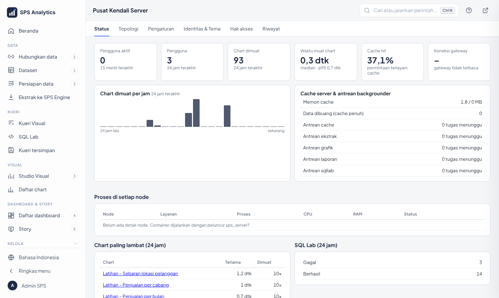
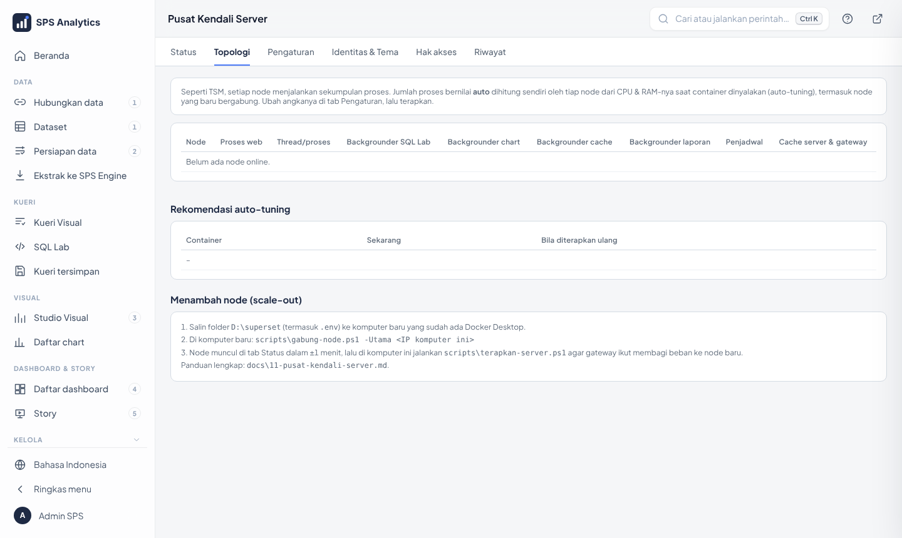
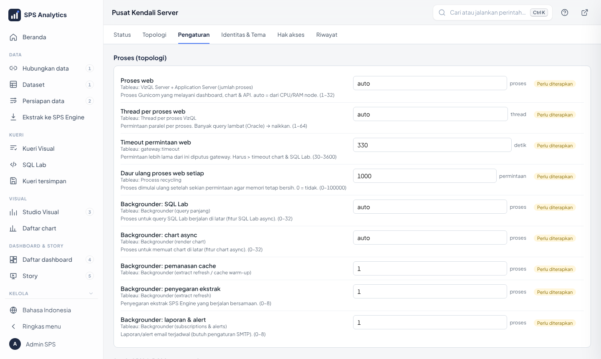
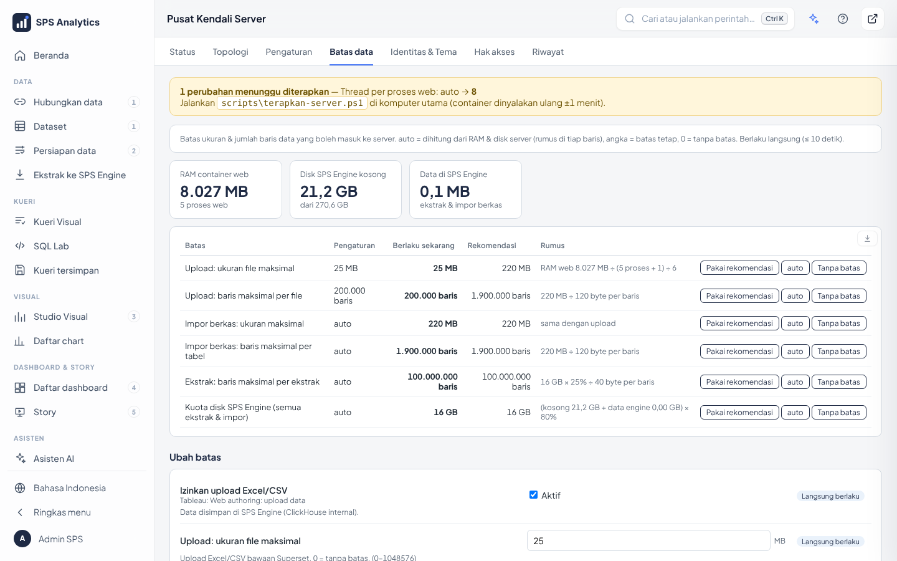
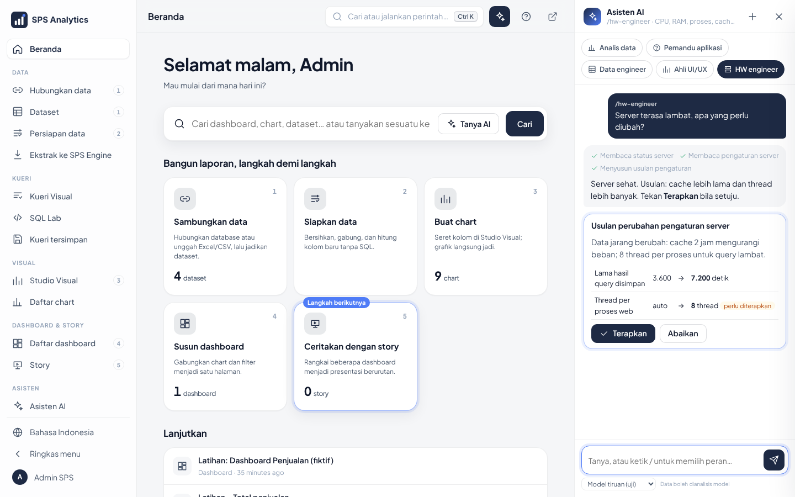
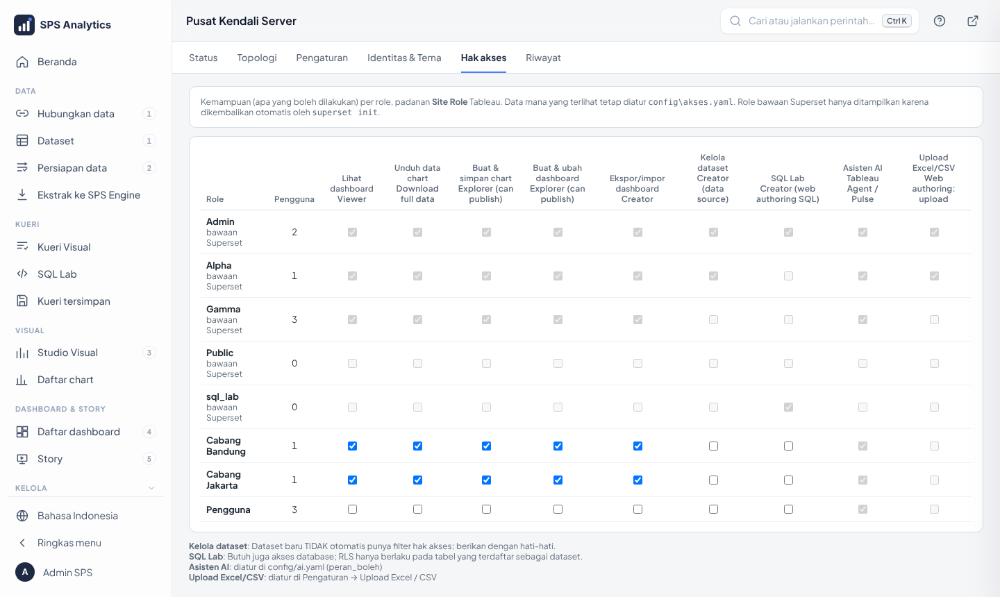
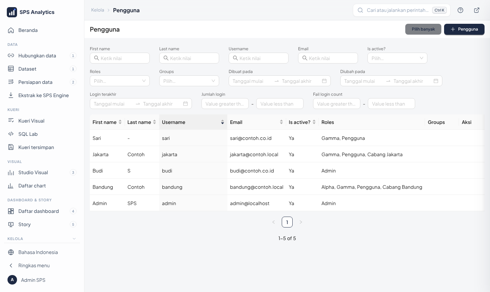
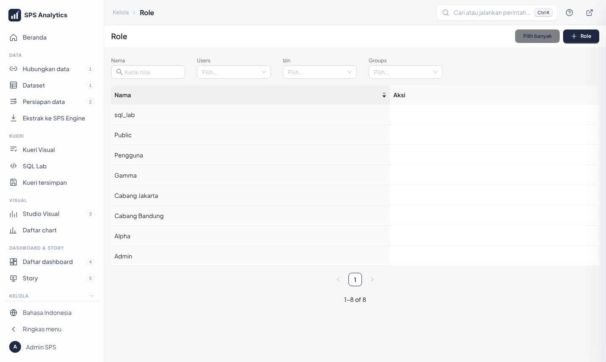
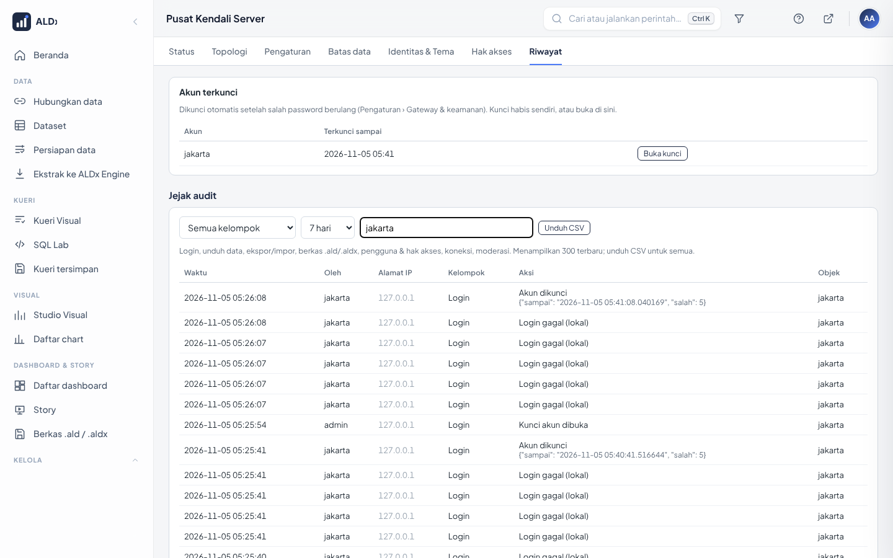

# Level 4 · Admin Server: Memasang, Memantau, Merawat

**Untuk:** tim TI pengelola server · **Waktu:** ± 4 jam · **Prasyarat:** Level 1–3, terbiasa
membuka PowerShell · **Izin:** role Admin + akses ke komputer server

Admin server menjaga agar ALDx **menyala, cepat, aman, dan bisa dipulihkan**.
Semua pekerjaan memakai tiga alat: **PASANG.cmd**, halaman **Pusat Kendali**, dan skrip di `scripts\`.

---

## 1. Memasang (sekali)

> Setelah terpasang, buka **Beranda**: kartu **Siapkan ALDx** menuntun lima langkah pertama (Asisten AI, data kantor,
> pengguna, nama & logo, cadangan). Semua dokumentasi bisa dibaca di aplikasi lewat menu **Panduan**.


1. Pasang **Docker Desktop**, atur *Settings → Resources* (lihat [15-sizing.md](../15-sizing.md)); masukkan akun pemakai ke grup `docker-users`.
2. Jalankan **`ALDx-Setup.exe`** (Releases › ALDx terbaru) → Lanjut-Lanjut, folder `D:\superset`. Tanpa Setup: salin folder / *Download ZIP* › Extract All. Langkah awam: [CARA-PASANG.md](../../CARA-PASANG.md).
3. Wizard pengaturan terbuka sendiri (atau klik dua kali **`PASANG.cmd`**) → ikuti wizard ([18-installer.md](../18-installer.md)). Yang wajib hanya **email & password Superadmin**;
   LDAP, pengguna lain, HTTPS dan AI boleh dilewati lalu diatur nanti.
4. Setelah selesai: `powershell -ExecutionPolicy Bypass -File scripts\uji.ps1` → semua **LULUS**.

| Skrip harian | Fungsi |
|---|---|
| `scripts\start.ps1` / `stop.ps1` | nyalakan / matikan semua container |
| `scripts\logs.ps1` | lihat log Superset |
| `scripts\uji.ps1` | uji otomatis seluruh komponen |
| `scripts\cadangkan.ps1 [-Engine]` | cadangan metadata (& engine) |
| `scripts\versi.ps1` | versi tiap komponen |
| `scripts\terapkan-server.ps1` | terapkan pengaturan yang butuh restart |
| `scripts\diagnose.ps1` | kumpulkan info masalah ke `diagnosa.txt` |
| `scripts\jadwal-cadangan.ps1` | (sekali) jadwal cadangan harian + uji pulih mingguan |
| `scripts\uji-beban.ps1 -Akun <email>` | uji beban: apakah server cukup untuk N pengguna (di luar jam kerja) |
| `scripts\percayai-sertifikat.ps1` | (HTTPS) hilangkan peringatan browser di komputer pengguna ([11 §9b](../11-pusat-kendali-server.md#https)) |

---

## 2. Pusat Kendali: Status



Menu **Settings → Pusat Kendali Server**.

| Bagian | Yang dipantau | Wajar |
|---|---|---|
| Ringkasan | pengguna aktif, query, waktu muat chart | – |
| Node | CPU & RAM tiap container, status online | bilah hijau/kuning; merah = > 85% |
| Cache server & antrean | memori Redis, tugas menunggu per antrean | antrean 0 di luar jam sibuk |
| Chart paling lambat | 10 chart terlama 24 jam terakhir | < 5 dtk; lebih → kandidat ekstrak |
| SQL Lab | status query | sedikit *Gagal/Timeout* |

## 3. Topologi



Menampilkan proses di setiap node (web, backgrounder per antrean, cache, gateway). Rekomendasi auto-tuning ditampilkan berdampingan dengan nilai yang berjalan.

## 4. Pengaturan



| Kelompok | Contoh pengaturan | Berlaku |
|---|---|---|
| Proses | jumlah proses & thread web, timeout | setelah `terapkan-server.ps1` |
| Backgrounder | proses per antrean: SQL Lab, grafik, cache, laporan, **ekstrak** | setelah terapkan |
| Cache | lama cache data, pemanasan cache dashboard populer | langsung |
| Batas | baris maksimal per chart, SQL Lab, filter | langsung (±10 dtk) |
| Timeout | chart, SQL Lab, sesi login | sebagian langsung |
| Gateway | permintaan per detik, login per menit, simpan log | setelah terapkan |
| Sumber daya | RAM/CPU web, backgrounder, Redis, **ALDx Engine**, **metadb** | setelah terapkan |

Nilai `auto` = dihitung otomatis dari CPU/RAM. Lencana kuning **perlu diterapkan** = jalankan:
```powershell
powershell -ExecutionPolicy Bypass -File scripts\terapkan-server.ps1
```

### 4a. Superadmin & Batas data

Tab **Pengaturan**, **Batas data**, dan **Hak akses** khusus **Superadmin** (akun admin instalasi otomatis
Superadmin). Admin biasa hanya melihat Status, Topologi, Identitas & Tema, Riwayat, Hubungkan data, Ekstrak.



1. Pusat Kendali → **Batas data**. Kartu atas: RAM web, disk ALDx Engine kosong, data di engine.
2. Tabel: pengaturan sekarang, **berlaku sekarang**, **rekomendasi** beserta rumusnya.
3. Klik **Pakai rekomendasi**, **auto** (ikut perangkat), atau **Tanpa batas** (`0`) → **Simpan perubahan**.
   Langsung berlaku (±10 detik).

### 4b. Minta saran HW engineer AI

Tekan `Ctrl + I` di Pusat Kendali: peran **/hw-engineer** terpilih otomatis. Tanya *"server terasa lambat,
apa yang perlu diubah?"*. AI membaca status & pengaturan, lalu membuat **kartu usulan** (lama → baru + alasan).
Tidak ada yang berubah sampai Anda menekan **Terapkan**; semua tercatat di Riwayat.



Peran **/ahli-ui-ux** (tab Identitas & Tema) bekerja sama untuk warna & huruf, lengkap dengan cek kontras.
Rincian: [23](../23-asisten-ai-peran-ahli.md), [24](../24-superadmin-dan-batas-data.md).

### 4c. Atur Asisten AI: model, cadangan, batas & keamanan

Model dipasang di **Kelola › Asisten AI** (key dienkripsi) dan/atau `config\ai.yaml`. ALDx menyesuaikan diri dengan model lokal,
gratis, maupun berbayar; yang perlu Anda atur:

| Pengaturan (`config\ai.yaml`) | Bawaan | Fungsi |
|---|---|---|
| `bawaan` | model pertama | model yang terpilih pertama kali |
| `batas_detik_model` / `batas_detik_lokal` | 120 / 240 | waktu tunggu **satu langkah** model cloud / lokal |
| `batas_latar_detik` | 900 | batas total **satu pertanyaan** (berjalan di latar, tidak terikat timeout web) |
| `cadangan_otomatis` | `true` | model sibuk/kuota habis (429/5xx, mis. Gemini 503) → coba ulang 2×, lalu beralih ke model aktif lain |
| `batas_pertanyaan_per_jam` | 60 | per pengguna (Admin bebas); melindungi biaya model berbayar |
| `kirim_data` (per model) | `false` untuk cloud | boleh/tidaknya angka dikirim ke model itu; pengalihan cadangan menghormatinya |

Saran: **pasang minimal dua model** (mis. satu cloud gratis + satu lokal) agar pengalihan otomatis berguna.
Lapisan keamanan bawaan: semua alat berjalan sebagai pengguna yang bertanya, isi data dianggap data (bukan perintah),
API key disamarkan bila muncul di jawaban, maksimal 12 objek baru per pertanyaan. Uji berkala dengan butir 4.8–4.9 di
[daftar periksa audit](../27-daftar-periksa-audit-keamanan.md). Detail: [docs/23](../23-asisten-ai-peran-ahli.md), [docs/28](../28-sambungkan-asisten-ai.md).

## 5. Hak akses kemampuan



Matriks **role × kemampuan** (lihat dashboard, unduh, buat chart, kelola dataset, SQL Lab, upload, Asisten AI).
Centang/hapus centang langsung berlaku. Role bawaan Superset (Admin, Alpha, Gamma) tidak diubah di sini.

Hak akses **data** (baris mana yang terlihat) diatur terpisah lewat RLS (Level 3).

### Pengguna & role



Saat instalasi: halaman **Pengguna lain** di PASANG.cmd (tabel email, nama, password, peran Pengguna / Analis / Admin / Superadmin) dan, opsional, halaman **Login kantor** (LDAP).
Sesudahnya: **Kelola › Pengguna**: admin membuat akun (**+**, isi username, nama, email, password, role `Gamma` + `Pengguna`; tambah `sql_lab` untuk analis yang memakai SQL Lab & Kueri Visual).
Dengan LDAP, pengguna otomatis terdaftar saat login pertama (role `LDAP_DEFAULT_ROLE` + `SPS_ROLE_PENGGUNA`).
Nonaktifkan user yang pindah/keluar: edit → hapus centang **Is active**.



## 6. Riwayat



Tab Riwayat berisi tiga bagian:

| Bagian | Isi |
|---|---|
| **Akun terkunci** | muncul bila ada akun terkunci karena 5 kali salah password; tombol **Buka kunci** |
| **Jejak audit** | login, unduh data, ekspor/impor, berkas .ald/.aldx, pengguna & hak akses, koneksi, moderasi. Pilih kelompok & periode, ketik nama di kotak cari, **Unduh CSV** untuk pemeriksa |
| **Riwayat pengaturan** | setiap perubahan pengaturan & hak akses: waktu, oleh siapa, nilai sebelum/sesudah |

Tab **Hak akses** menampilkan kotak kuning bila ada pengguna non-Admin yang bisa melihat *semua* data (role Alpha):
cabut role itu di Kelola › Pengguna kecuali memang disengaja.

---

### 6a. Kesehatan kueri

Menu **Kelola › Kesehatan kueri** (Admin): pilih periode 24 jam / 7 / 30 / 90 hari.

| Bagian | Cara membaca |
|---|---|
| Ringkasan | jumlah kueri, **median**, **p95** (95% kueri lebih cepat dari angka ini), kueri lambat (> 5 detik), kueri gagal |
| Chart paling lambat | diurutkan menurut p95; lencana *ALDx Engine* atau *langsung*; **saran**: ekstrak ke ALDx Engine, ringkas chart, atau atur cache |
| Dashboard | waktu kueri chart di dalam tiap dashboard |
| Kueri gagal | kueri SQL Lab dan penyegaran ekstrak yang gagal, beserta pesannya |

Alur kerja: p95 tinggi → buka chart terlambat → ikuti sarannya (biasanya **ekstrak**) → ulangi pemeriksaan keesokan hari.

## 7. Ekstrak & engine

Tab **Ekstrak**: pantau status *gagal*, ukuran engine, jadwal. Rincian: [13-sps-engine-ekstrak.md](../13-sps-engine-ekstrak.md).
Melihat isi engine langsung: `http://localhost:8124/play` (user `sps`, password `ENGINE_PASSWORD` di `.env`).

---

## 8. Cadangan & pemulihan

```powershell
scripts\cadangkan.ps1                 # metadata -> backup\metadb-<waktu>.dump
scripts\cadangkan.ps1 -Engine         # + isi ALDx Engine -> backup\engine\engine-<waktu>.zip
scripts\cadangkan.ps1 -Pulihkan backup\metadb-20261101-0100.dump
```

**Menjadwalkan otomatis (sekali pasang, PowerShell *Run as administrator*):**
```powershell
powershell -ExecutionPolicy Bypass -File scripts\jadwal-cadangan.ps1                          # harian 02:00 + uji pulih Minggu 04:00
powershell -ExecutionPolicy Bypass -File scripts\jadwal-cadangan.ps1 -Salin \\nas-kantor\aldx  # + salinan kedua di NAS
```
- **Cadangan harian** metadata + ALDx Engine (14 metadata, 5 engine terakhir disimpan).
- **Uji pulih mingguan**: cadangan terbaru dipulihkan ke database *sementara*, isinya dihitung, lalu dihapus. Aplikasi
  tidak disentuh. Ini bukti cadangan benar-benar bisa dipakai. Manual: `scripts\cadangkan.ps1 -UjiPulih`.
- Hasil tampil di **Pusat Kendali › Status** (kartu *Cadangan terakhir*; merah bila gagal atau > 2 hari) dan
  `backup\cadangan.log`.
- Docker Desktop harus menyala pada jamnya (jangan logout akun Windows server). Lepas jadwal: `-Hapus`.

---

## 9. Upgrade, akun & sizing

| Kebutuhan | Panduan |
|---|---|
| Daftar akun, password ada di mana, cara masuk tiap container | [14-akun-dan-akses.md](../14-akun-dan-akses.md) |
| Menentukan CPU/RAM/disk, membaca auto-tuning | [15-sizing.md](../15-sizing.md) |
| Upgrade/downgrade Superset, PostgreSQL, ClickHouse, Redis, nginx | [16-upgrade-downgrade.md](../16-upgrade-downgrade.md) |
| Menambah node (scale-out) | [11-pusat-kendali-server.md](../11-pusat-kendali-server.md) |
| Masalah umum | [04-troubleshooting.md](../04-troubleshooting.md) |
| **Menyambungkan Asisten AI** (lokal, cloud gratis, berbayar) | [28-sambungkan-asisten-ai.md](../28-sambungkan-asisten-ai.md) |
| Rincian model AI lokal | [20-model-ai-lokal.md](../20-model-ai-lokal.md) |
| Beda versi antar komputer, **hapus total** ALDx | [29-versi-pembaruan-hapus-total.md](../29-versi-pembaruan-hapus-total.md) |
| **Urutan menyala, SOP, FAQ admin** | [19-runbook-faq-admin.md](../19-runbook-faq-admin.md) |
| Identitas (nama, logo, warna) | Pusat Kendali → **Identitas & Tema** ([09](../09-identitas-tema.md)) |

### 9a. Memperbarui ALDx (cara termudah)

**Jalankan installer versi baru di atas instalasi lama, Next-Next.** Folder sama; `.env`, data, dashboard, dan pengguna tetap.

| Komputer | Unduh dari Releases | Langkah |
|---|---|---|
| Ada internet | *ALDx terbaru*: `ALDx-Setup.exe` | klik dua kali → Next-Next |
| Tanpa internet | *ALDx offline*: `ALDx-Setup-Offline.exe` + semua `.bin` (satu folder) | klik dua kali `.exe` → Next-Next |

Setelah selesai: `Ctrl + F5` di browser; cek versi di kaki halaman login (mis. `v2026.11.13.6`); baca *Perlu dilakukan setelah
memperbarui* di [catatan versi](../31-catatan-versi.md); jalankan `scripts\uji.ps1`. **Jangan** memakai `ALDx-HapusTotal.exe`
untuk memperbarui (itu menghapus data). Panduan lengkap: [docs/29](../29-versi-pembaruan-hapus-total.md).

### 9b. Masuk dengan SSO (OpenID Connect)

Tombol **Masuk dengan Microsoft / Google / …** di halaman login, **tambahan** di samping password (akun lokal & LDAP tetap ada,
sehingga Superadmin tetap bisa masuk bila penyedia SSO bermasalah).

1. Daftarkan aplikasi di penyedia (Entra ID, Google, Keycloak, Okta) dengan alamat kembali `https://<alamat-aldx>/sso/kembali`.
2. Isi `.env`: `SSO_DISCOVERY_URL`, `SSO_CLIENT_ID`, `SSO_CLIENT_SECRET`, `SSO_NAMA`, `SSO_DOMAIN` (domain email yang boleh),
   `SSO_BUAT_AKUN` (0 = hanya email yang sudah didaftarkan; 1 = akun dibuat otomatis dengan role `SSO_ROLE_BAWAAN`).
3. `docker compose up -d`, buka halaman login: tombol muncul. Coba dengan email domain benar dan domain lain (harus ditolak).

Detail & tabel penyedia: [docs/05](../05-login-ldap.md#masuk-dengan-sso-openid-connect).

## 10. Prosedur bila ada gangguan

```
1. docker compose ps                      -> container mana yang tidak "healthy"?
2. docker compose logs --tail 100 <nama>  -> pesan galat terakhir
3. scripts\uji.ps1                        -> fungsi mana yang GAGAL?
4. Perbaiki penyebab (RAM penuh, disk penuh, sumber data mati, password berubah)
5. docker compose restart <nama>   atau   scripts\start.ps1
6. scripts\uji.ps1 sampai LULUS semua
7. Bila belum selesai: scripts\diagnose.ps1 -> kirim diagnosa.txt ke pengembang (periksa dulu, tanpa password)
```

Pohon keputusan lengkap per gejala (web tidak terbuka, login gagal, lambat, ekstrak gagal):
[19-runbook-faq-admin.md §4](../19-runbook-faq-admin.md#4-mencari-penyebab-gangguan-pohon-keputusan).

## 10a. Sematkan dashboard ke web lain

1. `.env`: `SPS_SEMATKAN_DOMAIN` (asal situs induk), `SPS_SEMATKAN_KUNCI` (acak ≥ 32 karakter, **hanya di server induk**),
   `SPS_SEMATKAN_MENIT`; lalu `scripts\start.ps1`.
2. Menu **Dashboard & Story › Sematkan ke web lain** → **Nyalakan** pada dashboard yang boleh disematkan → tombol **Cara pakai**
   menampilkan contoh kode berisi alamat & id dashboard.
3. **Server** aplikasi induk meminta token (`POST /sematkan/api/token` dengan header `X-ALDx-Kunci`, isi `rls` = baris yang
   boleh dilihat penonton), lalu halaman memasang `<iframe src="…/sematkan/d/<uuid>?token=…&f.cabang=Bandung">`.
4. **Matikan** kapan saja: semua halaman yang menyematkannya langsung berhenti menampilkannya.

Tiga lapis pembatas: **RLS token** (baris), **filter URL** (tampilan), **domain** (situs yang boleh membingkai). Detail: [docs/30](../30-sematkan-dashboard.md).

## 10b. Email: Langganan laporan & Peringatan data

Isi di `.env` lalu `docker compose up -d`: `SMTP_HOST`, `SMTP_PORT` (587), `SMTP_STARTTLS=1`, `SMTP_USER`, `SMTP_PASSWORD`, `SMTP_MAIL_FROM`.
Tanpa `SMTP_HOST`, laporan & peringatan tetap terjadwal tetapi hanya **tercatat di log** (mode uji). Uji: buat satu Peringatan data
dengan syarat yang pasti terpenuhi dan jadwal tiap menit, pastikan email tiba, lalu nonaktifkan. Detail: [docs/26 §1](../26-langganan-versi-ponsel-lihat-sebagai.md).

## 11. Latihan (di server uji)

1. Jalankan `scripts\uji.ps1` dan catat jumlah uji yang lulus.
2. Ubah **Baris maksimal per chart** menjadi 10.000 di Pusat Kendali; cek di Riwayat siapa yang mengubah.
3. Ubah **Backgrounder: penyegaran ekstrak** menjadi 2, jalankan `terapkan-server.ps1`, lihat perubahannya di Topologi.
4. Buat cadangan metadata, hapus satu chart latihan, pulihkan cadangan, pastikan chart kembali.
5. Matikan container `engine` (`docker compose stop engine`), jalankan `scripts\uji.ps1`. Apa yang GAGAL?
   Nyalakan lagi dan ulangi uji.
6. Hitung jatah RAM engine untuk server 16 CPU / 32 GB Docker (pakai tabel di 15-sizing.md).
7. Buka **Batas data**: berapa rekomendasi ukuran impor berkas di server Anda, dan dari rumus apa? Set
   *Impor berkas: baris maksimal* = 3, impor CSV 10 baris di Hubungkan data, baca pesannya, lalu kembalikan ke **auto**.
8. Login sebagai Admin biasa (bukan Superadmin). Tab apa saja yang tampil di Pusat Kendali?
9. Minta **/hw-engineer** mengusulkan pengaturan, **Abaikan** usulannya, lalu cek Riwayat: adakah perubahan?
10. Login dengan akun uji dan password salah 5 kali. Apa pesannya? Buka kuncinya dari tab Riwayat, lalu cari kejadiannya di jejak audit.

- **T1.** Buka **Kesehatan kueri** (24 jam). Catat median dan p95, chart paling lambat, dan sarannya.
- **T2.** Pasang dua model di Asisten AI; rusak key satu model (mis. isi key salah) lalu ajukan pertanyaan memakai model itu. Apa yang terjadi?
- **T3.** Set `batas_pertanyaan_per_jam: 3`; dari akun Analis kirim 4 pertanyaan. Apa yang terjadi, dan bagaimana dengan Admin? Kembalikan ke 60.
- **T4.** Nyalakan sematan untuk satu dashboard, minta token dengan `curl`, tampilkan di halaman HTML sederhana, lalu coba `rls` berbeda.
- **T5.** (Bila ada penyedia SSO) aktifkan tombol SSO dan uji email domain benar dan salah.
- **T6.** Jalankan installer terbaru di atas instalasi lama pada server uji. Apa yang tetap, dan di mana Anda memeriksa versinya?

Kunci jawaban: [bahan ajar Level 4](../bahan-ajar/level-4-admin-server.md#kunci-jawaban); latihan **T1–T6**: [kunci tambahan](../bahan-ajar/level-4-admin-server.md#kunci-jawaban-tambahan).
